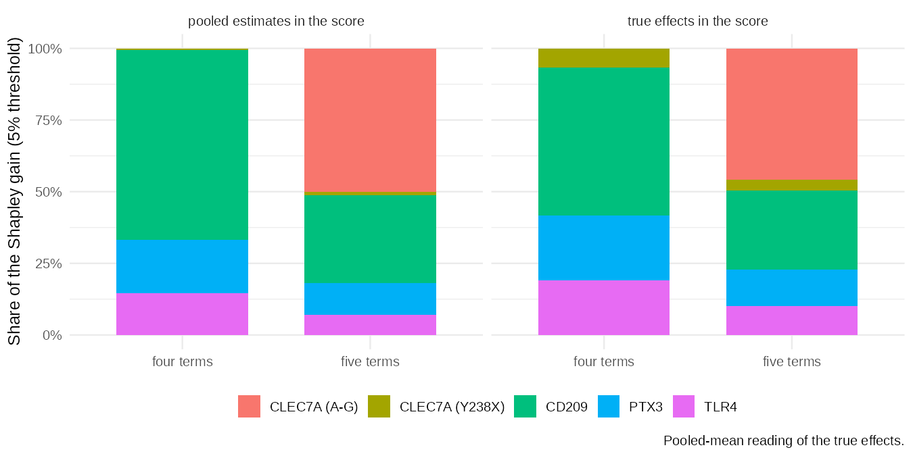
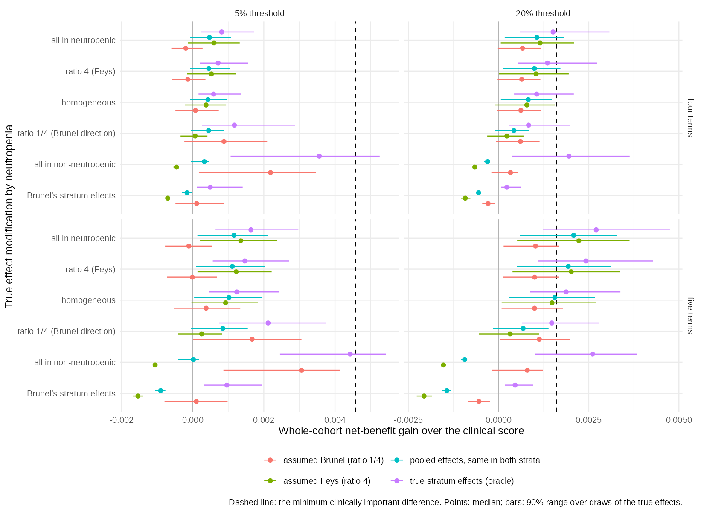

::: {.callout-warning}
## Working draft

This is a first draft of the write-up (phase 7). Every number comes from the files in `output/` as of 19 October 2026, after
the corrections recorded in addenda 16 to 21 of the [decision record](decisions.qmd). The evidence is still provisional:

- The record of the human round-2 verification is not yet in the repository.
- The priors on the pooled effects and the reading of the "realised" score are proposals.
- Cohort overlap between the Spanish registry series and the Jena AML cohorts is only partly adjudicated.

The discussion, references, author list, ethics statement and data-availability statement are not yet written. Citations
are informal author–year placeholders, and `[ref]` marks a statement that still needs a reference.
:::

```{r}
#| label: setup
source("_setup.R")
rd <- function(f) read.csv(file.path("output", f))
```

## Abstract

**Background.** Variants in the innate immune genes *PTX3*, *CLEC7A* (dectin-1), *TLR4* and *CD209* (DC-SIGN) are
repeatedly reported as associated with invasive aspergillosis, and adding genotype to clinical risk scores has been
proposed. Whether doing so would change clinical decisions, rather than improve discrimination, has not been tested.

**Methods.** We did a pre-specified simulation study of the value of host genetic information. The baseline was a
seven-predictor clinical score for proven or probable invasive mould disease (IMD) within 60 days, refit on 4,078
haematology admissions in 1,945 patients (Bologna, 2007–2016; 133 events, 3.3%). A systematic review supplied the genetic
effects (831 records screened, 63 studies extracted). Effects for four haplotype terms were mapped to a common per-copy scale
and pooled with Bayesian random-effects models. The net-benefit gain over the clinical score was computed exactly over all
clinical profiles and genotype combinations, for 2,000 draws from the pooled posteriors. The primary endpoint was the gain at
a 5% risk threshold. It was judged against a pre-specified minimum clinically important difference (MCID) of 20% more true
cases at no extra false positives (+0.00458). Secondary analyses added a second CLEC7A haplotype, effect modification by
neutropenia, donor genotype after allogeneic transplantation, and a sweep of 4,000 hypothetical genetic architectures.

**Results.** Pooled odds ratios per copy of the risk haplotype class (90% credible interval) were 1.35 (0.99 to 1.81) for
PTX3, 0.84 (0.48 to 1.48) for CLEC7A Y238X, 1.44 (0.77 to 2.69) for TLR4 and 1.80 (1.14 to 2.73) for CD209. With the true
effects in the score, the four-term panel raised net benefit at 5% by a median of +0.00059 (90% range 0.00015 to 0.00137).
That is about an eighth of the MCID: 1.2 extra true cases per 1,000 admissions, against 4.6 required. No draw reached the MCID,
and 1.3% did when between-study heterogeneity was propagated. The area under the ROC curve (aROC) rose from 0.857 to 0.870. A second CLEC7A haplotype
(OR 1.86, three studies) doubled the gain to +0.00122, but at most 3.3% of draws reached the MCID. In simulated studies of the
cohort's size, the sampling standard deviation of the observed gain was as large as the expected gain. Neutropenic admissions
(28% of admissions, 80% of events) supplied about four-fifths of the gain. In the architecture sweep, no panel of up to 20
independent loci with per-allele odds ratios of 1.5 or less reached the MCID. At an odds ratio of 2.0, seven to nine common
loci were needed.

**Conclusions.** On the published evidence, genotype at these four genes is unlikely to change decisions at the 5% threshold
in haematological inpatients. A panel that could change them would need much larger effects than candidate-gene studies
report, or many more loci. A genotyped, neutropenia-stratified study of this cohort's size could test whether genetic effects
depend on the inflammatory state of the host.

## Introduction

Invasive mould disease, mostly invasive aspergillosis, remains a major cause of morbidity and death in patients with
haematological malignancies [ref]. Decisions about antifungal prophylaxis, diagnostic work-up and pre-emptive treatment depend
on how much risk a patient is thought to carry. Clinical risk scores formalise that judgement. Stanzani and colleagues derived
a score from seven routinely recorded host factors in 4,127 admissions to the haematology unit in Bologna (Stanzani et al.,
*J Infect* 2019). It reached an aROC of 0.85 for proven or probable IMD within 60 days and defines high risk at a predicted
probability of 5%.

Host genetics might add information that clinical factors do not capture. Candidate-gene studies have reported associations
between invasive aspergillosis and variants in genes of innate antifungal immunity: the long pentraxin PTX3, the β-glucan
receptor dectin-1 (*CLEC7A*), Toll-like receptor 4 and DC-SIGN (*CD209*) [refs]. After allogeneic transplantation the
reconstituted innate immune system is donor-derived, which has led to proposals to use donor genotype to stratify transplant
recipients (Cunha et al., *N Engl J Med* 2014). These findings have prompted proposals for genetically augmented risk scores.

Two problems make such proposals hard to judge. First, the evidence is small and heterogeneous. Linked variants in the same
gene are often reported as separate findings, and adding them to a model as independent terms counts the same signal more
than once. An earlier analysis of this question did that and reported a net reclassification improvement of 22.5%. Second,
gains in discrimination or reclassification do not show whether anyone would be managed differently. Decision-curve analysis
does: it counts true and false positives at a clinically chosen risk threshold, weighted by the harm-to-benefit ratio that
the threshold implies (Vickers and Elkin, *Med Decis Making* 2006).

We therefore framed the question as one of value of information, not of prediction. Under what combinations of effect size,
risk-allele frequency and linkage structure would host genetic information change clinical decisions for IMD in
haematological patients, and is the published evidence anywhere near those combinations? We fixed the size of a clinically
important change before any genetic result existed, so that a negative answer would be a finding and not a failure. Our
objectives were to:

1. estimate the clinical baseline on the derivation cohort and compare it with the published equation;
2. quantify the decision value of the variants with the best evidence, as pooled from the literature;
3. test whether the genetic effects depend on neutropenia, as a proxy for the inflammatory state of the host;
4. find the genetic architectures that would be needed to reach a clinically important change.

## Methods

### Design and pre-specification

This is a simulation study that combines individual admission-level clinical data with a meta-analysis of the published
genetic evidence. The design is summarised below in the ADEMP structure for simulation studies (Morris, White and Crowther,
*Stat Med* 2019). Design decisions were recorded before any genetic result existed and locked at a git tag (`prespec-lock`,
commit `90e3656`, 17 October 2026). Every later change is a dated addendum to the [decision record](decisions.qmd). Each
addendum states what had been seen when the change was made. Two changes after the lock affected the primary analysis. In
both, no genetic result had yet been computed:

- The baseline cohort moved from a copula reconstruction to the admission-level data (D8 and D9).
- The baseline model became a refit on those data (D10). This raised the MCID by 13% at the 5% threshold, which made the
  primary test harder.

| ADEMP element | This study |
|---|---|
| Aims | Decision value of host genotype added to a clinical IMD score; the architectures that would be needed |
| Data-generating mechanisms | Clinical profiles from the observed cohort; genotypes in Hardy–Weinberg equilibrium at gnomAD non-Finnish European frequencies; true genetic effects drawn from the pooled posteriors under two readings; architecture sweep on a grid |
| Estimand | Gain in decision-curve net benefit over the clinical score, at thresholds of 5% (primary) and 20% (secondary) |
| Methods compared | Clinical score alone; clinical score plus a genetic score with the true effects (ceiling) or the pooled estimates (realised) |
| Performance measures | Median gain and 90% range over draws; share of draws reaching the MCID; extra true cases per 1,000 admissions; aROC |

### Clinical cohort and baseline model

The clinical data are the admission-level derivation data of the Stanzani score, from the BOSCORE registry of the
haematology unit in Bologna (admissions 2007–2016). The outcome is proven or probable IMD by EORTC criteria within 60 days of
admission. The seven predictors are:

- prior mould disease;
- high-dose corticosteroids;
- uncontrolled malignancy;
- high-risk chemotherapy;
- prolonged neutropenia;
- severe lymphopenia;
- cytomegalovirus infection.

The published analysis file has 4,127 rows. These are exactly the rows of the parent registry extract that are complete on the
seven items. Forty-nine admission numbers appeared twice, each time as an event row plus a non-event row with the same patient
and predictor profile. We confirmed these pairs as a recording artefact and removed the duplicate row. The base cohort is
therefore 4,078 unique admissions in 1,945 patients, with 133 events (3.26%). Only counts and pseudonymised fields were used,
and no patient-level data are in the repository. [Ethics approval and data-access statement to add.]

The baseline is a maximum-likelihood logistic regression of the outcome on the seven predictors in the base cohort. Its
uncertainty was handled as follows:

- Standard errors are clustered by patient.
- The bootstrap resamples patients and repeats the refit in each of 2,000 resamples.
- Optimism was estimated by Harrell's bootstrap method. It is reported, not subtracted.

The baseline is held fixed from here on. The joint distribution of clinical risk is the observed distribution of the 128
possible predictor profiles, 75 of which occur. Three alternatives were kept as sensitivity analyses:

- the published equation;
- the 4,127-row cohort;
- a Gaussian-copula reconstruction of the predictor correlation, fitted to the published marginal counts. It was carried as
  an ensemble of 150 near-optimal correlation matrices.

### Evidence synthesis

**Search and extraction.** We searched PubMed (263 records; search date [to confirm]) and Embase (568 records; 8 October 2026)
for studies of host genetic variants and invasive fungal disease. The searches gave 831 unique records. Of the 81 studies
included, 63 had a usable source document. Twelve had no full text available, and six links pointed to the wrong document. The
extraction yielded 2,008 variant rows. Of these, 970 were usable: 823 effect estimates with both confidence limits and an
orientable effect allele, 115 complete 2×3 genotype tables and 32 complete 2×2 tables. [Describe the extraction process and
the round-2 human verification.]

Every row whose comparison text had no reference marker was checked against the source tables. That covered seven studies.
The two reversals found (Herrero-Sanchez 2018, Fischer 2016) and one duplicated row read in the opposite direction
(Sainz 2012) were corrected and logged with their evidence (43 corrected rows in all).

**Panel.** Candidate variants needed at least three meta-analysable studies. Within each gene, pairwise linkage was measured
in phased 1000 Genomes phase 3 European haplotypes (503 samples). Haplotype frequencies were rescaled to gnomAD v4
non-Finnish European allele frequencies by iterative proportional fitting. Linked SNPs were collapsed into one haplotype term
per gene. Each term is an additive per-copy effect of a risk haplotype class:

- **PTX3:** h2, the class carrying A at rs2305619 (tagged equally by rs1840680), frequency 48.2%.
- **CLEC7A:** the Y238X haplotype, the C allele of rs16910526, which lies only on one rs7309123 background, frequency 7.7%.
- **TLR4:** the G-T haplotype of rs4986790 and rs4986791, frequency 6.1%. It was pooled under a carrier model with a
  continuity correction, because no cohort had minor homozygotes.
- **CD209:** chromosomes carrying G at rs4804800, frequency 12.5%.

TLR9 rs352140 was dropped because only one study was usable. IL10 rs1800896 and IFNG rs2069705 were dropped because they
had one and two studies respectively, and the two IFNG studies disagreed in direction. Herrero-Sanchez 2018 was excluded
from the primary analysis because its main endpoint included colonisation.

**Mapping and pooling.** Each study's contrast (allelic, dominant, recessive or genotype counts) was converted to a log odds
ratio per copy of the risk class. The conversion solves a haplotype model: additive on the log-odds scale, haplotype pairs in
Hardy–Weinberg equilibrium, case–control sampling. Standard errors come from the delta method. One effect was taken per
study. The primary analysis used recipient genotype, the odds-ratio scale and whole-cohort analyses. Hazard-ratio studies
were added only as a sensitivity analysis, or as a labelled fallback where fewer than three odds-ratio studies existed.
Effects were pooled with a Bayesian random-effects model, μ ~ N(0, 1) and τ ~ half-normal(0.5), evaluated on a grid.

**Second CLEC7A parameter.** The three CLEC7A haplotypes carry a second effect: the A-G haplotype (G at rs7309123 on the
non-Y238X background) against A-C. rs7309123 is a C/G palindrome. Its strand was therefore resolved study by study, from
control allele frequencies, primer sequences and full texts. The primary estimate uses the three strand-resolved studies of
European or Turkish cohorts. Two East Asian studies were mapped through 1000 Genomes East Asian haplotype frequencies and
entered a sensitivity analysis. This parameter was not part of the pre-specified four-term panel. The four-term analysis is
therefore primary, and the five-term analysis is secondary.

### The genetic layer

Each patient receives one genotype, which is shared by all of their admissions. The dosage of each risk class (0, 1 or 2)
follows Hardy–Weinberg equilibrium at the gnomAD frequencies. Genotype is independent across terms and of the clinical
profile. The true risk of an admission is

$$
\operatorname{logit} p = \eta_{\text{clin}} + \sum_j \beta_j g_j + a,
$$

where $$\eta_{\text{clin}}$$ is the baseline linear predictor and $$g_j$$ the dosage of term $$j$$. The constant $$a$$
recentres the genetic contribution so that the prevalence stays at 3.26%. A change in net benefit therefore reflects
discrimination, not a shift in the event rate.

True effects $$\beta_j$$ were drawn 2,000 times from each term's pooled posterior under two readings:

- **mean:** the pooled mean μ;
- **predictive:** a new-study effect drawn from N(μ, τ), which carries between-study heterogeneity.

Three scores were compared under the same truth:

- the clinical score alone;
- the **ceiling** score, which uses the true effects (the best any genetic score could do);
- the **realised** score, which uses the pooled posterior medians, recentred.

Net benefit at threshold $$p_t$$ is

$$
\text{NB}(p_t) = \frac{\text{TP}}{n} - \frac{\text{FP}}{n}\cdot\frac{p_t}{1-p_t}.
$$

The gain is the net benefit of a genetic score minus that of the clinical score. It was computed exactly over the 128 clinical
profiles and all genotype combinations (81 for four terms), with no patient-level sampling. A patient-level simulation on a
100-fold replicated cohort reproduced the exact gain (0.00041 against 0.00040 at 5%).

**MCID.** Before any genetic result, the minimum clinically important difference was defined as 20% more true cases at no
increase in false positives. That is $$0.2 \times \text{TP}_{\text{clin}}/n$$. The 5% threshold, the high-risk cut-off of the
original score, is primary. The 20% threshold is secondary and does not enter the headline conclusion. We report three
quantities:

- the median gain over draws, with its 90% range;
- the extra true cases per 1,000 admissions;
- the share of draws in which the gain reaches the MCID.

### Secondary and sensitivity analyses

- **Sampling variability.** We simulated 2,000 studies of the cohort's size per scenario. Each study resampled patients with
  their admissions, assigned genotypes, drew outcomes from the true risk, and recorded the observed gain of fixed scores.
- **Robustness.** The layer was repeated in three settings, each with its own MCID:
  - the 150 correlation-ensemble members;
  - the published equation on 4,078 and on 4,127 rows;
  - a refit on 4,127 rows.
- **Attribution.** The gain was divided among the terms by Shapley decomposition. The value of a subset is the gain of a score
  carrying only those terms, under the full truth. Shapley values sum to the total gain, but net benefit is not additive in
  the terms, so the split is a fair division of the gain and not a set of separable effects.
- **Effect modification by neutropenia.** This tests the hypothesis that per-copy effects are larger in neutropenic
  admissions (H_F, from the inflammatory-levelling argument of Feys and colleagues). The direction we expected was recorded
  before the run.
  - **Strata:** admissions were split by the prolonged-neutropenia predictor.
  - **Truth:** stratum-specific effects were constrained to average, weighted by events, to the pooled effect. The ratio of
    the neutropenic to the non-neutropenic effect was set to ∞, 4, 1, 1/4 and 0. A further scenario applied the stratum
    effects of the only stratified study (Brunel 2018) directly.
  - **Scores:** an oracle score, a common score with the pooled estimates, and two scores that assume a direction.
  - **Interaction test:** in 1,000 simulated studies per scenario, a logistic model with the baseline logit as an offset
    estimated the interaction between the genetic score and neutropenia.
- **Donor genotype.** In the allogeneic transplant stratum (272 admissions, 43 events, from an admission-level flag), donor
  effects from the donor-genotype studies were tested against the stratum's own MCID.
- **Architecture sweep.** The sweep covered k independent loci with the same risk-allele frequency and the same per-allele
  odds ratio:
  - k from 1 to 20;
  - odds ratio from 1.1 to 3.0 by 0.1;
  - frequency from 0.05 to 0.50 by 0.05.

  That gives 4,000 architectures, computed exactly by convolution with the ceiling score. In a realised version, each locus
  weight carried independent error with standard deviation σ from 0.05 to 0.40, with 12 replicate discovery studies per
  architecture.

### Software

Analyses used R 4.6.1, with package versions pinned by renv. The code, the test suite and every summary output are public at
https://github.com/lewis-id-lab/PROSE. Scripts 01 to 28 reproduce the results in order.

## Results

### Cohort and clinical baseline

The base cohort has 4,078 admissions in 1,945 patients (2.10 admissions per patient) and 133 events (3.26%). The refit
baseline's odds ratios ranged from 2.15 for uncontrolled malignancy to 7.28 for prior mould disease. Every published
coefficient lies inside the refit's 90% bootstrap interval. The aROC was 0.858 apparent and 0.853 after optimism correction,
and the calibration slope was 0.97. On the same admissions, the published equation under-predicted slightly (3.06% against
3.26%).

At the 5% threshold the refit baseline flags 15.7% of admissions, with 22.9 true and 133.8 false positives per 1,000. Its net
benefit is 0.0158. The MCID is therefore +0.00458 (patient bootstrap 90% interval 0.00387 to 0.00566), or 4.6 extra true cases
per 1,000 admissions at no extra false positives. At 20% the MCID is +0.00160. Under the published equation the MCIDs would be
+0.00404 and +0.00113.

### Evidence base

@tbl-pooled shows the pooled effects. Each term rests on three to five studies. CD209 is the only term in the four-term panel
whose interval excludes an odds ratio of 1. PTX3 is borderline, with a 5.5% posterior probability that its effect is below zero.
CLEC7A Y238X is centred below 1. The second CLEC7A parameter, A-G against A-C, is estimated at an odds ratio of 1.86 per copy.
Its interval excludes 1 under every strand assumption (1.5 to 1.9).

The two East Asian studies point the other way (difference from the European estimate −1.19 on the log scale, SE 0.31,
P = 0.0001). Adding them gives 1.28 (0.79 to 1.95). The linkage of rs7309123 with rs3901533 in phased 1000 Genomes data
explains this pattern: it is the reversal expected when a tag SNP sits on different haplotype backgrounds in the two
ancestries.

```{r}
#| label: tbl-pooled
#| tbl-cap: "Pooled effects per copy of each term's risk haplotype class, primary analysis (recipient genotype, odds-ratio scale). Bayesian random-effects model; 90% credible intervals. Frequencies are gnomAD v4 non-Finnish European."
pool_row <- function(file, term, risk_class, freq) {
  rd(file)[1, ] |>
    transmute(Term = term, `Risk class` = risk_class, Frequency = freq, Studies = k,
              OR = or, `90% CrI` = sprintf("%.2f to %.2f", or_lo, or_hi), tau = tau)
}
bind_rows(
  pool_row("ptx3_h2_pooled.csv", "PTX3", "h2 (A at rs2305619)", 0.482),
  pool_row("clec7a_pooled.csv", "CLEC7A", "Y238X (C at rs16910526)", 0.077),
  pool_row("tlr4_pooled.csv", "TLR4", "G-T (rs4986790, rs4986791)", 0.061),
  pool_row("cd209_pooled.csv", "CD209", "G at rs4804800", 0.125),
  pool_row("clec7a_second_pooled.csv", "CLEC7A, second parameter (secondary)", "A-G (G at rs7309123, non-Y238X)", 0.349)
) |>
  gt() |>
  fmt_percent(Frequency, decimals = 1) |>
  fmt_number(c(OR, tau), decimals = 2)
```

### Primary result: the four-term panel

@tbl-headline and @fig-headline show the main results. With the true effects in the score, the four terms raised net benefit
at the 5% threshold by a median of +0.00059 (90% range 0.00015 to 0.00137). That is 1.2 extra true cases per 1,000
admissions, against the 4.6 the MCID requires. The gain came with extra false positives: the share flagged rose from 15.7% to
16.9%. No draw reached the MCID under the pooled-mean reading, and 1.3% did under the predictive reading. With the pooled
estimates in the score the gain was +0.00042 (−0.00009 to 0.00098), and no draw reached the MCID. The expected aROC rose from
0.857 to 0.870 with the ceiling score and to 0.867 with the realised score.

At the secondary 20% threshold the ceiling score gained +0.00105 and reached the MCID of +0.00160 in 16% of draws (36% under
the predictive reading). The realised score reached it in 3% of draws (9% under the predictive reading).

```{r}
#| label: tbl-headline
#| tbl-cap: "Net-benefit gain over the clinical score: median and 90% range over 2,000 draws of the true effects, and the share of draws reaching the MCID (+0.00458 at 5%, +0.00160 at 20%). Mean: true effect is the pooled mean; predictive: a new-study effect including between-study heterogeneity."
four <- rd("genetic_layer_summary.csv") |>
  filter(scenario != "baseline") |>
  transmute(panel = "Four terms (primary)", truth, scenario, threshold,
            gain = delta_nb, lo = delta_lo, hi = delta_hi, extra = extra_cases_per_1000, p = p_meets_mcid, auc)
five <- rd("clec7a_second_layer_summary.csv") |>
  filter(second_parameter == "estimated") |>
  transmute(panel = "Five terms, CLEC7A A-G added (secondary)", truth, scenario, threshold,
            gain, lo, hi, extra = extra_cases_per_1000, p = p_meets_mcid, auc)
bind_rows(four, five) |>
  mutate(panel = factor(panel, unique(panel)),
         Threshold = paste0(threshold * 100, "%"),
         Truth = truth,
         Score = if_else(scenario == "ceiling", "true effects (ceiling)", "pooled estimates (realised)"),
         range = sprintf("%.5f to %.5f", lo, hi)) |>
  arrange(panel, threshold, Truth, Score) |>
  select(panel, Threshold, Truth, Score, gain, range, extra, p, auc) |>
  gt(groupname_col = "panel") |>
  fmt_number(gain, decimals = 5, pattern = "+{x}") |>
  fmt_number(extra, decimals = 1) |>
  fmt_number(auc, decimals = 3) |>
  fmt_percent(p, decimals = 1) |>
  cols_label(gain = "Median gain", range = "90% range", extra = "Extra true cases per 1,000",
             p = "Draws reaching MCID", auc = "aROC")
```

{#fig-headline}

### The second CLEC7A parameter

Adding the A-G haplotype made CLEC7A an active term and roughly doubled the gain: +0.00122 (0.00048 to 0.00242) at 5% with the
ceiling score, and +0.00100 with the realised score. The 5% MCID stayed out of reach, reached in 0.1% of draws under the
pooled-mean reading and 3.3% under the predictive reading. At 20% the ceiling score reached the MCID in 63% of draws (72%
under the predictive reading) and the realised score in 45%. With the all-ancestry estimate of the second parameter the gain at
5% was +0.00077, and 28% of draws reached the 20% MCID.

### Sampling variability and robustness

A study of the cohort's size would observe the gain with a standard deviation as large as the expected gain or larger: 0.00064
to 0.00131 at 5%. With the effects fixed at the pooled medians, the observed gain at 5% averaged +0.00039 (SD 0.00064). It was
above zero in 72% of studies and never reached the MCID. With the effects drawn from the posteriors, the observed gain was
positive in 69% to 82% of studies and reached the MCID in at most 1.6%. Even with every effect at the 95th percentile of its
posterior, the ceiling score's observed gain reached the 5% MCID in 1.0% of studies (78% at 20%).

The clinical correlation structure moved the median gain by at most 0.00016 (between-member SD 0.00007 to 0.00028). The
published-equation and 4,127-row cohorts gave gains at 5% of +0.00059 to +0.00064 (ceiling, pooled mean). In those settings at
most 1.8% of draws reached that setting's MCID. The settings differed mainly at 20%, where the published equation sets a lower
bar (+0.00113).

### Which terms carry the gain

In the four-term panel, CD209 supplied 51.7% of the Shapley gain at 5% (ceiling, pooled mean). PTX3 supplied 22.6%, TLR4
19.0% and CLEC7A 6.7% (@fig-attribution). CD209 has the largest pooled effect but rests on three studies. With the second
CLEC7A parameter the ranking changed. CLEC7A supplied 49.7%, almost all of it through the common A-G haplotype (45.9%), and
CD209 fell to 27.5%, PTX3 to 12.8% and TLR4 to 10.0%. CLEC7A's share stayed between 44.8% and 52.8% in every combination of
cohort, correlation structure, reading, score and threshold. It was the largest single contributor in 64% to 69% of draws.

{#fig-attribution}

### Effect modification by neutropenia

Neutropenic admissions were 28% of the cohort (1,157), with an event rate of 9.2% and 106 of the 133 events (80%). With
homogeneous effects, the gain per admission was 11 times larger in neutropenic admissions (+0.00170 against +0.00015 at 5%).
That stratum supplied 81% of the whole-cohort gain at 5% and 96% at 20%. With five terms it supplied 83% and 95%, and 78% to
84% at 5% across every sensitivity setting.

The only stratified evidence, Brunel 2018, points against H_F. Mapped to the per-copy PTX3 h2 scale, its effect was +1.17 in
non-neutropenic and −0.13 in neutropenic courses for rs2305619 (difference −1.30, SE 0.72, P = 0.07). For rs3816527 the
difference was −1.99 (SE 1.01, P = 0.049). These estimates come from 212 courses and 26 events, with neutropenia defined at
presentation.

Across scenarios (@fig-aim3b), the 5% MCID came within reach only when the whole effect was placed in non-neutropenic
admissions. There the oracle score gained +0.00356, reaching the MCID in 18% of draws. With five terms it gained +0.00443 and
reached the MCID in 42% of draws. The common score with pooled estimates lost little under an H_F truth (+0.00047 against an
oracle +0.00081 at 5%). It was harmful if Brunel's stratum effects held (−0.00016 with four terms, −0.00090 with five). A score built on H_F was the most harmful
when the truth ran the other way.

In simulated studies of the cohort's size, the interaction test detected the effect modification more often than we had
predicted. With five terms and pooled-median effects, it reached P < 0.05 in the true direction as follows:

| scenario | power |
|---|---|
| all of the effect in neutropenic admissions | 90% |
| ratio of 4 | 62% |
| Brunel-sized modifications | ≥ 99.9% |

The false-positive rate was 5.1%. The corresponding four-term figures were 59%, 34% and 95% to 96%. Of the five predictions
recorded before the run, two held, one mostly held, one was not borne out, and one was wrong: we had predicted that the test
would be underpowered.

{#fig-aim3b}

### Donor genotype in allogeneic transplant recipients

The allogeneic stratum held 272 admissions and 43 events (32% of events). The baseline already flagged 77% of these admissions
at 5%. Donor genotype added 0.4 to 1.4 extra true cases per 1,000 transplant admissions at 5%, against about 30 needed for the
stratum's MCID, and 14 to 28 at 20%, against about 12 needed. Whole-cohort, the gain at 5% was at most +0.0001. The donor
evidence is one study each for PTX3 and CLEC7A, two for TLR4 and none for CD209. A smoothed version of the stratum's profile
distribution gave the same conclusions.

### Genetic architectures that would reach the MCID

Of the 4,000 architectures, 46% reached the 5% MCID and 77% reached the 20% MCID (@fig-aim4). The pattern was:

- **One locus:** never enough. At an odds ratio of 3.0 and frequency 0.5 it reached 39% of the MCID.
- **Odds ratio 1.5 or less:** no number of loci up to 20 reached it.
- **Odds ratio 2.0:** 7 to 9 loci were needed at frequencies of 0.2 to 0.5, and 16 at 0.1.
- **Odds ratio 3.0:** 3 to 4 common loci were enough.

The four-term panel corresponds to about 7 loci of odds ratio 1.3 at frequency 0.3, and would need to be roughly eight times
stronger to reach the 5% MCID. Architectures near the frontier depended on the unpublished correlation structure (gain over
MCID varied by about 15% across ensemble members). Those well inside or outside it did not.

With estimated weights, a score kept a median of 96% of the ceiling gain at a per-locus precision of σ = 0.10. It kept 89% at
σ = 0.20 and 58% at σ = 0.40, which is the range of precision of the present pooled estimates (0.18 to 0.38). At those
precisions, between 12% and a third of the architectures that reached the MCID with exact weights no longer did. The loci
needed for a given odds ratio rose by one to several.

{#fig-aim4}

## Still to write

- Discussion: principal findings, comparison with the earlier reclassification result, strengths, limitations and
  implications for a genotyped, neutropenia-stratified study.
- Limitations to cover:
  - small and partly overlapping evidence;
  - genotype assumed independent of the clinical profile;
  - European haplotype frequencies;
  - the realised score uses shrunk posterior medians, with no winner's curse;
  - one cohort.
- References (no `.bib` file yet), author list, ethics and data access, funding.
- The record of the round-2 human verification, before any number here is treated as final.
