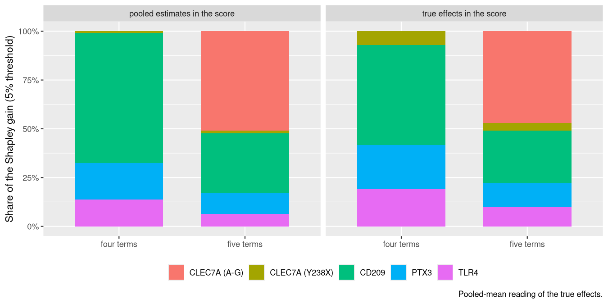
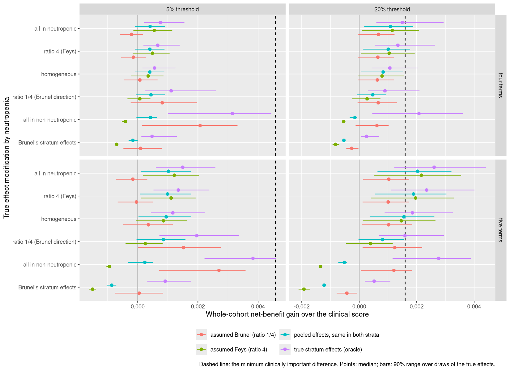
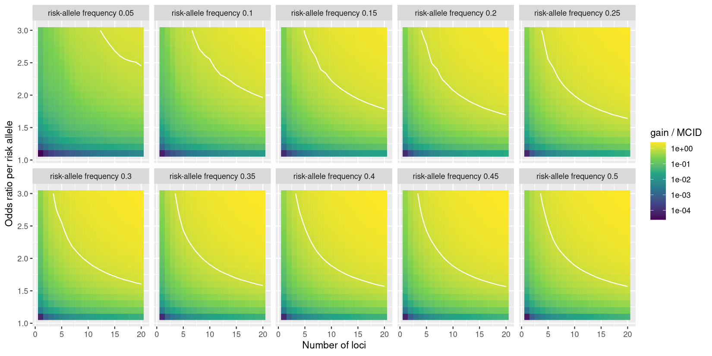

::: {.callout-warning}
## Working draft

This is a first draft of the write-up (phase 7). Every number comes from the files in `output/` as of 20 October 2026, after
the corrections recorded in addenda 16 to 22 and 24 to 26 of the [decision record](decisions.qmd). Addendum 24 made the
profile-preserving construction of the genetic truth primary, addendum 25 reran the sampling, ensemble, attribution,
effect-modification, donor and robustness analyses under it, and addendum 26 did the same for the all-ancestry variant of the
second CLEC7A parameter, so every result in this draft is on that construction. Addendum 23, the polygenic score benchmark, is
written up in the decision record and is not part of this draft. The evidence is still provisional:

- The record of the human round-2 verification is not yet in the repository.
- The priors on the pooled effects and the reading of the "realised" score are proposals.
- Cohort overlap between the Spanish registry series and the Jena AML cohorts is only partly adjudicated.

Still to do:

- the author list, ethics statement, data-availability statement and funding;
- the PubMed search date and a description of the extraction and round-2 verification;
- two missing references, marked `[ref]`: one on the burden of IMD, and Feys et al. (*J Infect Dis* 2026), which is not yet
  indexed in Crossref.

References are in `references.bib`. They were fetched from doi.org and should be checked against the journals before
submission.
:::

```{r}
#| label: setup
source("_setup.R")
rd <- function(f) read.csv(file.path("output", f))
```

## Abstract

**Background.** Variants in *PTX3*, *CLEC7A*, *TLR4* and *CD209* are often reported to be associated with invasive
aspergillosis, and adding genotype to clinical risk scores has been proposed. Whether this would change clinical decisions
has not been tested.

**Methods.** In a pre-specified simulation study, we added host genotype to a seven-predictor score for proven or probable
invasive mould disease (IMD) within 60 days. The score was refit on 4,078 haematology admissions in 1,945 patients (Bologna,
2007–2016; 133 events). Effects for four haplotype terms came from a systematic review (63 studies extracted) and were pooled
with Bayesian random-effects models. Genetic effects were added to the clinical logit with an intercept for each clinical
profile, so that the clinical score stayed calibrated and any gain reflected the genetic information. Net-benefit gains were
computed exactly for 2,000 posterior draws. The primary endpoint was the gain at a 5% risk threshold. It was judged against a
pre-specified minimum clinically important difference (MCID) of 20% more true cases at no extra false positives (+0.00458).

**Results.** Pooled odds ratios per copy of the risk haplotype ranged from 0.84 (CLEC7A Y238X) to 1.80 (CD209). With the true
effects in the score, the four-term panel raised net benefit at 5% by a median of +0.00056 (90% range 0.00015 to 0.00127).
That is 1.1 extra true cases per 1,000 admissions, against 4.6 required. At most 0.6% of draws reached the MCID, although the
area under the ROC curve rose from 0.861 to 0.873 and the continuous net reclassification improvement was 34%. A second
CLEC7A haplotype doubled the gain to +0.00115, about a quarter of the MCID. Neutropenic admissions (80% of events) supplied
about four-fifths of the gain. No panel of up to 20 loci with per-allele odds ratios of 1.5 or less reached the MCID. A
single global intercept, used in an earlier version of the simulation, gave gains 5% to 6% larger at 5%, and comparison with
the correctly marginalised clinical risk showed that this was not a correction of miscalibration.

**Conclusions.** On the published evidence, genotype at these genes is unlikely to change decisions at the 5% threshold in
haematological inpatients. Doing so would need much larger effects, or many more loci, than candidate-gene studies report. A
genotyped, neutropenia-stratified cohort of this size could test whether genetic effects depend on the inflammatory state of
the host.

## Introduction

Invasive mould disease, mostly invasive aspergillosis, remains a major cause of morbidity and death in patients with
haematological malignancies [ref]. Decisions about antifungal prophylaxis, diagnostic work-up and pre-emptive treatment depend
on how much risk a patient is thought to carry. Clinical risk scores formalise that judgement. Stanzani and colleagues derived
a score from seven routinely recorded host factors in 4,127 admissions to the haematology unit in Bologna [@stanzani2019].
It reached an aROC of 0.85 for proven or probable IMD within 60 days and defines high risk at a predicted
probability of 5%.

Host genetics might add information that clinical factors do not capture. Candidate-gene studies have reported associations
between invasive aspergillosis and variants in genes of innate antifungal immunity: the long pentraxin PTX3, the β-glucan
receptor dectin-1 (*CLEC7A*), Toll-like receptor 4 and DC-SIGN (*CD209*)
[@cunha2014; @sainz2012; @brunel2018; @fisher2017; @kalkanci2020; @schnetzke2024]. After allogeneic transplantation the
reconstituted innate immune system is donor-derived, which has led to proposals to use donor genotype to stratify transplant
recipients [@cunha2014]. These findings have prompted proposals for genetically augmented risk scores.

Two problems make such proposals hard to judge. First, the evidence is small and heterogeneous. Linked variants in the same
gene are often reported as separate findings, and adding them to a model as independent terms counts the same signal more
than once. An earlier, unpublished analysis of this question did that and reported a net reclassification improvement of
22.5%. Second, gains in discrimination or reclassification do not show whether anyone would be managed differently.
Decision-curve analysis does: it counts true and false positives at a clinically chosen risk threshold, weighted by the
harm-to-benefit ratio that the threshold implies [@vickers2006].

We therefore framed the question as one of value of information, not of prediction. Under what combinations of effect size,
risk-allele frequency and linkage structure would host genetic information change clinical decisions for IMD in
haematological patients, and is the published evidence anywhere near those combinations? We fixed the size of a clinically
important change before any genetic result existed, so that a negative answer would be a finding and not a failure. Our
objectives were to:

1. estimate the clinical baseline on the derivation cohort and compare it with the published equation;
2. quantify the decision value of the variants with the best evidence, as pooled from the literature;
3. test whether the genetic effects depend on neutropenia, as a proxy for the inflammatory state of the host;
4. find the genetic architectures that would be needed to reach a clinically important change.

## Methods

### Design and pre-specification

This is a simulation study that combines individual admission-level clinical data with a meta-analysis of the published
genetic evidence. The design is summarised below in the ADEMP structure for simulation studies [@morris2019]. Design decisions were recorded before any genetic result existed and locked at a git tag (`prespec-lock`,
commit `90e3656`, 17 October 2026). Every later change is a dated addendum to the [decision record](decisions.qmd). Each
addendum states what had been seen when the change was made. Two changes after the lock affected the primary analysis. In
both, no genetic result had yet been computed:

- The baseline cohort moved from a copula reconstruction to the admission-level data (D8 and D9).
- The baseline model became a refit on those data (D10). This raised the MCID by 13% at the 5% threshold, which made the
  primary test harder.

A third change was made after the genetic results were known. The lock specified a single global intercept to hold prevalence
(D5). A review of the genetic layer showed that this leaves the clinical score miscalibrated within clinical profiles under the
simulated truth, so that part of a genetic score's gain could be the correction of that miscalibration. Addendum 24 (D27) made
a profile-preserving truth primary and kept the global-intercept truth as a sensitivity analysis. The change lowered the primary
net-benefit gains slightly (by 5% to 6% at the 5% threshold) and did not change any conclusion, but it was not blind to the
earlier results. The sampling, ensemble, attribution, effect-modification, donor and robustness analyses were then rerun under
it (addendum 25), with the same seeds and the same posterior draws.

| ADEMP element | This study |
|---|---|
| Aims | Decision value of host genotype added to a clinical IMD score; the architectures that would be needed |
| Data-generating mechanisms | Clinical profiles from the observed cohort; genotypes in Hardy–Weinberg equilibrium at gnomAD non-Finnish European frequencies; true genetic effects drawn from the pooled posteriors under two readings and added with an intercept per clinical profile (profile-preserving; a single global intercept as sensitivity analysis); architecture sweep on a grid |
| Estimand | Gain in decision-curve net benefit over the clinical score, at thresholds of 5% (primary) and 20% (secondary) |
| Methods compared | Clinical score alone, which is calibrated under the primary truth; clinical score plus a genetic score with the true effects (ceiling) or the pooled estimates (realised) |
| Performance measures | Median gain and 90% range over draws; share of draws reaching the MCID; extra true cases per 1,000 admissions; aROC |

### Clinical cohort and baseline model

The clinical data are the admission-level derivation data of the Stanzani score, from the BOSCORE registry of the
haematology unit in Bologna (admissions 2007–2016). The outcome is proven or probable IMD by EORTC criteria within 60 days of
admission. The seven predictors are:

- prior mould disease;
- high-dose corticosteroids;
- uncontrolled malignancy;
- high-risk chemotherapy;
- prolonged neutropenia;
- severe lymphopenia;
- cytomegalovirus infection.

The published analysis file has 4,127 rows. These are exactly the rows of the parent registry extract that are complete on the
seven items. Forty-nine admission numbers appeared twice, each time as an event row plus a non-event row with the same patient
and predictor profile. We confirmed these pairs as a recording artefact and removed the duplicate row. The base cohort is
therefore 4,078 unique admissions in 1,945 patients, with 133 events (3.26%). Only counts and pseudonymised fields were used,
and no patient-level data are in the repository. [Ethics approval and data-access statement to add.]

The baseline is a maximum-likelihood logistic regression of the outcome on the seven predictors in the base cohort. Its
uncertainty was handled as follows:

- Standard errors are clustered by patient.
- The bootstrap resamples patients and repeats the refit in each of 2,000 resamples.
- Optimism was estimated by Harrell's bootstrap method [@harrell1996]. It is reported, not subtracted.

The baseline is held fixed from here on. The joint distribution of clinical risk is the observed distribution of the 128
possible predictor profiles, 75 of which occur. Three alternatives were kept as sensitivity analyses:

- the published equation;
- the 4,127-row cohort;
- a Gaussian-copula reconstruction of the predictor correlation, fitted to the published marginal counts. It was carried as
  an ensemble of 150 near-optimal correlation matrices.

### Evidence synthesis

**Search and extraction.** We searched PubMed (263 records; search date [to confirm]) and Embase (568 records; 8 October 2026)
for studies of host genetic variants and invasive fungal disease. The searches gave 831 unique records. Of the 81 studies
included, 63 had a usable source document. Twelve had no full text available, and six links pointed to the wrong document. The
extraction yielded 2,008 variant rows. Of these, 970 were usable: 823 effect estimates with both confidence limits and an
orientable effect allele, 115 complete 2×3 genotype tables and 32 complete 2×2 tables. [Describe the extraction process and
the round-2 human verification.]

Every row whose comparison text had no reference marker was checked against the source tables. That covered seven studies.
The two reversals found [@herrerosanchez2018; @fischer2016] and one duplicated row read in the opposite direction
[@sainz2012] were corrected and logged with their evidence (43 corrected rows in all).

**Panel.** Candidate variants needed at least three meta-analysable studies. Within each gene, pairwise linkage was measured
in phased 1000 Genomes phase 3 European haplotypes (503 samples) [@genomes2015]. Haplotype frequencies were rescaled to
gnomAD v4 non-Finnish European allele frequencies [@gnomad] by iterative proportional fitting. Linked SNPs were collapsed into one haplotype term
per gene. Each term is an additive per-copy effect of a risk haplotype class:

- **PTX3:** h2, the class carrying A at rs2305619 (tagged equally by rs1840680), frequency 48.2%.
- **CLEC7A:** the Y238X haplotype, the C allele of rs16910526, which lies only on one rs7309123 background, frequency 7.7%.
- **TLR4:** the G-T haplotype of rs4986790 and rs4986791, frequency 6.1%. It was pooled under a carrier model with a
  continuity correction, because no cohort had minor homozygotes.
- **CD209:** chromosomes carrying G at rs4804800, frequency 12.5%.

TLR9 rs352140 was dropped because only one study was usable. IL10 rs1800896 and IFNG rs2069705 were dropped because they
had one and two studies respectively, and the two IFNG studies disagreed in direction. One study [@herrerosanchez2018] was
excluded from the primary analysis because its main endpoint included colonisation.

**Mapping and pooling.** Each study's contrast (allelic, dominant, recessive or genotype counts) was converted to a log odds
ratio per copy of the risk class. The conversion solves a haplotype model: additive on the log-odds scale, haplotype pairs in
Hardy–Weinberg equilibrium, case–control sampling. Standard errors come from the delta method. One effect was taken per
study. The primary analysis used recipient genotype, the odds-ratio scale and whole-cohort analyses. Hazard-ratio studies
were added only as a sensitivity analysis, or as a labelled fallback where fewer than three odds-ratio studies existed.
Effects were pooled with a Bayesian random-effects model, μ ~ N(0, 1) and τ ~ half-normal(0.5), evaluated on a grid.

**Second CLEC7A parameter.** The three CLEC7A haplotypes carry a second effect: the A-G haplotype (G at rs7309123 on the
non-Y238X background) against A-C. rs7309123 is a C/G palindrome. Its strand was therefore resolved study by study, from
control allele frequencies, primer sequences and full texts. The primary estimate uses the three strand-resolved studies of
European or Turkish cohorts [@schnetzke2024; @kalkanci2020; @sainz2012]. Two East Asian studies [@chen2019; @tanpaibule2020]
were mapped through 1000 Genomes East Asian haplotype frequencies and
entered a sensitivity analysis. This parameter was not part of the pre-specified four-term panel. The four-term analysis is
therefore primary, and the five-term analysis is secondary.

### The genetic layer

Each patient receives one genotype, which is shared by all of their admissions. The dosage of each risk class (0, 1 or 2)
follows Hardy–Weinberg equilibrium at the gnomAD frequencies. Genotype is independent across terms and of the clinical
profile. The true risk of an admission is

$$
\operatorname{logit} p = \eta_X + \sum_j \beta_j g_j + a_X,
$$

where $$\eta_X$$ is the baseline linear predictor of clinical profile $$X$$ (one of 128) and $$g_j$$ the dosage of term
$$j$$. The intercept $$a_X$$ is chosen separately for each profile so that the risk averaged over genotypes equals the
clinical score's risk,

$$
\sum_g \pi_g \operatorname{expit}\!\left(\eta_X + \beta^\top g + a_X\right) = \operatorname{expit}(\eta_X),
$$

where $$\pi_g$$ is the Hardy–Weinberg probability of genotype $$g$$. The conditional effect of genotype is the same in every
profile; what is held fixed is that the clinical score is exactly calibrated within every clinical profile. A change in net
benefit therefore cannot come from correcting miscalibration of the clinical score, and reflects the information in genotype.
We call this the **profile-preserving truth**. Each genetic score is built in the same way, with an intercept per profile that
holds its mean risk at $$\operatorname{expit}(\eta_X)$$ (for a score with estimated weights simulated on a sample of genotypes,
the mean over that sample).

The first version of the layer (D5) used one intercept $$a$$ for all profiles, which holds the overall prevalence at 3.26% but
not the risk within each profile. Because $$\operatorname{E}_g\{\operatorname{expit}(\eta_X + \beta^\top g + a)\} \neq
\operatorname{expit}(\eta_X)$$ (Jensen's inequality), the clinical score is then miscalibrated within profiles under the
simulated truth, and some of a genetic score's gain could be the correction of that miscalibration. We keep this
**global-intercept truth** as a sensitivity analysis and compare three things (addendum 24):

- **current:** the global-intercept truth, with the clinical score $$\operatorname{expit}(\eta_X)$$ as the comparator (the
  construction of the first version);
- **marginal:** the same truth, with the best clinical-only rule under it as the comparator, the marginal risk
  $$m(X) = \sum_g \pi_g \operatorname{expit}(\eta_X + \beta^\top g + a)$$;
- **profile:** the profile-preserving truth, with $$\operatorname{expit}(\eta_X)$$ as the comparator, which is then exactly
  calibrated.

**Which comparison answers the clinical question.** The question is whether adding genotype to a clinical score that is
already calibrated would change decisions for patients stratified by that score. The profile comparison estimates this. The
current comparison handicaps the clinical score by construction. The marginal comparison removes that handicap while keeping
the truth, so the difference between current and marginal measures the part of the gain that is a correction of induced
miscalibration, and the difference between marginal and profile measures the effect of the truth itself being a different
simulated population.

True effects $$\beta_j$$ were drawn 2,000 times from each term's pooled posterior under two readings:

- **mean:** the pooled mean μ;
- **predictive:** a new-study effect drawn from N(μ, τ), which carries between-study heterogeneity.

Three scores were compared under the same truth:

- the clinical score alone;
- the **ceiling** score, which uses the true effects (the best any genetic score could do);
- the **realised** score, which uses the pooled posterior medians, recentred.

Net benefit at threshold $$p_t$$ is

$$
\text{NB}(p_t) = \frac{\text{TP}}{n} - \frac{\text{FP}}{n}\cdot\frac{p_t}{1-p_t}.
$$

The gain is the net benefit of a genetic score minus that of the clinical score. It was computed exactly over the 128 clinical
profiles and all genotype combinations (81 for four terms), with no patient-level sampling. Under the global-intercept truth, a
patient-level simulation on a 100-fold replicated cohort reproduced the exact gain (0.00041 against 0.00040 at 5%).

**MCID.** Before any genetic result, the minimum clinically important difference was defined as 20% more true cases at no
increase in false positives. That is $$0.2 \times \text{TP}_{\text{clin}}/n$$. Under the profile-preserving truth the clinical
score's true positives are exactly those of the refit baseline, so the MCID is unchanged (+0.00458 at 5%, +0.00160 at 20%). The
5% threshold, the high-risk cut-off of the original score, is primary. The 20% threshold is secondary and does not enter the headline conclusion. We report three
quantities:

- the median gain over draws, with its 90% range;
- the extra true cases per 1,000 admissions;
- the share of draws in which the gain reaches the MCID.

### Secondary and sensitivity analyses

All of these were run under the profile-preserving truth. The global-intercept versions are kept as sensitivity analyses (addendum 25).

- **Sampling variability.** We simulated 2,000 studies of the cohort's size per scenario. Each study resampled patients with
  their admissions, assigned genotypes, drew outcomes from the true risk, and recorded the observed gain of fixed scores.
- **Robustness.** The layer was repeated in four further settings, each with its own MCID:
  - the 150 correlation-ensemble members;
  - the published equation on the 4,078 admissions;
  - the published equation on the 4,127 rows;
  - a refit on the 4,127 rows.
- **Attribution.** The gain was divided among the terms by Shapley decomposition. The value of a subset is the gain of a score
  carrying only those terms, under the full truth. Shapley values sum to the total gain, but net benefit is not additive in
  the terms, so the split is a fair division of the gain and not a set of separable effects.
- **Effect modification by neutropenia.** This tests the hypothesis that per-copy effects are larger in neutropenic
  admissions (H_F, from the inflammatory-levelling argument of Feys and colleagues [ref]). The direction we expected was
  recorded before the run.
  - **Strata:** admissions were split by the prolonged-neutropenia predictor.
  - **Truth:** stratum-specific effects were constrained to average, weighted by events, to the pooled effect. The ratio of
    the neutropenic to the non-neutropenic effect was set to ∞, 4, 1, 1/4 and 0. A further scenario applied the stratum
    effects of the only stratified study [@brunel2018] directly.
  - **Scores:** an oracle score, a common score with the pooled estimates, and two scores that assume a direction.
  - **Interaction test:** in 1,000 simulated studies per scenario, a logistic model with the baseline logit as an offset
    estimated the interaction between the genetic score and neutropenia.
- **Donor genotype.** In the allogeneic transplant stratum (272 admissions, 43 events, from an admission-level flag), donor
  effects from the donor-genotype studies were tested against the stratum's own MCID. The baseline score has no allogeneic item
  and under-predicts in the stratum, so the truth holds, within each profile, the risk that includes the stratum's
  recalibration offset, and the scores hold the baseline's risk.
- **Architecture sweep.** The sweep covered k independent loci with the same risk-allele frequency and the same per-allele
  odds ratio:
  - k from 1 to 20;
  - odds ratio from 1.1 to 3.0 by 0.1;
  - frequency from 0.05 to 0.50 by 0.05.

  That gives 4,000 architectures, computed exactly by convolution with the ceiling score. In a realised version, each locus
  weight carried independent error with standard deviation σ from 0.05 to 0.40, with 12 replicate discovery studies per
  architecture.
- **Net reclassification improvement (tertiary).** This analysis places the earlier 22.5% figure in context. NRI was
  computed exactly in three forms:
  - categorical at 5%;
  - three categories, with cuts at 5% and 20%;
  - continuous, in which any change in predicted risk counts as a reclassification.

  Five scores were compared with the clinical score:
  - the four-term panel, with true effects or pooled estimates;
  - the PTX3 h2 term alone;
  - a score that adds the PTX3 effect once for each of the three SNPs, applied to real, linked chromosomes;
  - the earlier analysis's structure, in which the three SNPs are simulated independently and the effect enters both the
    truth and the score.

  The earlier per-SNP effects are not on record, so every PTX3 structure used the pooled per-copy effect, over the same
  2,000 posterior draws as the main analysis. We also traced NRI against the per-copy effect from a log odds ratio of 0
  to 1.6.

### Software

Analyses used R 4.6.1, with package versions pinned by renv. The code, the test suite and every summary output are public at
https://github.com/lewis-id-lab/PROSE. Scripts 01 to 29 reproduce the results in order.

## Results

### Cohort and clinical baseline

The base cohort has 4,078 admissions in 1,945 patients (2.10 admissions per patient) and 133 events (3.26%). The refit
baseline's odds ratios ranged from 2.15 for uncontrolled malignancy to 7.28 for prior mould disease. Every published
coefficient lies inside the refit's 90% bootstrap interval. The aROC was 0.858 apparent and 0.853 after optimism correction,
and the calibration slope was 0.97. On the same admissions, the published equation under-predicted slightly (3.06% against
3.26%).

At the 5% threshold the refit baseline flags 15.7% of admissions, with 22.9 true and 133.8 false positives per 1,000. Its net
benefit is 0.0158. The MCID is therefore +0.00458 (patient bootstrap 90% interval 0.00387 to 0.00566), or 4.6 extra true cases
per 1,000 admissions at no extra false positives. At 20% the MCID is +0.00160. Under the published equation the MCIDs would be
+0.00404 and +0.00113.

### Evidence base

@tbl-pooled shows the pooled effects. Each term rests on three to five studies. CD209 is the only term in the four-term panel
whose interval excludes an odds ratio of 1. PTX3 is borderline, with a 5.5% posterior probability that its effect is below zero.
CLEC7A Y238X is centred below 1. The second CLEC7A parameter, A-G against A-C, is estimated at an odds ratio of 1.86 per copy.
Its interval excludes 1 under every strand assumption (1.5 to 1.9).

The two East Asian studies point the other way (difference from the European estimate −1.19 on the log scale, SE 0.31,
P = 0.0001). Adding them gives 1.28 (0.79 to 1.95). The linkage of rs7309123 with rs3901533 in phased 1000 Genomes data
explains this pattern: it is the reversal expected when a tag SNP sits on different haplotype backgrounds in the two
ancestries.

```{r}
#| label: tbl-pooled
#| tbl-cap: "Pooled effects per copy of each term's risk haplotype class, primary analysis (recipient genotype, odds-ratio scale). Bayesian random-effects model; 90% credible intervals. Frequencies are gnomAD v4 non-Finnish European."
pool_row <- function(file, term, risk_class, freq) {
  rd(file)[1, ] |>
    transmute(Term = term, `Risk class` = risk_class, Frequency = freq, Studies = k,
              OR = or, `90% CrI` = sprintf("%.2f to %.2f", or_lo, or_hi), tau = tau)
}
bind_rows(
  pool_row("ptx3_h2_pooled.csv", "PTX3", "h2 (A at rs2305619)", 0.482),
  pool_row("clec7a_pooled.csv", "CLEC7A", "Y238X (C at rs16910526)", 0.077),
  pool_row("tlr4_pooled.csv", "TLR4", "G-T (rs4986790, rs4986791)", 0.061),
  pool_row("cd209_pooled.csv", "CD209", "G at rs4804800", 0.125),
  pool_row("clec7a_second_pooled.csv", "CLEC7A, second parameter (secondary)", "A-G (G at rs7309123, non-Y238X)", 0.349)
) |>
  gt() |>
  fmt_percent(Frequency, decimals = 1) |>
  fmt_number(c(OR, tau), decimals = 2)
```

### Primary result: the four-term panel

@tbl-headline and @fig-headline show the main results, under the profile-preserving truth. With the true effects in the
score, the four terms raised net benefit at the 5% threshold by a median of +0.00056 (90% range 0.00015 to 0.00127). That is
1.1 extra true cases per 1,000 admissions, against the 4.6 the MCID requires. The gain came with extra false positives: the
share flagged rose from 15.7% to 16.8%. No draw reached the MCID under the pooled-mean reading, and 0.6% did under the
predictive reading. With the pooled estimates in the score the gain was +0.00040 (−0.00010 to 0.00091), and no draw reached the
MCID. The expected aROC rose from 0.861 to 0.873 with the ceiling score and to 0.870 with the realised score.

At the secondary 20% threshold the ceiling score gained +0.00107 and reached the MCID of +0.00160 in 17% of draws (36% under
the predictive reading). The realised score reached it in 4% of draws (12% under the predictive reading).

```{r}
#| label: tbl-headline
#| tbl-cap: "Net-benefit gain over the clinical score under the profile-preserving truth: median and 90% range over 2,000 draws of the true effects, and the share of draws reaching the MCID (+0.00458 at 5%, +0.00160 at 20%). Mean: true effect is the pooled mean; predictive: a new-study effect including between-study heterogeneity. The global-intercept results are in @tbl-calibration and in `output/genetic_layer_summary.csv`."
rd("calibration_check_layer.csv") |>
  filter(comparison == "profile") |>
  transmute(panel = recode(panel, "four terms" = "Four terms (primary)", "five terms" = "Five terms, CLEC7A A-G added (secondary)"),
            truth, scenario = score, threshold,
            gain, lo, hi, extra = extra_cases_per_1000, p = p_meets_mcid, auc) |>
  mutate(panel = factor(panel, unique(panel)),
         Threshold = paste0(threshold * 100, "%"),
         Truth = truth,
         Score = if_else(scenario == "ceiling", "true effects (ceiling)", "pooled estimates (realised)"),
         range = sprintf("%.5f to %.5f", lo, hi)) |>
  arrange(panel, threshold, Truth, Score) |>
  select(panel, Threshold, Truth, Score, gain, range, extra, p, auc) |>
  gt(groupname_col = "panel") |>
  fmt_number(gain, decimals = 5, pattern = "+{x}") |>
  fmt_number(extra, decimals = 1) |>
  fmt_number(auc, decimals = 3) |>
  fmt_percent(p, decimals = 1) |>
  cols_label(gain = "Median gain", range = "90% range", extra = "Extra true cases per 1,000",
             p = "Draws reaching MCID", auc = "aROC")
```

{#fig-headline}

### Does the construction of the truth favour the genetic score?

The clinical score is exactly calibrated within every profile under the profile-preserving truth, by construction. Under the
global-intercept truth it was not: for the four-term panel (pooled-mean reading) the median calibration slope of the clinical
score was 0.98, and its largest error within a profile was 0.023 in risk (0.029 under the predictive reading). The best
clinical-only rule under that truth, the marginal risk, did better than the clinical score in 0.05% to 34% of draws,
depending on panel, reading and threshold. The margin was at most +0.00027 in net benefit in any draw, and the 95th percentile
of its share of the ceiling gain was at most 0.1%. The median gain was therefore the same with the marginal risk as the
comparator as with the clinical score (@tbl-calibration). Correcting induced miscalibration did not produce the reported gains.

Moving from the global-intercept to the profile-preserving truth did change the results, because it is a different simulated
population. For the panels the gain at 5% was 4.6% lower for four terms (+0.00056 against +0.00059) and 5.9% lower for five
terms, and at 20% it was within 2% of the original. The architecture sweep was more sensitive (@tbl-calibration): at 5%, 39.7%
of 4,000 architectures reached the MCID, against 45.7%. 241 verdicts changed, all of them losses. At 20% the share was 77.2%
against 77.0%, with six verdicts changed, all gains. The panels' conclusions did not change.

```{r}
#| label: tbl-calibration
#| tbl-cap: "The same analyses under three comparisons. Current: global-intercept truth, comparator is the clinical score. Marginal: the same truth, comparator is the best clinical-only rule (the marginal risk). Profile: profile-preserving truth, comparator is the (calibrated) clinical score, primary. Gains are net-benefit gains over the comparator multiplied by 1,000; panels use the ceiling score and the pooled-mean reading (medians over 2,000 draws); the frontier is for risk-allele frequency 0.3 at the 5% threshold."
rd("calibration_check_headline.csv") |>
  filter(analysis != "PRS benchmark, ceiling") |>
  mutate(analysis = factor(analysis, unique(analysis))) |>
  gt(groupname_col = "analysis", rowname_col = "metric") |>
  fmt_number(c(current, marginal, profile), decimals = 3, drop_trailing_zeros = TRUE) |>
  sub_missing(missing_text = "none") |>
  cols_label(current = "Current", marginal = "Marginal", profile = "Profile (primary)")
```

### The second CLEC7A parameter

Adding the A-G haplotype made CLEC7A an active term and roughly doubled the gain: +0.00115 (0.00046 to 0.00220) at 5% with the
ceiling score, and +0.00094 with the realised score. The 5% MCID stayed out of reach, reached in no draw under the
pooled-mean reading and 1.5% under the predictive reading. At 20% the ceiling score reached the MCID in 64% of draws (73%
under the predictive reading) and the realised score in 47%. With the all-ancestry estimate of the second parameter the gain at
5% was +0.00073, and 30% of draws reached the 20% MCID.

### Sampling variability and robustness

The next four sections (sampling and robustness, attribution, effect modification, donor genotype) use the profile-preserving
truth. Rerunning them under the global-intercept truth gave the same conclusions. Most gains and shares differed by a few per
cent. The largest difference was in the scenario that puts the whole effect in non-neutropenic admissions, where the oracle
score's gain and its chance of reaching the MCID were lower under the profile-preserving truth (addendum 25).

A study of the cohort's size would observe the gain with a standard deviation as large as the expected gain or larger: 0.00064
to 0.00116 at 5%. With the effects fixed at the pooled medians, the observed gain at 5% averaged +0.00038 (SD 0.00064). It was
above zero in 71% of studies and never reached the MCID. With the effects drawn from the posteriors, the observed gain was
positive in 67% to 82% of studies and reached the MCID in at most 1.1%. Even with every effect at the 95th percentile of its
posterior, the ceiling score's observed gain reached the 5% MCID in 0.5% of studies (78% at 20%).

The clinical correlation structure moved the median gain by at most 0.00016 (between-member SD 0.00007 to 0.00028). The
published-equation and 4,127-row cohorts gave gains at 5% of +0.00060 to +0.00062 (ceiling, pooled mean). In those settings at
most 1.3% of draws reached that setting's MCID. The settings differed mainly at 20%, where the published equation sets a lower
bar (+0.00113).

### Which terms carry the gain

In the four-term panel, CD209 supplied 51.4% of the Shapley gain at 5% (ceiling, pooled mean). PTX3 supplied 22.6%, TLR4
19.0% and CLEC7A 7.0% (@fig-attribution). CD209 has the largest pooled effect but rests on three studies. With the second
CLEC7A parameter the ranking changed. CLEC7A supplied 50.9%, almost all of it through the common A-G haplotype (47.0%), and
CD209 fell to 26.9%, PTX3 to 12.4% and TLR4 to 9.8%. CLEC7A's share stayed between 44.8% and 53.3% in every combination of
cohort, correlation structure, reading, score and threshold. It was the largest single contributor in 54% to 70% of draws.

{#fig-attribution}

### Effect modification by neutropenia

Neutropenic admissions were 28% of the cohort (1,157), with an event rate of 9.2% and 106 of the 133 events (80%). With
homogeneous effects, the gain per admission was 11 times larger in neutropenic admissions (+0.00160 against +0.00015 at 5%).
That stratum supplied 80% of the whole-cohort gain at 5% and 95% at 20%. With five terms it supplied 82% and 95%, and 77% to
83% at 5% across every sensitivity setting.

The only stratified evidence [@brunel2018] points against H_F. Mapped to the per-copy PTX3 h2 scale, its effect was +1.17 in
non-neutropenic and −0.13 in neutropenic courses for rs2305619 (difference −1.30, SE 0.72, P = 0.07). For rs3816527 the
difference was −1.99 (SE 1.01, P = 0.049). These estimates come from 212 courses and 26 events, with neutropenia defined at
presentation.

Across scenarios (@fig-aim3b), the 5% MCID came nearest only when the whole effect was placed in non-neutropenic
admissions. There the oracle score gained +0.00314, reaching the MCID in 2% of draws. With five terms it gained +0.00383 and
reached the MCID in 6% of draws. The common score with pooled estimates lost little under an H_F truth (+0.00041 against an
oracle +0.00075 at 5%). It was harmful if Brunel's stratum effects held (−0.00016 with four terms, −0.00086 with five). A score built on H_F was the most harmful
when the truth ran the other way.

In simulated studies of the cohort's size, the interaction test detected the effect modification more often than we had
predicted. With five terms and pooled-median effects, it reached P < 0.05 in the true direction as follows:

| scenario | power |
|---|---|
| all of the effect in neutropenic admissions | 89% |
| ratio of 4 | 60% |
| Brunel-sized modifications | ≥ 99.7% |

The false-positive rate was 5.0%. The corresponding four-term figures were 58%, 32% and 94% to 96%. Of the five predictions
recorded before the run, two held, one mostly held, one was not borne out, and one was wrong: we had predicted that the test
would be underpowered.

{#fig-aim3b}

### Donor genotype in allogeneic transplant recipients

The allogeneic stratum held 272 admissions and 43 events (32% of events). The baseline already flagged 77% of these admissions
at 5%. Donor genotype changed the number of true cases by −0.1 to +1.3 per 1,000 transplant admissions at 5% (a net loss of true
cases in one reading, with a gain in net benefit), against about 30 needed for the stratum's MCID, and added 14 to 27 at 20%,
against about 12 needed. Whole-cohort, the gain at 5% was at most +0.0001. The donor
evidence is one study each for PTX3 and CLEC7A, two for TLR4 and none for CD209. A smoothed version of the stratum's profile
distribution gave the same conclusions.

### Genetic architectures that would reach the MCID

Under the profile-preserving truth, of the 4,000 architectures 40% reached the 5% MCID and 77% reached the 20% MCID
(@fig-aim4). The pattern was:

- **One locus:** never enough. At an odds ratio of 3.0 and frequency 0.5 it reached 37% of the MCID.
- **Odds ratio 1.5 or less:** no number of loci up to 20 reached it at 5%.
- **Odds ratio 2.0:** 9 to 12 loci were needed at frequencies of 0.2 to 0.5, and 19 at 0.1.
- **Odds ratio 3.0:** 4 to 5 loci were enough at frequencies of 0.15 to 0.5.

The gain peaks at a frequency of about 0.45 and is slightly lower at 0.5, so the frontier is not strictly monotone in frequency
near 0.5 (under the global-intercept truth, for example, an odds ratio of 2.9 needs 3 loci at frequencies of 0.4 and 0.45 and 4
at 0.5).

The global-intercept truth needed 7 to 9 loci at odds ratio 2.0 and 3 to 4 at odds ratio 3.0, so the 5% frontier moved out by
two to three loci at an odds ratio of 2.0, and by two at 1.8 (frequency 0.3; @tbl-calibration). Under that truth one architecture with an odds ratio of 1.5 (20 loci
at frequency 0.45) reached the 5% MCID, by +0.000007. The profile-preserving truth removes it.

The four-term panel corresponds to about 7 loci of odds ratio 1.3 at frequency 0.3, and would need to be roughly eight times
stronger to reach the 5% MCID. Architectures near the frontier depended on the unpublished correlation structure (gain over
MCID varied by about 15% across ensemble members, computed under the global-intercept truth). Those well inside or outside it
did not.

With estimated weights, a score kept a median of 96% of the ceiling gain at a per-locus precision of σ = 0.10. It kept 89% at
σ = 0.20 and 58% at σ = 0.40, which is the range of precision of the present pooled estimates (0.18 to 0.38). At those
precisions, between 12% and 36% of the architectures that reached the MCID with exact weights no longer did. The loci
needed for a given odds ratio rose by one to several. At σ = 0.40 and an odds ratio of 1.8 (frequency 0.3), no number of loci up
to 20 reached the 5% MCID under the profile-preserving truth, against 20 under the global-intercept truth.

{#fig-aim4}

### Net reclassification improvement (tertiary)

All NRI results use the profile-preserving truth, with the clinical score as the comparator. Continuous NRI was large even
where net benefit barely moved (@tbl-nri). For the four-term panel with true effects, the continuous NRI was 34% (90% range
19% to 53%), yet the net-benefit gain at 5% was +0.0006, about an eighth of the MCID. The categorical NRI at the 5% decision
threshold was 2.4%.

**The earlier analysis's structure.** Simulating the three PTX3 SNPs independently, at the pooled per-copy effect, gave a
continuous NRI of 25% (4% to 63%). That is consistent with the 22.5% the earlier analysis reported, but does not reproduce it
(see Limitations).

**Linkage at the same per-copy effect.** The correct h2 structure gave less than a quarter of the independent model's
net-benefit gain (+0.00008 against +0.00033). That is because the independent model triples the true genetic variance.
Continuous NRI did not follow this: it was higher for the h2 haplotype (34%) than for the independent structure (25%), for the
reason given below; under the global-intercept truth the h2 value was 13%. @fig-nri-grid traces both structures across per-copy
effects, and the table below gives the crossing points:

| target | three SNPs, independent | PTX3 h2 haplotype |
|---|---|---|
| continuous NRI of 22.5% | OR 1.32 per copy | OR 1.17 per copy |
| three-category NRI of 22.5% | OR 2.32 | OR 3.67 |
| the 5% MCID | OR 3.32 | not reached by OR 4.95, the end of the grid |

```{r}
#| label: fig-nri-grid
#| fig-cap: "NRI and net-benefit gain at 5% against the per-copy PTX3 effect, for the correct h2 haplotype structure and the earlier analysis's structure (three SNPs simulated independently), under the profile-preserving truth. Dashed lines: an NRI of 22.5% (the earlier analysis's figure) and the 5% MCID. Grey line: the pooled per-copy odds ratio (1.35)."
#| fig-height: 5.5
mcid5 <- rd("dca_baseline_refit_summary.csv") |> filter(threshold == 0.05) |> pull(mcid_b)
panels <- c(nri_cont = "Continuous NRI", nri_cat3 = "NRI, cuts at 5% and 20%",
            nri_cat5 = "NRI at 5%", dnb_05 = "Net-benefit gain at 5%")
rd("calibration_check_nri_grid.csv") |>
  filter(comparison == "profile") |>
  pivot_longer(all_of(names(panels)), names_to = "metric") |>
  mutate(metric = factor(panels[metric], panels), or = exp(log_or),
         structure = recode(structure, "PTX3 h2 haplotype" = "h2 haplotype (correct)",
                            "PTX3 three SNPs, independent" = "three SNPs, independent (earlier analysis)")) |>
  ggplot(aes(or, value, colour = structure)) +
  geom_hline(data = data.frame(metric = factor(panels, panels), y = c(0.225, 0.225, 0.225, mcid5)),
             aes(yintercept = y), linetype = "dashed") +
  geom_vline(xintercept = 1.35, colour = "grey60") +
  geom_line() +
  facet_wrap(~metric, scales = "free_y") +
  scale_x_log10(breaks = c(1, 1.5, 2, 3, 4, 5)) +
  labs(x = "Odds ratio per copy (log scale)", y = NULL, colour = NULL) +
  theme(legend.position = "bottom")
```

**Applying the three-SNP score to real chromosomes.** Here the haplotype is counted up to three times. The score lowered net
benefit (−0.0004 at 5%) and the aROC (−0.005), and its categorical NRI at 5% was negative (−1.4%). Its continuous NRI was
positive (29%), so the continuous measure did not register the miscalibration.

**Instability of continuous NRI.** Even for the correctly specified h2 term, its components were unstable. The event component
was −18% and the non-event component +53%. Heterozygotes' predicted risk shifts by a very small amount after recentring, and
the continuous NRI counts any shift as a reclassification. Across draws the event component ranged from −36% to +51%. The value
depends on the construction of the truth in a way that net benefit does not: for the h2 term the continuous NRI was 13% under
the global-intercept truth and 34% under the profile-preserving one, while its net-benefit gain was +0.00008 under both. Mean
h2 dosage is 0.96, so a heterozygote sits almost exactly at its profile's mean risk, and which way its predicted risk moves is
decided by a small curvature effect. Between the global-intercept comparison and the marginal one, only 0.9% of the cohort
changed direction (23.2% moved up, against 24.1%), yet the continuous NRI went from 0.13 to 0.33, so those cells must carry a
large share of the events. We did not examine which profiles they belong to.

```{r}
#| label: tbl-nri
#| tbl-cap: "Net reclassification improvement, net-benefit gain and aROC change against the clinical score, under the same profile-preserving truth: median and 90% range over 2,000 draws of the true effects (pooled-mean reading). Every PTX3 structure carries the pooled per-copy h2 effect."
labs_nri <- c(
  "four-term panel, ceiling"     = "Four-term haplotype panel, true effects",
  "four-term panel, realised"    = "Four-term haplotype panel, pooled estimates",
  "PTX3 h2 haplotype"            = "PTX3 h2 haplotype (correct structure)",
  "PTX3 three SNPs, real LD"     = "PTX3 three-SNP score on real (linked) chromosomes",
  "PTX3 three SNPs, independent" = "PTX3 three SNPs simulated independently (earlier analysis)"
)
pct <- function(m, lo, hi) sprintf("%.1f (%.1f to %.1f)", 100 * m, 100 * lo, 100 * hi)
rd("calibration_check_nri.csv") |>
  filter(comparison == "profile", metric %in% c("nri_cat5", "nri_cat3", "nri_cont", "dnb_05", "dauc")) |>
  mutate(value = case_when(
    metric == "dnb_05" ~ sprintf("%.5f (%.5f to %.5f)", median, lo, hi),
    metric == "dauc" ~ sprintf("%.3f (%.3f to %.3f)", median, lo, hi),
    TRUE ~ pct(median, lo, hi)),
    scenario = unname(labs_nri[scenario])) |>
  select(scenario, metric, value) |>
  pivot_wider(names_from = metric, values_from = value) |>
  gt() |>
  cols_label(scenario = "Score", nri_cat5 = "NRI at 5% (%)", nri_cat3 = "NRI, cuts at 5% and 20% (%)",
             nri_cont = "Continuous NRI (%)", dnb_05 = "Net-benefit gain at 5%", dauc = "aROC change")
```

## Discussion

### Principal findings

On the published evidence, adding the four best-evidenced host variants to a validated clinical score for invasive mould
disease would change few decisions at the 5% threshold. With the true effects in the score, the panel found about one extra
case per 1,000 admissions, against a pre-specified bar of 4.6. Every combination of evidence reading, cohort, baseline equation
and correlation structure we examined gave the same conclusion. The most favourable addition the evidence allows, a second
CLEC7A parameter, still left the gain at about a quarter of the MCID.

The conclusion does not depend on how the genetic truth was added to the clinical model. The first version of the simulation
held only the overall prevalence, which left the clinical score slightly miscalibrated within profiles. That raised the gains
at 5% by 5% to 6% and made the architecture frontier two to three loci easier to reach, but none of the gain was a correction of the
miscalibration: the best clinical-only rule under that truth did as well as the clinical score to within 0.00027 in net benefit
in every draw. We therefore report the profile-preserving truth, under which the clinical score is calibrated by construction
and a gain can only come from the information in genotype. That is the comparison that corresponds to the clinical question,
which is whether genotype adds to a score that is already well calibrated.

A real gain of this size would also be hard to observe: it would show as no gain, or a loss, in a fifth to a third of cohorts
the size of the derivation cohort. Taken together, the panel behaves like about seven loci of odds ratio 1.3, far from the
architectures the sweep shows would be needed.

### Comparison with the earlier reclassification result

An earlier, unpublished analysis of the same question reported a net reclassification improvement (NRI) of 22.5% from adding
PTX3 variants to the same clinical score. Our results differ from it for two reasons.

**Linkage.** The earlier analysis simulated rs2305619, rs3816527 and rs1840680 as independent multiplicative risks, although in
European haplotypes they tag one haplotype class (r² 0.79 to 0.996, D′ = 1). Its homozygote odds ratio of 15.2 for rs1840680
came from that triple counting. It also used the global dbSNP frequency of rs2305619 (0.36) rather than the non-Finnish
European one (0.48), which shrinks the homozygote class from 21% to 13% of the cohort. At the same per-copy effect, the
independent structure quadrupled the net-benefit gain (+0.00033 against +0.00008; @fig-nri-grid). Treated
correctly as one haplotype, PTX3 adds +0.00008 in net benefit at 5%, about 2% of the MCID. It does not reach the MCID at any per-copy odds ratio
up to 5.

**The metric.** NRI counts movements across risk categories without weighing the consequences of the decisions they imply. It
can be positive for uninformative markers, and it can reward miscalibration [@kerr2014; @pepe2014; @hilden2013]. Our own
four-term haplotype panel had a continuous NRI of 34%, above the earlier 22.5%, with a net-benefit gain an eighth of the MCID.
An NRI of this size is therefore no evidence that decisions would change.

Genotype does improve the ranking (aROC +0.012), but few admissions cross the threshold. The extra admissions flagged at 5%
included about nine false positives for every extra true case (8.9 under the profile-preserving truth). At this threshold a true case is worth up to 19 false
positives, so these moves are beneficial on balance, but there are too few of them to matter.

Continuous NRI also failed to register harm. The three-SNP score applied to real, linked chromosomes lowered net benefit yet
had a positive continuous NRI (29%), and the measure's value and components swung with tiny shifts in heterozygotes' predicted
risk: for the correct h2 term it was 13% under one construction of the truth and 34% under the other, with the same net-benefit
gain. Net benefit at
a clinically chosen threshold, judged against a difference fixed in advance, asks the question a clinician would ask: does the
score find more patients who will develop disease without treating more who will not [@vickers2006]?

### Where genetic information might matter

The analyses point to four settings where genotype could carry more value. Each comes with qualifications.

**At a higher threshold.** At the secondary 20% threshold, fewer admissions are flagged and each extra true case is worth
fewer false positives. There the five-term ceiling score reached the MCID in 64% of draws. This result is secondary, rests on a
parameter estimated from three studies, and should be read as a hypothesis.

**In neutropenic admissions.** Neutropenic admissions hold 80% of the events. They supplied about four-fifths of the gain
whichever way the effect modification ran, unless the effect was placed entirely in non-neutropenic admissions. The only
stratified data [@brunel2018] point the opposite way to the inflammatory-levelling hypothesis. They come from one small study
with a different definition of neutropenia, so they do not settle the question.

The design analysis shows what a genotyped cohort of this size could do, provided genotype is measured and the weights are
right. With the five-term score, it would detect a modification of the size the inflammatory-levelling argument implies in 60% to
89% of studies, and a modification of Brunel's size almost always. Of the follow-up studies these results suggest, this one would be the most
informative. It would test the biology directly. It would also show whether a single pooled score is safe to use: under
Brunel's pattern, such a score would do harm.

**With larger effects or more loci.** Reaching the frontier needs loci with odds ratios of 2 or more, or many loci with
precise weights. A per-locus precision of 0.1 on the log scale needs a discovery sample of about 1,000 balanced subjects per
locus at a common frequency. A cohort the size of the Bologna one gives 0.14 to 0.22. To our knowledge no genome-wide
association study of invasive aspergillosis has been published. The candidate-gene literature cannot supply the number of
precisely estimated loci the sweep shows would be needed.

**In allogeneic transplant recipients.** Here the biological case for donor genotype is strongest [@cunha2014]. But the
baseline already flags 77% of these admissions at 5%, which leaves little room for genotype to add. At 20% donor genotype could
plausibly reach the stratum's MCID. The evidence is one or two studies per term, however, and none for CD209.

### Strengths and limitations

The study has six main strengths:

- The MCID, the primary threshold and the panel were fixed before any genetic result existed and locked in version control.
  Every later change is a dated addendum that discloses what had been seen.
- Gains were computed exactly rather than by Monte Carlo sampling.
- Linked SNPs were modelled as haplotypes.
- Every primary-analysis contrast with an ambiguous reference group was checked against its source, and errors were corrected
  and logged. The predictions for the neutropenia analysis were committed before it was run.
- The clinical baseline comes from individual admission-level data rather than published margins.
- The code, tests and summary outputs are public.

The limitations fall into seven groups.

**The evidence is thin.** Each term rests on three to five studies. Some cohorts overlap, notably the Spanish registry series
and the Jena AML cohorts, and that overlap has only partly been adjudicated. The record of the human round-2 verification is
not yet in the repository. Small candidate-gene studies are prone to publication bias and inflated effects. If so, our pooled
effects are optimistic, which would strengthen the negative conclusion at 5% rather than weaken it.

**The mapping rests on assumptions.** Converting heterogeneous contrasts to one per-copy scale assumes additive effects and
Hardy–Weinberg equilibrium. It also uses European haplotype frequencies for every cohort except the two East Asian studies in
the CLEC7A sensitivity analysis. The priors on μ and τ, and the continuity correction for TLR4, are analytic choices with
little data to check them against.

**Several simulation assumptions favour the genetic score.** The realised score uses posterior medians, which are already
shrunk, and it ignores the winner's curse. Real-world realised gains would therefore be lower.

**Other simulation assumptions could cut either way.** Genotype is assumed independent across genes and independent of the
clinical profile. The analysis considers one threshold decision per admission. Only candidate genes are modelled.

**The construction of the genetic truth.** The profile-preserving truth adds the same logit-scale effect in every clinical
profile and compensates with an intercept per profile. Other forms of interaction between genotype and clinical risk were not
examined. The primary truth was adopted after the global-intercept results were known (addendum 24), though it was not tuned to
them. Every analysis in this paper, including the sampling-variability, correlation-ensemble, attribution, effect-modification,
donor-stratum and robustness analyses, was run under it, and the first version's global intercept was kept as a sensitivity
analysis (addenda 24 to 26). Compared with that sensitivity analysis, the global intercept overstated gains at 5% by 5% to 6%
in the panels, let 241 of 4,000 architectures reach the MCID that did not under the profile-preserving truth, and made the
scenario with all of the effect in non-neutropenic admissions look more favourable (the oracle score reached the 5% MCID in 18%
of draws against 2%). It changed little at 20% and did not change the neutropenia pattern, the attribution or the donor result.
The non-neutropenic scenario is the one most sensitive to the construction because it puts a per-copy effect about five times
the pooled one into a low-risk stratum. There the single intercept flattens the clinical gradient: the lowest-risk profiles,
which hold most of the stratum, get a true risk 14% to 29% above the clinical score's, and the highest-risk ones a much lower
one. This is a different simulated population, not a correction of the comparator: against the best clinical-only rule the
gain under the global intercept was almost the same (3.01 against 3.05, per 1,000 admissions at 5%). The gain was 11% lower under
the profile-preserving truth, which is enough to move the MCID from the 82nd to above the 95th percentile of the draws (addendum 26).

**The second CLEC7A parameter is the least mature part of the evidence.** It comes from three studies. The opposite direction
in East Asian studies fits a tag SNP whose linkage to a causal variant differs between ancestries, but the causal variant has
not been identified.

**The cohort is a single pre-pandemic centre.** Admissions run from 2007 to 2016, and the outcome is all invasive moulds, not
aspergillosis alone. The baseline is evaluated on the data it was fitted to, although the optimism was small (0.005 in aROC).
Prophylaxis practice has changed since 2016, and the score's calibration today is unknown.

**The decision framework is narrow.** Net benefit at a fixed threshold captures one use of a risk score. The MCID of 20% more
true cases is a judgement, though the strictest of the three readings we considered. Other uses of genotype, such as choosing
an antifungal agent or enriching a trial, were not evaluated.

Two planned analyses are not yet done:

- the pathogen-specificity scenario;
- locus-specific error, winner's curse and linkage in the architecture sweep.

The NRI comparison rests on the pooled PTX3 effect, because the earlier analysis's per-SNP inputs are not on record, and we
do not know which form of NRI it reported.

### Conclusions

On the published evidence, host genotype at PTX3, CLEC7A, TLR4 and CD209 is unlikely to change decisions at the 5% threshold
for invasive mould disease in haematological inpatients. A study the size of the derivation cohort could not reliably detect
the gain it would give. Genotyping would become worth doing only with variants of larger effect, or many more of them, than
candidate-gene studies have found. A more immediate use for a genotyped cohort of this size would be to test whether genetic
effects depend on neutropenia, which would also show whether a single pooled score is safe.

## References {.unnumbered}

::: {#refs}
:::
