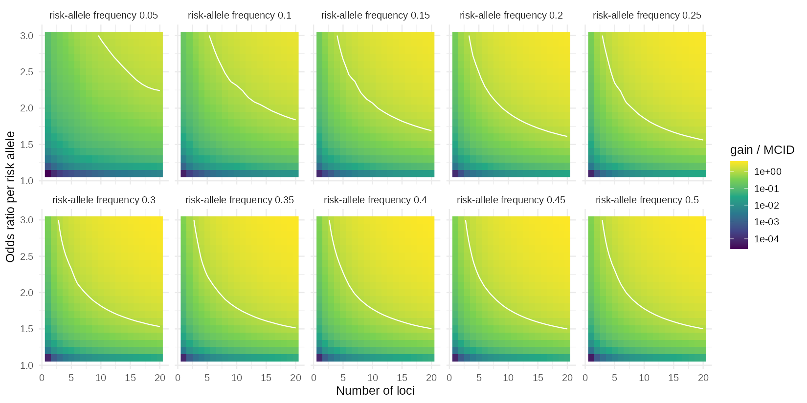
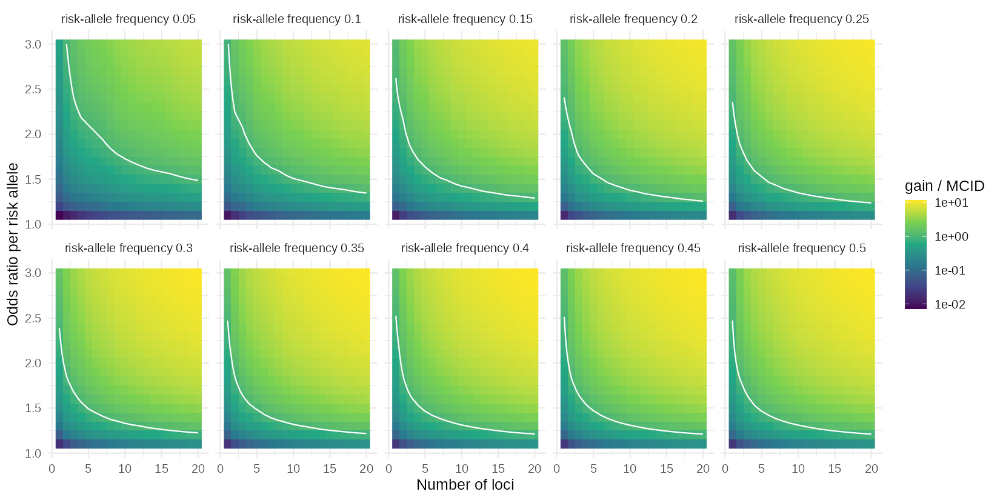
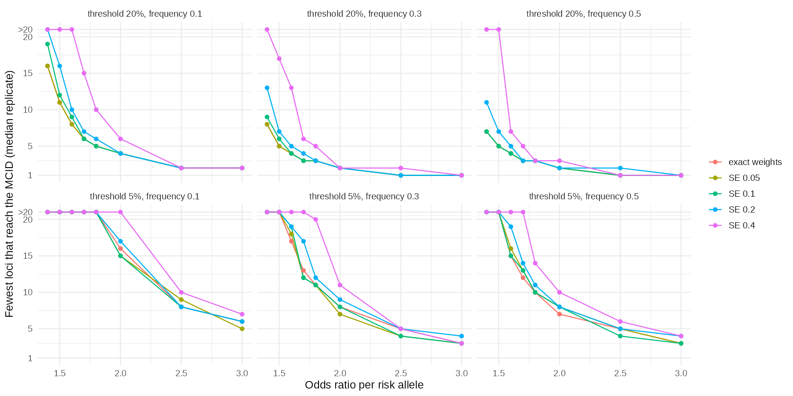

# Phase 3 gate: decisions

Recorded 16 October 2026. This is the pre-specification record — it is written **before** any genetic
result exists and should not be revised once results are in view.

---

## D1. Primary genotype — **settled: recipient primary, donor secondary in the allo-HSCT stratum**

Agreed 16 October 2026. Recipient genotype is the primary exposure. Donor genotype enters as a
pre-specified secondary analysis restricted to the allogeneic HSCT stratum, which carries 33% of all IMD
events on 7% of admissions, and which gives Aim 3b a second host-context contrast alongside the
neutropenia split. The reasoning that forced the revision is kept below for the record.

**Originally stated:** donor genotype as the primary exposure.

**The biology supports you, the cohort does not.** After allogeneic transplant the reconstituted innate
immune system is donor-derived, so for PTX3, dectin-1 and the TLR genes the donor is arguably the right
genome — that is the Cunha 2014 *NEJM* argument. But two facts block donor as the *primary* exposure:

1. **The baseline cohort is overwhelmingly not transplanted.** In Stanzani's Table 1, allogeneic HSCT is the reason for admission in 248 of 3,994 non-IMD admissions and 44 of 133 IMD admissions — **292 of 4,127 admissions, 7.1%**. Donor genotype is undefined for the other 93%. A donor-genotype term cannot enter a model whose denominator is all haematology admissions.
2. **The evidence base cannot parameterise it.** Of 970 usable variant rows, only 90 are donor-stratified. Per panel variant, the number of studies contributing a donor-specific usable estimate is **at most one**, and rs4804800 and rs1840680 have none. No panel variant reaches two donor studies, let alone three.

Donor-as-primary would therefore shrink the analysis to a 7% subgroup — 292 admissions, 44 events —
parameterised from single studies.

**Proposed instead:** recipient genotype as the primary exposure, with **donor genotype as a
pre-specified secondary analysis restricted to the allogeneic HSCT stratum**. That stratum carries 33% of
all IMD events despite being 7% of admissions, so it is where a genetic effect has the most room to show,
and it is where the donor-genome argument actually applies. This also gives Aim 3b a second natural
contrast alongside the neutropenia split.

☑ Revision confirmed.

## D2. PTX3 and TLR4 as haplotypes — **accepted**

Consistent with the evidence and with the thesis's central methodological correction.

- **PTX3** enters as a single h1/h2 haplotype term, not three SNPs. In 1000 Genomes EUR, rs2305619 and rs1840680 sit at r² = 0.996 and are interchangeable; rs3816527 is at r² ≈ 0.79 with both; D′ ≈ 1 throughout. The trio collapses to two haplotypes at roughly 0.40–0.46 (h2) and 0.54 (h1). Simulating the three independently is what inflated the predecessor's result.
- **TLR4** enters as a single rs4986790–rs4986791 haplotype term. D′ = 0.981, r² = 0.945, GT haplotype frequency 0.056 in EUR, with about 0.3% recombinant chromosomes.

Parameter cost: these two blocks contribute 2 terms rather than 5.

☑ **E1. Settled 16 October 2026 (arithmetic check): coupling confirmed.** `haplotype_frequencies.csv` assumes
the minor alleles are in coupling (D > 0). The reported r² and the allele frequencies fix |D| independently
of that assumption, and for every pair |D| exceeds the largest value a negative D could take given those
frequencies. For example, for rs2305619 x rs3816527 the r² of 0.787 requires |D| = 0.216, but a negative D
cannot exceed 0.181. TLR4 (rs4986790 x rs4986791) needs 0.0524 against a negative-phase ceiling of 0.0033.
CLEC7A and CD209 are likewise consistent only with D > 0. The check assumes r² and D′ were taken from the
1000G source and not back-calculated from the assumed D. Phased 1000G haplotypes remain the route for the
three-locus PTX3 frequencies, but the sign is no longer an open question.

## D3. Final panel — **settled, with the within-gene structure corrected**

The panel chosen was: PTX3 haplotype, TLR4 haplotype, CLEC7A rs16910526, CLEC7A rs7309123, CD209
rs4804800 and/or rs7248637, with IL10 rs1800896 and IFNG rs2069705 as possibles.

**Two of those terms had to be collapsed.** The panel as listed carries two CLEC7A SNPs and two CD209 SNPs
as separate additive terms, which is structurally the same error the thesis exists to correct — the
predecessor's mistake was treating linked SNPs within one gene as independent. Pairwise linkage
disequilibrium in 1000 Genomes EUR:

| pair | gene | r² | D′ | haplotypes present |
|---|---|---|---|---|
| rs16910526 × rs7309123 | CLEC7A | 0.104 | 1.000 | 3 |
| rs4804800 × rs7248637 | CD209 | 0.413 | 0.671 | 4 |

CLEC7A: D′ = 1 means no recombination between the two sites, so the rare Y238X allele (rs16910526, MAF
0.071) sits **entirely on one rs7309123 background**. The low r² reflects the frequency difference, not
independence. Three haplotypes exist — CG 0.071, majG 0.352, majmaj 0.578 — and the Cmaj haplotype is
absent. Entering both SNPs as independent additive terms double-counts the 7% of chromosomes carrying
Y238X.

CD209: D′ = 0.671 means recombination has occurred and all four haplotypes are present — GA 0.082,
Gmaj 0.042, majA 0.033, majmaj 0.843. The two SNPs are correlated at r² = 0.41, so again not independent.

**Final panel: four core haplotype terms, with two optional single SNPs.**

| term | variants | contributing studies | independent cohorts |
|---|---|---|---|
| PTX3 haplotype (h1/h2) | rs2305619, rs3816527, rs1840680 | 7 | 7 |
| CLEC7A haplotype (3 haplotypes) | rs16910526, rs7309123 | 11 | 9 |
| TLR4 haplotype | rs4986790, rs4986791 | 5 | 5 |
| CD209 haplotype (4 haplotypes) | rs4804800, rs7248637 | 5 | 4 |
| IL10 rs1800896 *(optional)* | rs1800896 | 3 | 3 |
| IFNG rs2069705 *(optional)* | rs2069705 | 3 | 3 |

That is **four core terms, six with the optional pair** — comfortably inside the roughly ten-parameter
ceiling that 133 events supports, and it leaves room for the Aim 4 sweep to add synthetic loci without
the baseline panel already being overfitted.

CLEC7A is now the best-evidenced term in the panel at nine independent cohorts, ahead of PTX3 at seven.

Three sub-decisions remain:

☑ **D3a. Settled 16 October 2026: drop TLR9 rs352140** — reported by three studies, usable in one.
☑ **D3b. Settled 16 October 2026: excluded from the primary analysis and run as a sensitivity analysis.** The
reasoning follows. Herrero-Sanchez 2018 in or out. Its supplementary rows use *Candida*/*Aspergillus* detection or colonisation as the endpoint, not proven or probable invasive mould disease. It contributes a cohort to the PTX3 and CLEC7A terms; excluding it takes PTX3 from 7 to 6 and CLEC7A from 9 to 8.
☑ **D3c. Settled 16 October 2026: carrier (dominant) model, with a continuity correction.** The reasoning
follows. TLR4 pooling model. Both SNPs are usable only through genotype counts, and every contributing cohort has zero minor homozygotes in cases and controls, so only a dominant or carrier model is estimable and a continuity correction is required.

## D4. Minimum clinically important difference — **settled: 20% more true cases, no extra false positives**

**Stated:** a 20% improvement in prediction.

Net benefit is measured in true positives per patient, not in percent, so "20%" needs saying *of what*
before it can be tested. Three defensible readings, with what each requires numerically. The figures come
from the synthetic cohort at an exchangeable latent correlation of 0.30 (N = 400,000, prevalence 3.25%,
aROC 0.852) and should be re-derived once the calibrated cohort of section A2 exists.

Baseline clinical model, net benefit:

| threshold | NB (model) | NB (treat all) | % flagged | true positives / 1000 | false positives / 1000 |
|---|---|---|---|---|---|
| 5% | 0.01514 | −0.01843 | 13.3% | 21.0 | 111.7 |
| 10% | 0.01007 | −0.07501 | 6.0% | 15.1 | 44.9 |
| 20% | 0.00571 | −0.20939 | 2.5% | 9.5 | 15.4 |

What the genetic layer would have to add:

| reading | at the 5% threshold | at the 20% threshold |
|---|---|---|
| **(a)** 20% relative increase in net benefit | +0.00303 | +0.00114 |
| **(b)** 20% more true cases detected at no increase in false positives | +0.00420 | +0.00191 |
| **(c)** 20% relative increase in standardised net benefit | +0.00303 | +0.00114 |

For scale: a net-benefit increment of 0.00100 is one extra true case found per 1,000 admissions, which
across the 4,127-admission Bologna registry is about four extra cases over the decade.

**Recommendation: reading (b).** It is the one a clinician can state in a sentence — "the genetic layer
must find 20% more cases of invasive mould disease without treating anyone extra unnecessarily" — and it
is the strictest of the three. Reading (a) is simplest to compute and is the conventional decision-curve
formulation. Avoid framing the MCID in terms of reclassification: a "20% improvement" expressed as NRI is
precisely the predecessor thesis's 22.5% figure, and moving off that metric is one of the reasons for
redoing the work.

☑ **Settled: reading (b).** The genetic layer must find 20% more cases of invasive mould disease without
treating anyone extra unnecessarily. In net-benefit terms that is **+0.00420 at the 5% threshold** and
**+0.00191 at the 20% threshold**, on the indicative cohort. Re-derive both on the calibrated cohort
before locking; the ratios will hold, the absolute values may move.

☑ **Settled 16 October 2026: the 5% threshold is primary.** The MCID of +0.00420 is tested at 5%, which is
the Youden cut-off Stanzani used to define high risk. The 20% threshold (+0.00191) is reported as
secondary and does not enter the headline conclusion, which avoids a multiplicity problem.

☑ **Re-derived 17 October 2026 on the calibrated cohort.** The predictor correlation structure (D7) was
fitted to all 16 published targets, and the MCID recomputed exactly from the fitted profile distribution.
These values replace the indicative figures above:

| threshold | indicative cohort | calibrated cohort | ensemble 90% range |
|---|---|---|---|
| 5% (primary) | +0.00420 | **+0.00428** | 0.00397 to 0.00460 |
| 20% (secondary) | +0.00191 | **+0.00140** | 0.00117 to 0.00167 |

At 5% the baseline net benefit is 0.01478, with 21.4 true and 125.7 false positives per 1,000 admissions and
14.7% flagged. The primary value moved by 2% from the indicative one; the secondary value fell by 27%. The
ensemble range reflects the unpublished correlation structure, and the 5% value sits on a plateau of the
decision curve because the baseline has only 128 clinical profiles. The pre-specification lock (git tag) is
still to be made.

---

## D7. Predictor correlation structure — **settled: version 2, nine parameters**

Settled 17 October 2026. The joint distribution of the seven clinical predictors is not published, so a
Gaussian-copula latent correlation matrix is a model assumption. The first version (eight parameters) left
uncontrolled malignancy in cases 2.3 standard errors too high and two parameters at their upper bound,
because the chemotherapy-lymphopenia correlation was tied to the block baseline that also set malignancy's
links. Version 2 gives chemotherapy-lymphopenia its own parameter and allows the three block extras to reach
0.7.

| | v1 | v2 |
|---|---|---|
| Parameters | 8 | 9 |
| Chi-square, 16 targets | 8.6 | 0.36 |
| Largest miss (standard errors) | 2.3 (malignancy in cases) | 0.4 |
| Prevalence, aROC | 3.25%, 0.848 | 3.22%, 0.849 |

The fit is saturated: about nine independent constraints for nine parameters, so a near-zero chi-square is
expected and does not validate the structure. In the fitted matrix, malignancy is almost uncorrelated with the
rest of the block (0.04), which is what the published figures imply under this structure and should be
checked against the Bologna cross-tabulation of malignancy by chemotherapy. The decisions that depend on it
are carried through an ensemble of 150 near-optimal matrices, not one point estimate.

---

## D5. How the genetic term enters the baseline model — **settled: recentred**

Settled 16 October 2026. The genetic linear predictor is recentred (equivalently, the intercept is adjusted)
so that marginal IMD prevalence stays at the calibrated baseline value of 3.3%. Any change in net benefit
therefore reflects discrimination and risk redistribution, not a shift in overall event rate.

## D6. Baseline aROC calibration target — **settled: 0.85**

Settled 16 October 2026. The correlation structure of section A2 is fitted to the published derivation aROC
of 0.85, together with the 3.3% prevalence and the per-predictor case and non-case prevalences. The
bootstrap-validated 0.83 is recorded in `baseline_validation_targets.csv` but is not a fitting target.

---

## Record of what is now fixed

| decision | status |
|---|---|
| Primary genotype | **fixed** — recipient primary; donor secondary, restricted to the allo-HSCT stratum |
| PTX3 as h1/h2 haplotype | **fixed** |
| TLR4 as rs4986790–rs4986791 haplotype | **fixed** |
| CLEC7A as a 3-haplotype term | **fixed** — collapsed from two SNPs after LD check |
| CD209 as a 4-haplotype term | **fixed** — collapsed from two SNPs after LD check |
| IL10 rs1800896, IFNG rs2069705 | optional, include or drop at the analyst's discretion |
| MCID | **fixed** — 20% more true cases at no increase in false positives; +0.00420 at 5%, +0.00191 at 20% |
| MCID threshold | **fixed** — 5% primary; 20% secondary |
| MCID values | **re-derived** 17 October 2026 on the calibrated cohort: +0.00428 at 5%, +0.00140 at 20% |
| D7 correlation structure | **fixed** — version 2, nine parameters |
| D3a drop TLR9 rs352140 | **fixed** — dropped |
| D5 genetic term recentred to hold prevalence | **fixed** |
| D6 baseline aROC target | **fixed** — 0.85 |
| D3b Herrero-Sanchez | **fixed** — excluded from primary; sensitivity analysis only |
| D3c TLR4 pooling model | **fixed** — carrier model with continuity correction |
| E1 haplotype phase sign | **fixed** — coupling, confirmed arithmetically |

No Phase 3 decision is outstanding. The next step is to tag this commit as the pre-specification lock.

---

## Addendum, 17 October 2026

Written after the `prespec-lock` tag. No decision above is changed.

Haplotype frequencies were derived directly from phased 1000 Genomes phase 3 European genotypes (503
samples, 1,006 chromosomes; `data/haplotype_frequencies_phased.csv`) and rescaled to gnomAD v4
non-Finnish-European allele frequencies by iterative proportional fitting, which keeps the odds-ratio
structure of the observed table and moves only the allele frequencies.

- **E1 is confirmed directly from phased chromosomes.** In every pair the minor alleles are in coupling
  (D > 0), as the arithmetic check showed.
- **The earlier pairwise table is reproduced.** Haplotype frequencies agree to within 0.0014, and r² agrees
  for PTX3, TLR4 and CLEC7A. For CD209, r² is 0.431 from phased data against 0.414 in the earlier table.
- **The PTX3 trio has three common haplotypes, not two.** In 1000G EUR: G-A-G 54.4%, A-C-A 39.8%, A-A-A
  5.8%, and a single A-A-G chromosome (alleles in the order rs2305619, rs3816527, rs1840680). Rescaled to
  gnomAD NFE: 51.8%, 42.4%, 5.6% and 0.1%. rs2305619 A and rs1840680 A mark the same haplotype class
  (r² = 0.996), which is A-C-A plus A-A-A (45.6% in 1000G, 48.2% in gnomAD NFE). rs3816527 C splits that
  class, and A-C-A is about 87% of it.

D2 stands as settled: PTX3 enters as a single h1/h2 term. The evidence mapping will need an explicit
definition of "h2". Studies that report rs2305619 or rs1840680 identify the whole class (A-C-A and A-A-A);
studies that report rs3816527 identify only A-C-A. A three-haplotype term would be a sensitivity analysis,
not a change to D2.

---

## Addendum 2, 18 October 2026: baseline cohort switched to the empirical profile distribution (D8)

Written after the `prespec-lock` tag. No genetic-layer result exists. The pre-specified MCID rule and every
decision above except the primary status of D7 are unchanged.

**What prompted it.** The admission-level derivation data (`bs.xlsx`, 4,127 admissions) became available. It
reproduces the published Table 2 counts apart from two non-case counts that are one lower than published (high-risk
chemotherapy 776 against 777, prolonged neutropenia 1,097 against 1,098). A refit recovers the published
coefficients to within 0.0063, and the apparent aROC is 0.853. It is the cohort the model was derived on, and it
gives the joint distribution of the seven predictors that D7 had to assume.

**What the real joint shows.** Only 75 of the 128 predictor profiles occur, 35 of them in fewer than 5 admissions.
The fitted copula (D7) is 0.098 away from the real distribution in total variation distance, against 0.188 for the
exchangeable copula and 0.274 for independence. Several of its correlations are wrong, including some in sign (four
of the 21 pairs are negative in the data, and D7 allowed none):

| pair | latent correlation in the data | fitted copula |
|---|---|---|
| malignancy and CMV | -0.15 | +0.23 |
| steroids and lymphopenia | 0.33 | 0.03 |
| steroids and prior mould disease | -0.10 | 0.18 |
| lymphopenia and CMV | 0.49 | 0.23 |

The saturated fit reproduced the 16 published targets without recovering the structure, as D7 warned.

### D8. Baseline cohort: settled

1. **The baseline cohort is the observed distribution of the 128 clinical profiles in the 4,127 admissions.** Each
   profile's outcome risk is the fixed Stanzani equation's predicted risk, as before. The observed outcomes give a
   cross-check on that assumption.
2. **Sampling uncertainty** comes from bootstrapping the admissions (2,000 resamples). Clustering of admissions
   within patients is ignored until the patient link is available.
3. **The fitted copula (D7) is demoted from primary to a sensitivity analysis.** It smooths the 53 profiles that are
   not observed and stress-tests the joint distribution. It is not used for headline results.
4. **The MCID rule is unchanged:** 20% more true cases of invasive mould disease at no increase in false positives,
   with 5% as the primary threshold and 20% secondary. The numeric values are a function of the baseline cohort, so
   they are re-derived on the new one and replace the copula-based values:

| threshold | copula, at the lock | **empirical cohort (adopted)** | observed outcomes (cross-check) |
|---|---|---|---|
| 5% (primary) | +0.00428 (ensemble 0.00397 to 0.00460) | **+0.00445** (bootstrap 90% 0.00412 to 0.00478) | +0.00436 |
| 20% (secondary) | +0.00140 (ensemble 0.00117 to 0.00167) | **+0.00142** (bootstrap 90% 0.00116 to 0.00170) | +0.00141 |

   On the empirical cohort the baseline net benefit at 5% is 0.01501, with 22.3 true and 137.9 false positives per
   1,000 admissions and 16.0% flagged. The two sets of MCID values differ by 4% at 5% and 1% at 20%, and each lies
   inside the other's uncertainty range, so the switch does not change what the primary test asks for.

**Disclosure.** The MCID under both cohorts was seen before this switch was adopted. The rule and the threshold were
fixed first, and the new values follow mechanically from the data, but the choice of cohort was made after seeing
that they were close. No genetic result was in view.

**Still open, both from Bologna:** the rule that defines the 4,127 admissions out of the full BOSCORE database (no
date filter reproduces it), and the key linking `bs.xlsx` rows to patients, which is needed for admissions per
patient. Until then the bootstrap treats admissions as independent. The empirical cohort is re-derived if the file
changes.

| decision | before | now |
|---|---|---|
| D7 predictor correlation structure | primary baseline | **sensitivity analysis** |
| D8 baseline cohort | (none) | **empirical 128-profile distribution** |
| MCID values | +0.00428 at 5%, +0.00140 at 20% | **+0.00445 at 5%, +0.00142 at 20%** |
| MCID rule, primary threshold, D1 to D6, E1 | fixed | unchanged |

Code and outputs: `scripts/07_empirical_baseline.R`, `output/dca_empirical_summary.csv`,
`output/empirical_vs_copula_summary.csv`, `output/empirical_vs_copula_correlations.csv`.

---

## Addendum 3, 18 October 2026: base dataset, twin correction and patient-level bootstrap (D9)

Written after the `prespec-lock` tag and after addendum 2. No genetic-layer result exists. The MCID rule, the primary
threshold, the fixed published equation and every decision above except the baseline cohort and the bootstrap are
unchanged.

**What prompted it.** `boscore.xlsx`, the parent file of `bs.xlsx`, became available. It reconciles with `bs.xlsx`
exactly (`scripts/08_reconcile_boscore.R` checks this and stops if anything changes):

- The seven `bs.xlsx` predictors are the `BOSCORE_*` columns: `BOSCORE_8` uncontrolled malignancy, `_9` high-risk
  chemotherapy, `_6` high-dose steroids, `_11` severe lymphopenia, `_15` CMV, `_10` prolonged neutropenia and `_4` prior
  mould disease, with 100% agreement on all 4,127 rows. The outcome matches, and `id` in `bs.xlsx` is the row number.
- The paper's analysis set is the 4,127 of the 4,694 rows with complete data on those seven items. All 567 excluded
  rows have a missing item.
- 49 admission numbers appear on two rows. In every pair the patient and the predictor profile are identical and
  exactly one row is an event. So the 4,127 rows are 4,078 unique admissions, and 133 events in 4,078 is 3.26%, the
  paper's stated 3.3% (133 in 4,127 is 3.22%). The published equation reproduces only from the rows with the twins
  in, so it appears to have been fitted with them.

### D9. Base dataset and baseline cohort: settled

1. **The base dataset is `boscore.xlsx`**, restricted by the inclusion rule above to the 4,127 rows of the analysis set.
2. **The baseline cohort is the 4,078 unique admissions.** For each of the 49 duplicated admission numbers the event
   row is kept and the non-event twin is dropped. The cohort has 4,078 admissions in 1,945 patients (2.10 per patient)
   and all 133 events. It replaces the 4,127-row cohort of D8. The 4,127 rows stay as a sensitivity analysis.
3. **The bootstrap resamples patients**, with all their admissions, 2,000 resamples. This replaces the admission-level
   bootstrap of D8, which ignored clustering. The admission-level intervals are kept for comparison.
4. **The MCID rule is unchanged** (20% more true cases at no increase in false positives; 5% primary, 20%
   secondary). Its values are a function of the baseline cohort, so they are re-derived on the new one:

| threshold | copula, at the lock | 4,127 rows (D8) | **base cohort, 4,078 (adopted)** | observed outcomes (cross-check) |
|---|---|---|---|---|
| 5% (primary) | +0.00428 | +0.00445 | **+0.00404** (patient bootstrap 90% 0.00370 to 0.00438) | +0.00441 |
| 10% | not recorded | +0.00276 | +0.00239 (0.00207 to 0.00269) | +0.00265 |
| 20% (secondary) | +0.00140 | +0.00142 | **+0.00113** (0.00090 to 0.00137) | +0.00142 |

   On the base cohort the baseline net benefit at 5% is 0.01327, with 20.2 true and 131.8 false positives per 1,000
   admissions and 15.2% flagged. With the twins in, the patient-level intervals are about 25% wider than the
   admission-level ones (5% MCID: 0.00404 to 0.00488 against 0.00412 to 0.00477). On the base cohort they are 3 to 12%
   wider (0.00370 to 0.00438 against 0.00373 to 0.00435), because the twins were adding within-patient correlation.
5. **The outcome risk stays the published equation's.** The equation was fitted with the twins in, and on the
   corrected cohort it under-predicts slightly: mean predicted risk 3.06% against 3.26% observed, aROC 0.858. A refit
   on the unique admissions gives larger coefficients (CMV 1.42 against 1.14, prior mould disease 1.99 against 1.64,
   intercept -5.59 against -5.45). The model is not refitted, as before. Because the observed-outcome cross-check gives
   a higher MCID at 5% (+0.00441, 9% above the model-implied value) and at 20% (+0.00142, 25% above), the choice of
   outcome risk matters. A "truth equals the refit" scenario is recorded as a sensitivity analysis for the genetic
   layer and has not been run.
6. **D6 is consistent with the correction.** The 3.3% prevalence target is the corrected prevalence (3.26%); the 3.22%
   noted earlier came from counting the twin rows.
7. **Data handling.** The cohort is stored as `data/restricted/base_cohort_pseudonymised.csv` (gitignored): random
   patient and admission codes, admission year, the seven predictors, the outcome and a twin flag. `read_boscore()`
   skips names, birth dates and every column it does not need when it reads the file.

**Disclosure.** The MCID on the rows and on the unique admissions was seen before this decision was taken, and the
correction lowers the primary threshold by 9% (+0.00445 to +0.00404) and the secondary by 20%. A lower threshold is
easier to meet. The correction is made because the twin rows are duplicate records of event admissions, not because of
its effect on the MCID. To keep the primary test honest, results will be reported against both the base-cohort MCID
and the 4,127-row MCID (+0.00445 at 5%).

**Still open.** Bologna should confirm that the 49 pairs are a recording artefact, and explain the two Table 2
non-case counts that exceed the file's by one (high-risk chemotherapy 777 against 776, prolonged neutropenia 1,098
against 1,097). If the pairs turn out to be legitimate, the 4,127-row cohort becomes the baseline again.

| decision | before (addendum 2) | now |
|---|---|---|
| Baseline cohort | 4,127 rows of `bs.xlsx` (D8) | **4,078 unique admissions of `boscore.xlsx` (D9)** |
| Bootstrap | admissions | **patients** |
| MCID at 5% / 20% | +0.00445 / +0.00142 | **+0.00404 / +0.00113** |
| D7 copula, MCID rule, primary threshold, fixed equation, D1 to D6, E1 | as stated | unchanged |

Code and outputs: `scripts/08_reconcile_boscore.R`, `scripts/09_baseline_cohort.R`, `R/boscore_data.R`,
`output/boscore_reconciliation.csv`, `output/boscore_predictor_mapping.csv`, `output/boscore_cohort_summary.csv`,
`output/admissions_per_patient.csv`, `output/dca_baseline_summary.csv`, `output/dca_baseline_sensitivity.csv`.

---

## Addendum 4, 18 October 2026: how the MCID depends on the outcome risk (no decision changed)

Written after the tag. D9 item 5 recorded a "truth equals the refit" scenario as a sensitivity analysis. It has now
been run on the base cohort (4,078 admissions in 1,945 patients), resampling patients 2,000 times with the refit
repeated inside each resample, so its uncertainty is included. The decision rule is the published equation's, except
in scenario C.

| MCID (90% patient-bootstrap interval) | A: published truth (adopted) | B: refit truth, published rule | C: refit truth and rule | D: observed outcomes |
|---|---|---|---|---|
| 5% (primary) | +0.00404 (0.00368 to 0.00439) | +0.00452 (0.00380 to 0.00529) | +0.00458 (0.00386 to 0.00564) | +0.00441 (0.00367 to 0.00519) |
| 10% | +0.00239 (0.00208 to 0.00271) | +0.00277 (0.00222 to 0.00333) | +0.00285 (0.00239 to 0.00454) | +0.00265 (0.00205 to 0.00328) |
| 20% (secondary) | +0.00113 (0.00090 to 0.00138) | +0.00137 (0.00100 to 0.00175) | +0.00160 (0.00121 to 0.00301) | +0.00142 (0.00100 to 0.00188) |

- **The adopted value is the lowest of the four readings at every threshold.** The alternatives raise it by 9 to 13% at 5%,
  11 to 19% at 10% and 21 to 41% at 20%.
- **The data cannot separate them.** The intervals overlap, and the published coefficient lies inside the refit's 90%
  bootstrap interval for every term. The refit coefficients are larger (CMV 1.42 against 1.14, prior mould disease 1.99
  against 1.64, intercept -5.59 against -5.45), but not detectably so.
- **Why the direction is upward.** The published equation under-predicts on the corrected cohort (3.06% against 3.26%
  observed), so the people it flags contain more true cases than the model implies, and the MCID is 0.2 times the true
  positives.
- **Scenario C at 20% is unstable** (interval 0.00121 to 0.00301): few profiles sit near the threshold, so the refit rule
  changes which profiles it flags from one resample to the next.

No decision changes. Treating the published equation as truth is the most permissive reading for the primary test, and
that is stated here. The D9 commitment to report against the 4,127-row MCID also brackets the other readings: at 5% it
is +0.00445 against +0.00441 to +0.00458, and at 20% it is +0.00142 against +0.00137 and +0.00142 (scenario C, +0.00160,
is above it). The genetic layer itself has not been scored against a refit truth, because that needs genotype effects.

Code and outputs: `scripts/10_outcome_risk_sensitivity.R`, `R/outcome_risk.R`, `output/mcid_outcome_risk_sensitivity.csv`,
`output/refit_coefficients.csv`.

---

## Addendum 5, 18 October 2026: the 49 duplicate pairs are confirmed as an artefact

Written after the tag. The 49 admission numbers that appear on two rows (same patient, identical predictor profile,
one event row and one non-event twin) have been confirmed as a recording artefact. This settles the condition left
open in D9 and in addendum 3, which said the 4,127-row cohort would become the baseline again if the pairs proved
legitimate.

- **D9 stands.** The baseline cohort is the 4,078 unique admissions, and the bootstrap resamples patients. The revert
  condition no longer applies.
- **The 4,127-row cohort is now a sensitivity analysis only,** which was its role in D9. It is a record of how the
  paper's analysis set was built, not an alternative baseline. The D9 commitment to report results against the
  4,127-row MCID (+0.00445 at 5%, +0.00142 at 20%) is unchanged. It still brackets the outcome-risk readings of
  addendum 4, and any decision to drop it should be taken and recorded separately.
- **Set aside, not pursued:** the two Table 2 non-case counts that exceed the file's by one (high-risk chemotherapy 777
  against 776, prolonged neutropenia 1,098 against 1,097), and whether the published equation was fitted with the twin
  rows in. The analysis uses the counts in the file, and the equation stays fixed at its published coefficients either
  way, so neither question affects any result. Addenda 3 and 4 mention them as open; this addendum retires them.
  No request to Bologna remains outstanding.

---

## Addendum 6, 18 October 2026: the baseline model is refit on the base cohort (D10)

Written after the tag and after addendum 5. No genetic-layer result exists. This amends the design rule that the
clinical block is "kept fixed, never refitted" at its published values, and item 5 of D9 ("the outcome risk stays the
published equation's"). It was decided to use the data in hand to estimate the baseline directly.

**Background.** On the corrected base cohort the published equation under-predicts slightly (mean predicted risk 3.06%
against 3.26% observed), and its coefficients reproduce from the 4,127 rows but not from the 4,078 unique admissions.
A refit on the 4,078 gives larger coefficients, but every published coefficient lies inside the refit's 90% interval
(addendum 4), so the refit is a better-fitting baseline for this cohort and not a correction of a detectable error.

### D10. The baseline model: settled

1. **The baseline is a maximum-likelihood logistic refit of the seven predictors on the 4,078 unique admissions in
   1,945 patients.** It is fixed from here on: genetic terms are added to it and fitted, the clinical block is not
   refitted again in the simulation.

| term | published | refit | robust SE | bootstrap 90% interval | odds ratio |
|---|---|---|---|---|---|
| intercept | -5.45 | -5.591 | 0.275 | -6.129 to -5.220 | |
| uncontrolled malignancy | 0.68 | 0.764 | 0.201 | 0.438 to 1.111 | 2.15 |
| high-risk chemotherapy | 0.79 | 0.862 | 0.237 | 0.490 to 1.263 | 2.37 |
| high-dose steroids | 0.80 | 0.803 | 0.252 | 0.341 to 1.205 | 2.23 |
| severe lymphopenia | 0.89 | 0.933 | 0.226 | 0.562 to 1.323 | 2.54 |
| CMV | 1.14 | 1.421 | 0.324 | 0.854 to 1.960 | 4.14 |
| prolonged neutropenia | 1.52 | 1.575 | 0.292 | 1.130 to 2.095 | 4.83 |
| prior mould disease | 1.64 | 1.985 | 0.281 | 1.499 to 2.465 | 7.28 |

2. **Uncertainty.** Standard errors are clustered by patient, and the bootstrap resamples patients and repeats the refit
   in every resample (2,000 resamples). The intervals are available for a sensitivity analysis of the baseline
   coefficients; the main analysis treats the refit as fixed.
3. **Optimism is reported and not subtracted** (a bootstrap refit in each resample, Harrell's method). aROC is 0.858
   apparent and 0.853 corrected (optimism 0.005). The calibration slope is 0.97 (optimism 0.029). The model is
   calibrated in the large by construction (3.26% predicted and observed). Observed net benefit at 5% is 0.0152
   apparent and 0.0148 corrected, at 10% 0.0086 and 0.0079, and at 20% 0.0040 and 0.0033.
4. **The published equation becomes a sensitivity analysis,** with the 4,127-row cohort and the copula (D7), which keeps
   the published coefficients. D6 (the 0.85 aROC target) applies to those published-equation analyses only.
5. **The MCID rule is unchanged** (20% more true cases at no increase in false positives; 5% primary, 20% secondary).
   Its values are re-derived on the refit baseline and replace D9's. They equal scenario C of addendum 4.

| threshold | **refit baseline (adopted)** | published equation, base cohort (D9) | 4,127 rows (D8) |
|---|---|---|---|
| 5% (primary) | **+0.00458** (patient bootstrap 90% 0.00387 to 0.00566) | +0.00404 | +0.00445 |
| 10% | +0.00285 (0.00236 to 0.00460) | +0.00239 | +0.00276 |
| 20% (secondary) | **+0.00160** (0.00122 to 0.00301) | +0.00113 | +0.00142 |

   On the refit baseline the net benefit at 5% is 0.01584, with 22.9 true and 133.8 false positives per 1,000
   admissions and 15.7% flagged. The 20% interval is wide because few profiles sit near the threshold, so the refit
   rule flags different profiles from one resample to the next.
6. **Aim 2 changes** from reproducing the published baseline to estimating the baseline on the base cohort and
   comparing it with the published equation.
7. **Reporting.** Results are reported against the refit MCID (primary) and against +0.00404 (published equation) and
   +0.00445 (4,127 rows) as sensitivity thresholds. The commitment in D9 to report against the 4,127-row value stands.

**Disclosure.** The MCID under every reading was seen before this decision. The refit gives the highest value of the
four readings in addendum 4, so adopting it makes the primary test harder for the genetic layer, by 13% at 5% and 41%
at 20% compared with the published reading. The change is made to use the data in hand, not for its effect on the MCID.
The baseline's own performance is apparent, since it is evaluated on the data it was fitted on; the optimism above is
small.

| decision | before | now |
|---|---|---|
| Baseline model | published equation, never refitted | **refit on the 4,078 admissions (D10)** |
| Published equation | the baseline | **sensitivity analysis** |
| MCID at 5% / 20% | +0.00404 / +0.00113 | **+0.00458 / +0.00160** |
| Aim 2 | reproduce the published baseline | **estimate the baseline and compare** |
| Base cohort (D9), patient bootstrap, MCID rule, primary threshold, D1 to D5, D7 as a sensitivity analysis, E1 | as stated | unchanged |

Code and outputs: `scripts/11_refit_baseline.R`, `R/refit_baseline.R`, `output/baseline_refit_parameters.csv`,
`output/baseline_refit_performance.csv`, `output/dca_baseline_refit_summary.csv`.

---

## Addendum 7, 18 October 2026: PTX3 h2 defined, and the evidence-to-parameter mapping started (D11)

Written after the tag. No genetic-layer result exists. Nothing in D1 to D10 changes. This settles the meaning of "h2" that
addendum 2 left open, and records the rules for turning extracted evidence into model parameters, with PTX3 as the pilot.

### D11. The PTX3 term, and what "h2" means: settled

- **h2 is the chromosome class that carries the A allele at rs2305619** (forward strand). In the phased 1000G EUR data
  that is A-C-A (39.8%), A-A-A (5.8%) and A-A-G (0.1%), 45.6% in all; rescaled to gnomAD NFE it is 48.2%. **h1 is G-A-G**
  (54.4%, or 51.8% rescaled). The model term is an additive per-copy effect of h2 in the recipient: dosage 0, 1 or 2, on
  the log-odds scale. The single A-A-G chromosome goes to h2 by the rs2305619 rule.
- **rs1840680 A marks the same class** (r2 = 0.996), so it is an interchangeable tag. The h2 dosage is the number of A
  alleles at either SNP.
- **rs3816527 C is not interchangeable.** It marks only A-C-A, about 87% of h2. Evidence reported on rs3816527 is mapped
  to h2 through the haplotype structure, which attenuates a per-copy effect by about 12% at a log OR of 0.8, and is used
  as a cross-check, not as primary evidence.
- A three-haplotype term that separates A-C-A from A-A-A is a sensitivity analysis. It has not been run.

### The mapping rules

| # | rule | status |
|---|---|---|
| 1 | The target is the log OR per h2 copy, recipient genotype | settled earlier (D1, D2) |
| 2 | Every study contrast (dominant, recessive, allelic, counts) is converted to that one scale by solving a haplotype model: additive on the log-odds per h2 copy, Hardy-Weinberg haplotype pairs, case-control sampling. Standard errors by the delta method | proposed |
| 3 | The contrast is read from the comparison text, including which side is the reference. If the text cannot be read, the model label is used and flagged | proposed |
| 4 | Primary evidence is recipient genotype, on the odds-ratio scale (counts are converted), from whole-cohort analyses. Herrero-Sanchez 2018 is excluded (D3b). Donor genotype is the secondary analysis (D1), described and not pooled. Hazard ratios are excluded from the primary analysis | D3b and D1 earlier; HR rule proposed |
| 5 | One effect per study, from rs2305619 and then rs1840680; within a SNP the best of counts (additive trend), allelic, dominant, recessive, other. A study with several independent cohorts is combined by fixed-effect inverse variance | proposed |
| 6 | Pooling is Bayesian random effects: mu ~ N(0, 1), tau ~ half-normal(0.5), on a grid, with a 90% credible interval and a prediction interval | proposed |
| 7 | Haplotype frequencies are the gnomAD NFE rescaled ones for every cohort, including non-European ones | proposed, a limitation |
| 8 | The extraction is round 1 and unverified, so every number below is provisional | fact |

Rules 2 to 7 are my proposals and are open to change before the genetic layer uses them.

### Pilot results (PTX3, provisional)

Of 162 usable PTX3 rows, 104 map to a per-copy h2 effect. The others are 39 three-group genotype comparisons, 18
heterozygote-only contrasts (no single effect explains them) and 1 estimate that lies outside its own interval.

| study | evidence used | log OR as reported | per-copy h2 effect (SE) | OR per h2 copy |
|---|---|---|---|---|
| Tang 2020 (S026) | dominant estimate | 0.495 | 0.364 (0.265) | 1.44 |
| Brunel 2018 (S029) | 2x2 counts, homozygotes; allele inferred as the minor allele | 0.803 | 0.625 (0.353) | 1.87 |
| Schnetzke 2024 (S045) | two cohorts combined (they disagree, Q = 5.5) | 0.049 | 0.441 (0.257) | 1.55 |
| Kalkanci 2020 (S056) | 2x3 counts, additive trend | 0.046 | -0.046 (0.342) | 0.96 |
| Tanpaibule 2020 (S077) | dominant estimate, G carriers against A/A | 0.226 | -0.165 (0.569) | 0.85 |

| analysis | studies | log OR per h2 copy (90% interval) | OR | tau |
|---|---|---|---|---|
| **primary** | 5 | **0.300** (-0.010 to 0.591) | **1.35** (0.99 to 1.81) | 0.17 (0.01 to 0.56) |
| with Herrero-Sanchez 2018 | 6 | 0.141 (-0.166 to 0.442) | 1.15 (0.85 to 1.56) | 0.30 |
| European-ancestry cohorts only | 3 | 0.335 (-0.099 to 0.758) | 1.40 (0.91 to 2.13) | 0.24 |
| rs3816527 as the tag SNP | 4 | 0.363 (0.006 to 0.727) | 1.44 (1.01 to 2.07) | 0.20 |
| with hazard-ratio studies | 5 | 0.304 (-0.004 to 0.599) | 1.36 (1.00 to 1.82) | 0.17 |

The primary prediction interval for a new study's per-copy effect is an OR of 0.81 to 2.21, and the probability that the
pooled effect is below zero is 5.5%.

- **The evidence is weak.** The primary interval just reaches 1. Two of five studies are near null.
- **Herrero-Sanchez 2018 points the other way** (-0.43 per copy) and raises the heterogeneity (tau 0.17 to 0.30). Its
  direction should be checked against the source in round 2.
- **Mapping through rs3816527 agrees** with the h2 tag SNP within 0.15 for every study, which supports the h2 definition.
- **The donor-genotype evidence** (Fisher 2017, one study, allo-HSCT, hazard ratio) gives 1.24 per h2 copy (SE 0.08 on the
  log scale). It is the largest study and secondary by D1, so it is described and not pooled.
- **Limits:** the rows are unverified, Brunel's allele is inferred, the Chinese and Thai cohorts use European haplotype
  frequencies, there are only five studies, and the priors on mu and tau are mine. The 2x3 additive trend is mapped as
  an allelic effect, an approximation.

The draws of (mu, tau) from the primary analysis are in `output/ptx3_h2_posterior_draws.csv`, for the genetic layer.

**Next.** Repeat for CLEC7A, TLR4, CD209, and the optional IL10 and IFNG terms. Verify the PTX3 rows in round 2, starting
with Herrero-Sanchez and Brunel. Decide how donor evidence should inform the allo-HSCT stratum.

Code and outputs: `R/evidence_mapping.R`, `R/ptx3_evidence.R`, `scripts/12_map_ptx3_evidence.R`,
`output/ptx3_row_effects.csv`, `output/ptx3_study_effects.csv`, `output/ptx3_h2_pooled.csv`, `output/ptx3_snp_crosscheck.csv`,
`output/ptx3_donor_effects.csv`, `output/ptx3_h2_posterior_draws.csv`.

---

## Addendum 8, 18 October 2026: PTX3 rows checked against sources, and the mapping extended to CLEC7A and TLR4 (D12)
> **Erratum (addendum 16, section 0):** the CLEC7A figures below (Y238X OR 0.98, 1.36 with hazard ratios) used Fischer 2016 with its direction reversed; corrected they are 0.84 (0.48 to 1.48) and 1.23 (0.70 to 1.77).

Written after the tag. No genetic-layer result exists. Nothing in D1 to D11 changes, but one statement in addendum 7 is
retracted (below). The source checks are read-throughs by the assistant. They are not the human round-2 check, which is
still pending, and the two papers were read differently: Herrero-Sanchez 2018 as full text from PMC, Brunel 2018 from a
summary of the article page returned by the fetch tool, so its figures and quotes are not verbatim and should be re-read.

### Herrero-Sanchez 2018 (S035): corrected, and addendum 7 was wrong about its direction

Addendum 7 said this study "points the other way" (-0.43 per h2 copy) and raised the heterogeneity. **That was an artefact.**
In every table of the paper the reference group is labelled 1.00, but the printed odds ratio belongs to that group
*against the others*. The genotype counts show it: for rs2305619 and the Candida or Aspergillus detection endpoint (Table 3),
AA is the "reference", yet AA has the higher share of cases (23 of 41 against 66 of 157) and the printed 1.83 is the crude
1.76 for AA against the rest, not its reciprocal 0.57. All 18 dominant and recessive odds ratios in Tables 3, 4 and 5
(three SNPs) agree with that reading: 16 decisively, 2 too close to 1 to tell, none contradicting. The paper's text agrees,
calling AA (rs2305619, rs1840680) and CC (rs3816527) the risk genotypes and A-C-A the risk haplotype.

The extraction copied the table faithfully and my parser followed its "(ref)" marker. 30 dominant and recessive rows are now
corrected (`data/extraction_corrections.csv`, each with its evidence and a check that the value it replaces is unchanged).
Corrected, the study's per-copy h2 effect is **+0.47** (SE 0.29) on the detection endpoint and **+1.16** (SE 0.55) on invasive
aspergillosis (Table 5: 12 patients with EORTC/MSG invasive disease), so it agrees in direction with the other studies.
Also confirmed: the extracted Table 3 values match the paper, samples were taken before HSCT (a recipient study), and the
analysis is adjusted for sex, age and malignancy. The paper prints 1.76 (0.92 to 1.76) for the rs1840680 recessive row, an
upper limit equal to the estimate, a printing error in the source. The supplementary CLEC7A tables were not read.

**D3b is not changed,** but note what it rests on. It excluded this study because its extracted endpoint (Table 3) includes
colonisation. Table 5 is an invasive mould endpoint in the whole cohort, and it is in the extraction; it is run as a
sensitivity analysis below. Whether the primary analysis should use the Table 5 rows is a question for you.

### Brunel 2018 (S029): the design is confirmed, the per-SNP counts cannot be, and one check is worrying

Confirmed from the page: 185 patients and 212 courses (2007 to 2017), 26 probable or proven invasive mould infections (16
probable, 10 proven), all moulds, and an adjusted HR of 5.06 (1.68 to 15.2) without pre-existing neutropenia. The reported minor
allele frequencies, 0.48 for rs2305619 and 0.44 for rs3816527, fit A and C as the minor alleles. But the main text gives only
a combined exposure ("two copies of the minor allele of rs2305619 and/or rs3816527"); the per-SNP counts are in Online
Supplementary Figure S2, an image, so **the extracted counts cannot be checked against the text.**

A frequency check on the extracted counts raises a doubt. With a minor allele frequency of 0.44 the rs3816527 CC
homozygotes should be about 19% of courses, but the extracted "homozygous" group is 30% (z = +4.0 against CC) and fits the
major-allele AA homozygotes (31%). It is the same in the two strata (z = +2.7 and +3.1). For rs2305619 the two homozygote
shares (23% and 27%) are too close to separate, but the observed 27% fits the major-allele group slightly better. So the
extracted groups may not be the minor-allele homozygotes the paper describes, and the sign of Brunel's effect is not
secure. Genotype source is also not stated in the text. This study stays in the primary analysis for now, flagged, and a
sensitivity analysis drops it.

### Updated PTX3 results

The primary analysis is unchanged, because Herrero-Sanchez is outside it (D3b): OR **1.35** per h2 copy (90% interval 0.99 to
1.81), tau 0.17, five studies. 128 of 162 usable rows now map, up from 104, because the cleaned comparison text is readable.

| analysis | studies | OR per h2 copy (90% interval) | tau |
|---|---|---|---|
| **primary** | 5 | **1.35** (0.99 to 1.81) | 0.17 |
| with Herrero-Sanchez, detection endpoint | 6 | 1.40 (1.08 to 1.80) | 0.14 |
| with Herrero-Sanchez, invasive aspergillosis endpoint | 6 | 1.45 (1.08 to 1.96) | 0.18 |
| without Brunel 2018 | 4 | 1.26 (0.87 to 1.79) | 0.19 |
| European-ancestry cohorts only | 3 | 1.39 (0.91 to 2.11) | 0.23 |
| rs3816527 as the tag SNP | 4 | 1.44 (1.00 to 2.04) | 0.20 |
| with hazard-ratio studies | 5 | 1.35 (1.00 to 1.81) | 0.18 |

The h2 effect is positive in every analysis. Its interval includes 1 in the primary analysis and when Brunel is dropped, and
excludes 1 once Herrero-Sanchez is added. The other PTX3 studies (Tang, Schnetzke, Kalkanci, Tanpaibule, Fisher) have not been
checked against their sources.

### Mapping extended (rules proposed, open to change)

The pipeline now takes any haplotype block. New or changed rules: a study reported on the opposite strand has its alleles
and the genotypes in its text complemented; "carrier" is read as a dominant contrast; for rare risk alleles (CLEC7A, TLR4) a
2x3 table is mapped as carriers against non-carriers with 0.5 added to a zero cell (D3c), while PTX3 keeps the additive
trend; a row's genotype source is read from its text, then the study, and **rows whose source is stated nowhere are left out of
the recipient analysis**; and three table-specific subgroup labels count as whole-cohort analyses (Ceesay's "patients tested for
SNP" and "HSCT donors", Fisher's "recipient (patient) genotype").

### D12. CLEC7A: the Y238X haplotype

The term is the Y238X haplotype, the C allele of rs16910526 on the forward strand, which sits only on the C-G haplotype of
rs16910526 and rs7309123 (7.7% in gnomAD NFE; A-G is 34.9% and A-C 57.4%). Strand flips are handled: Kalkanci and
Cunha write the allele as G, which is forward-strand C.

| analysis | studies | OR per Y238X copy (90% interval) |
|---|---|---|
| **primary** (Ceesay, Kalkanci, Sainz, Fischer) | 4 | **0.98** (0.56 to 1.72), tau 0.26 |
| with Herrero-Sanchez | 4 | same four studies: none of its CLEC7A rows maps (they come from the supplementary tables, which were not read) |
| with hazard-ratio studies (adds Fisher 2017) | 5 | 1.36 (0.81 to 1.88) |

Among the small odds-ratio studies Y238X is null. The one large study, Fisher 2017 (483 cases), reports hazard ratios above 1
(allelic 1.69 for recipient genotype), and including it moves the pooled effect up. Whether hazard ratios should join the
primary analysis is a decision for you.

**The second CLEC7A parameter is not estimated.** The three-haplotype structure has two effects, one for Y238X and one for
rs7309123 G on the non-Y238X background. rs7309123 is a C/G palindrome, so its strand cannot be settled from the letters, and
none of its 26 usable rows from 8 studies records a control allele frequency to settle it. Used anyway, it forces its signal
onto the Y238X haplotype, which carries only 18% of the G alleles, and produced an odds ratio of 4.5. Those rows are not used,
and the second effect is held at zero until the strand of each study is resolved (round 2, item C2).

### D12. TLR4: the G-T haplotype, carrier model

The term is the G-T haplotype of rs4986790 (G) and rs4986791 (T), 6.1% in gnomAD NFE, with no cohort showing minor
homozygotes, so every study enters through carriers against non-carriers (D3c).

| analysis | studies | OR per G-T copy (90% interval) |
|---|---|---|
| **primary** (Ceesay, Kalkanci, Grube, Tanpaibule) | 4 | **1.44** (0.77 to 2.69), tau 0.27, P(effect < 0) 16% |
| with de Boer 2011 (genotype source unstated, treated as recipient) | 5 | 1.78 (1.02 to 3.02) |
| European-ancestry cohorts only | 3 | 1.57 (0.82 to 3.04) |
| rs4986791 as the tag SNP | 3 | 0.98 (0.48 to 2.00) |
| donor genotype (secondary) | 2 | 1.24 (0.46 to 3.00) |

The effect is positive but uncertain, and the two SNPs disagree within the large sampling error (differences of 0.3 to 0.9 on
the log scale against standard errors of 0.6 to 1.5), which is expected from carrier counts this small. de Boer 2011 analysed
donors and recipients and the extraction does not say which genotype its rows use. Tanpaibule's allele is carried by no case
(0 of 33) against 11 of 295 controls, so its estimate rests on the 0.5 correction.

### Open for you

1. Whether the primary analysis should use Herrero-Sanchez's Table 5 (invasive aspergillosis) rows, which would reopen D3b.
2. Whether Brunel 2018 stays in the primary analysis while its counts are unverifiable and may be the wrong homozygote group.
3. Whether hazard-ratio studies, above all Fisher 2017, join the primary analysis. Rule 4 of addendum 7 excluded them.
4. How to resolve rs7309123 strand for each study, to estimate the second CLEC7A effect.

Code and outputs: `R/source_verification.R`, `scripts/13_verify_ptx3_rows.R`, `scripts/14_map_clec7a_tlr4_evidence.R`,
`data/source_checks_S035.csv`, `data/extraction_corrections.csv`, `output/ptx3_verification_log.csv`,
`output/s035_direction_check.csv`, `output/s029_genotype_frequency_check.csv`, `output/clec7a_*.csv`, `output/tlr4_*.csv`.

---

## Addendum 9, 19 October 2026: CD209, IL10 and IFNG mapped (D13)

Written after the tag. No genetic-layer result exists. Nothing in D1 to D12 changes.

**Round-2 status.** The user reports that the human checks confirmed the extraction against the source PDFs and that none of the flagged
items in addendum 8 changed. No verification record is in the repository, so the extraction used here is still the round-1 file plus the
30 Herrero-Sanchez corrections, and the Brunel, de Boer, rs7309123 strand and Herrero-Sanchez Table 5 questions keep their addendum 8 treatment.
The record of the checks should be added to `data/` so the claim can be traced.

### D13. Decisions made on 19 October 2026

- **CD209 risk class: chromosomes carrying G at rs4804800** (G-A and G-G, 12.5% in gnomAD NFE). rs4804800 rows map to it directly;
  rs7248637 rows (A allele, r2 = 0.41) map through the haplotype structure and are used only where a study has no rs4804800 row.
  A second CD209 parameter is not estimated.
- **Hazard-ratio rule, per term.** Odds-ratio evidence is the primary analysis. If it has fewer than three studies, hazard-ratio studies
  are added and the scenario is labelled as a fallback. PTX3, CLEC7A and TLR4 are unchanged (all have four or more studies, and their
  hazard-ratio versions stay sensitivity analyses). The question of Fisher 2017 joining the primary analysis for those terms stays closed.
- **IL10 and IFNG risk alleles** (my choice, open to change): the forward-strand allele most studies report as their effect allele, IL10 C
  (reported as G) and IFNG G (reported as C). A study that reports the other allele maps to the same class with the sign reversed.

### Mapping rule changes

Two changes to the shared code, both checked by re-running scripts 12 and 14, which reproduce every earlier output unchanged (the
row-effect files gain one column):

1. Three more subgroup labels count as whole-cohort analyses: Lupianez 2015's "patient (recipient) genotype" (phase 1 and overall
   combined) and Fisher 2017's "recipient (PT) genotype". Without them, IFNG lost its only odds-ratio study and Fisher's CD209 rows were dropped.
2. Within a study, an "overall combined" analysis is preferred to the phase analyses it contains. Before, the phase 1 additive row
   outranked the combined dominant row only because of the model-type ordering, which would have used the smaller cohort by accident.

### Results (provisional)

| term | primary analysis | studies | OR per copy of the risk class (90% interval) | tau |
|---|---|---|---|---|
| CD209 G at rs4804800 | odds ratios | 3 (Schnetzke 2024, Sainz 2012, Tanpaibule 2020) | 1.80 (1.14 to 2.73) | 0.21 |
| IL10 rs1800896 C | fallback, hazard ratios added | 1 (Tanpaibule 2020) | 2.59 (1.01 to 5.02) | 0.33 |
| IFNG rs2069705 G | fallback, hazard ratios added | 2 (Ceesay 2016, Lupianez 2015) | 0.82 (0.49 to 1.69) | 0.33 |

- **CD209** is positive in all three studies. Adding Fisher 2017 (hazard ratios, rs7248637) gives 1.45 (0.85 to 2.22), and the
  European-ancestry subset 1.91 (1.09 to 3.20). The two rs7248637-mapped studies agree with rs4804800 (differences 0.21 and 0.07 on the log scale).
  Sainz 2011's two rows cannot be mapped (an allele is missing and the comparison has more than two groups).
- **IL10 rests on one study** with a dominant odds ratio of 5.3 (log 1.67, SE 0.49). The pooled value is that study shrunk by the prior, so
  it is not a meta-analysis. Treating de Boer 2011 (genotype source unstated) as recipient gives two studies and 1.80 (0.95 to 3.20).
  Cunha 2017 is donor genotype only.
- **IFNG has two studies that disagree in direction** (OR per G copy 1.92 and 0.68). The hazard-ratio fallback adds nothing, because
  Fisher's IFNG rows are donor genotype only. The pooled interval is mostly the prior.
- For IL10 and IFNG the fallback does not reach three studies, so their posterior draws should enter the genetic layer only with that
  caveat, or the terms should be dropped. This is a decision for you, since both are optional (D3).

Code and outputs: `R/term_mapping.R`, `scripts/15_map_cd209_il10_ifng_evidence.R`, `tests/testthat/test-term-mapping.R`,
`output/{cd209,il10,ifng}_*.csv`. Script 14 now uses the shared `run_term()`.

---

## Addendum 10, 19 October 2026: IL10 and IFNG dropped from the panel (D14)

Written after the tag. No genetic-layer result exists. This uses the discretion D3 left open ("IL10 rs1800896, IFNG rs2069705:
optional, include or drop at the analyst's discretion"), so no pre-specified decision is reversed.

### D14. The panel is the four core terms

**IL10 rs1800896 and IFNG rs2069705 are dropped.** The genetic layer uses four terms: PTX3 (h2), CLEC7A (Y238X), TLR4 (G-T) and
CD209 (G at rs4804800).

Reasons (addendum 9): after the hazard-ratio fallback IL10 rests on one study and IFNG on two, so a pooled value is mostly the
prior. IFNG's two studies disagree in direction. Neither term has enough evidence to estimate an effect or its heterogeneity, and
using a prior-dominated draw would add a term whose size is set by the prior rather than the literature.

- The mapping outputs (`output/il10_*.csv`, `output/ifng_*.csv`) and the code stay in the repository and are described on the
  evidence-mapping page. They are not read by the genetic layer.
- Adding either term back later is a sensitivity analysis, not a change to the primary panel. It needs more studies or an
  explicit prior for its effect.
- Four terms is well inside the roughly ten-parameter ceiling that 133 events supports (D3), which leaves room for the Aim 4 sweep.

---

## Addendum 11, 19 October 2026: the genetic layer started (D15)

> **Erratum (19 October 2026, addendum 16, section 0):** the CLEC7A evidence behind this addendum used one study (Fischer 2016) with its direction reversed. The tables below show the values before the correction; the regenerated files in `output/` hold the corrected ones, and the differences are small (gains by at most 0.00006, shares reaching the MCID by at most 3 points, Shapley shares by at most 1.6 points). The conclusions do not change.

Written after the tag. This is the first genetic-layer result. It is provisional, because every effect comes from the provisional
evidence mapping (addenda 7 to 9), and the design below is my proposal, open to change before the layer is extended.

### D15. Design of the first pass (proposed)

| element | choice |
|---|---|
| Cohort | the base cohort of `load_base_cohort()`: 4,078 unique admissions, 1,945 patients, empirical profile distribution |
| Baseline | the refit model (D10), as the clinical score and as the clinical part of the truth |
| Terms | PTX3 h2, CLEC7A Y238X, TLR4 G-T, CD209 G at rs4804800 (D14); recipient genotype |
| Genotype | dosage 0, 1 or 2 of each risk class, Hardy-Weinberg, gnomAD NFE class frequencies 48.2%, 7.7%, 6.1%, 12.5%; independent across terms (four chromosomes) and of the clinical profile (an assumption) |
| Per patient | one genotype per patient, shared by all of the patient's admissions. This does not change the expected net benefit per admission, only its sampling variability |
| Truth | baseline logit + sum of beta x dosage + a, with a chosen so that prevalence stays at the baseline value (D5) |
| True effects | draws from each term's pooled posterior. "Mean": the pooled mean effect mu. "Predictive": mu plus between-study heterogeneity, theta ~ N(mu, tau) |
| Scores | baseline; ceiling (true effects in the score); realised (posterior medians in the score, recentred) |
| Comparison | gain in net benefit over the baseline under the same truth, tested against the pre-specified MCID: +0.00458 at 5%, +0.00160 at 20% (D10) |

The calculation is exact over 128 profiles by 81 dosage combinations, not a sample. The exact engine agrees with a patient-level
simulation on a 100-fold replicated cohort (gain at 5%: 0.00040 exact, 0.00041 simulated; at 20%: 0.00078 and 0.00071).

**Interpretation to confirm.** The plan said the realised value uses "published estimates in the score, a shrunk truth". I read it as
the pooled posterior medians in the score and posterior draws as the truth. The pooled values already carry the prior's shrinkage, so the
gap between realised and ceiling comes from posterior uncertainty alone. If "published estimates" means each study's unshrunk
effect (with the winner's curse that implies), the realised score should use those instead, and the realised gain would be lower.

### First results (2,000 draws per reading)

Gain in net benefit over the baseline, median with 90% range, and the share of draws that reach the MCID:

| truth | score | threshold | gain | 90% range | extra true cases per 1,000 | reaches MCID |
|---|---|---|---|---|---|---|
| mean | ceiling | 5% | +0.00058 | 0.00015 to 0.00136 | 1.2 | 0% |
| mean | realised | 5% | +0.00042 | -0.00008 to 0.00095 | 1.3 | 0% |
| predictive | ceiling | 5% | +0.00078 | 0.00017 to 0.00272 | 1.4 | 1.1% |
| predictive | realised | 5% | +0.00044 | -0.00029 to 0.00130 | 1.3 | 0% |
| mean | ceiling | 20% | +0.00104 | 0.00041 to 0.00208 | 2.7 | 16% |
| mean | realised | 20% | +0.00078 | -0.00002 to 0.00153 | 2.2 | 3.5% |
| predictive | ceiling | 20% | +0.00130 | 0.00043 to 0.00371 | 3.0 | 36% |
| predictive | realised | 20% | +0.00078 | -0.00039 to 0.00188 | 2.2 | 11% |

- At the primary threshold of 5% the MCID is +0.00458, which is 4.6 extra true cases per 1,000 admissions at no extra false
  positives. The four terms together add about 1 to 1.5 true cases per 1,000 in the median draw, so the gain is a fraction of the MCID
  in these draws, even when the true effects are in the score.
- At 20% the MCID is smaller (+0.00160) and the ceiling score reaches it in some draws, more often under the predictive reading.
  The 20% threshold is secondary (D4) and does not enter the headline conclusion.
- Expected aROC rises from 0.857 (baseline) to 0.870 (ceiling) and 0.867 (realised).
- The result is driven by CD209 (pooled log OR 0.59) and TLR4 (0.37), which are rare risk classes with wide intervals. CLEC7A is
  near zero (-0.02) and PTX3 is 0.30 on a common class.
- Not yet carried through: the correlation ensemble for the clinical profile distribution, donor genotype in the allo-HSCT stratum,
  Aim 3b, the CLEC7A second parameter (held at zero), the 4,127-row and published-equation sensitivity cohorts, and the sampling
  variability of a study of this size (the layer is evaluated as an expectation). The posterior draws of the effects, not the point
  estimates, set the width of the ranges above.

Code and outputs: `R/genetic_layer.R`, `scripts/16_genetic_layer.R`, `tests/testthat/test-genetic-layer.R`,
`output/genetic_layer_effects.csv`, `output/genetic_layer_draws.csv`, `output/genetic_layer_summary.csv`, `output/genetic_layer_engine_check.csv`.

---

## Addendum 12, 19 October 2026: sampling variability, the correlation ensemble and per-term attribution (D16)

> **Erratum (19 October 2026, addendum 16, section 0):** the CLEC7A evidence behind this addendum used one study (Fischer 2016) with its direction reversed. The tables below show the values before the correction; the regenerated files in `output/` hold the corrected ones, and the differences are small (gains by at most 0.00006, shares reaching the MCID by at most 3 points, Shapley shares by at most 1.6 points). The conclusions do not change.

Written after the tag. Provisional, like addendum 11: the effects come from the provisional evidence mapping, and the design below is my
proposal. Nothing in D1 to D15 changes. The addendum 11 results reproduce unchanged after the code was extended.

### D16. Design (proposed)

- **Correlation ensemble (sensitivity analysis, D8 and D9).** Each simulated world draws one of the 150 near-optimal copula matrices
  (script 02) and uses its exact profile distribution (cached in `output/correlation_ensemble_profile_probs.csv`; total-variation distance to
  the empirical distribution 0.08 to 0.19, median 0.12). The refit baseline and the published marginals are unchanged. The MCID is the one of
  the baseline in that member's own distribution (+0.00488 at 5% and +0.00188 at 20% at the ensemble median, against +0.00458 and +0.00160
  on the empirical cohort). 3,000 worlds per reading, 20 per member.
- **Attribution.** Shapley decomposition of the gain into the four terms. The value of a subset of terms is the gain of a score that carries
  only those effects (recentred), under the full true model. The four contributions sum to the gain of the full score. Net benefit is a
  threshold rule on a sum of effects, so it is not additive in the terms, and the Shapley split is a fair division of the total, not a
  separable effect. Run on the empirical cohort for 1,000 draws per reading, for the ceiling and the realised score.
- **Sampling variability.** Each simulated study resamples patients with their admissions (so the clinical mix varies: about 4,078
  admissions, 1,945 patients, 133 events), gives each patient a genotype, draws outcomes from the true risk, and measures the observed gain
  in net benefit of a fixed score over the baseline in that sample. Scores are not refitted in the sample. Four runs of 2,000 studies: effects
  fixed at the pooled medians, effects fixed at the 95th percentile of each term's pooled effect (a favourable truth), and effects drawn
  from the posteriors under the two readings. The ensemble and the sampling variability are not combined: the studies resample the real cohort.

- **Sensitivity cohorts (added later on 19 October).** The same three analyses on three further settings, with the same effects, seeds and pooled
  estimates, so the settings differ only in the cohort and the baseline model: the **published equation on the 4,078-admission base cohort**,
  the **published equation on the 4,127 rows** of the paper (twin rows kept; the D8 baseline), and a **refit on the 4,127 rows**. The last is my
  addition, to separate the effect of the cohort from the effect of the equation. Each setting uses its own MCID, which reproduces the values in
  D8 and D9: +0.00404 and +0.00113 (published, 4,078), +0.00445 and +0.00142 (published, 4,127), +0.00440 and +0.00141 (refit, 4,127), against
  +0.00458 and +0.00160 for the primary setting (refit, 4,078). The ensemble is not repeated on these settings.

### Results

**Sampling variability.** Expected gain from the exact engine against what one study of this size observes:

| truth | score | threshold | expected gain | observed gain, mean (90% range) | SD | observed gain > 0 | reaches MCID |
|---|---|---|---|---|---|---|---|
| medians | either | 5% | +0.00040 | +0.00039 (-0.00057 to 0.00150) | 0.00063 | 72% | 0% |
| medians | either | 20% | +0.00078 | +0.00080 (-0.00062 to 0.00239) | 0.00093 | 80% | 20% |
| 95th percentile | ceiling | 5% | +0.00196 | +0.00195 (0.00006 to 0.00384) | 0.00114 | 96% | 1.1% |
| 95th percentile | realised | 5% | +0.00124 | +0.00124 (0.00004 to 0.00258) | 0.00078 | 95% | 0% |
| 95th percentile | ceiling | 20% | +0.00280 | +0.00278 (0.00066 to 0.00518) | 0.00140 | 98% | 79% |
| 95th percentile | realised | 20% | +0.00193 | +0.00191 (0.00031 to 0.00370) | 0.00105 | 97% | 60% |
| drawn, mean | ceiling | 5% | | +0.00062 (-0.00067 to 0.00217) | 0.00088 | 76% | 0% |
| drawn, predictive | ceiling | 5% | | +0.00106 (-0.00050 to 0.00333) | 0.00132 | 83% | 2.0% |
| drawn, mean | realised | 5% | | +0.00041 (-0.00075 to 0.00168) | 0.00075 | 69% | 0% |
| drawn, predictive | realised | 5% | | +0.00046 (-0.00077 to 0.00201) | 0.00084 | 69% | 0% |

Across the cohorts, at the 5% threshold (observed gain of one study: mean, SD, share of studies with a gain above zero, share reaching that setting's MCID):

| truth, score | refit, 4,078 (primary) | published, 4,078 | published, 4,127 | refit, 4,127 |
|---|---|---|---|---|
| pooled medians, either score | +0.00039 (SD 0.00063), >0 72%, 0% | +0.00043 (SD 0.00071), >0 72%, 0% | +0.00043 (SD 0.00072), >0 72%, 0% | +0.00042 (SD 0.00071), >0 72%, 0% |
| 95th percentile, ceiling | +0.00195 (SD 0.00114), >0 96%, 1% | +0.00208 (SD 0.00113), >0 97%, 5% | +0.00214 (SD 0.00112), >0 98%, 2% | +0.00212 (SD 0.00110), >0 98%, 2% |
| 95th percentile, realised | +0.00124 (SD 0.00078), >0 95%, 0% | +0.00147 (SD 0.00083), >0 97%, 0.3% | +0.00150 (SD 0.00080), >0 98%, 0% | +0.00147 (SD 0.00079), >0 98%, 0% |
| drawn (mean), ceiling | +0.00062 (SD 0.00088), >0 76%, 0% | +0.00066 (SD 0.00092), >0 76%, 0.2% | +0.00071 (SD 0.00091), >0 78%, 0% | +0.00069 (SD 0.00091), >0 77%, 0% |
| drawn (mean), realised | +0.00041 (SD 0.00075), >0 69%, 0% | +0.00043 (SD 0.00084), >0 69%, 0.1% | +0.00047 (SD 0.00084), >0 70%, 0% | +0.00046 (SD 0.00083), >0 70%, 0% |
| drawn (predictive), ceiling | +0.00106 (SD 0.00132), >0 83%, 2% | +0.00113 (SD 0.00137), >0 84%, 4% | +0.00112 (SD 0.00139), >0 83%, 3% | +0.00111 (SD 0.00138), >0 82%, 2% |
| drawn (predictive), realised | +0.00046 (SD 0.00084), >0 69%, 0% | +0.00050 (SD 0.00097), >0 68%, 0.1% | +0.00052 (SD 0.00098), >0 69%, 0.1% | +0.00051 (SD 0.00097), >0 69%, 0.1% |

At 20% (the MCID is +0.00160, +0.00113, +0.00142 and +0.00141 in the four settings), the share of studies reaching it, with the mean observed gain:

| truth, score | refit, 4,078 (primary) | published, 4,078 | published, 4,127 | refit, 4,127 |
|---|---|---|---|---|
| pooled medians, either score | +0.00080, 20% | +0.00069, 30% | +0.00073, 21% | +0.00070, 20% |
| 95th percentile, ceiling | +0.00278, 79% | +0.00257, 84% | +0.00279, 85% | +0.00273, 83% |
| 95th percentile, realised | +0.00191, 60% | +0.00160, 67% | +0.00176, 61% | +0.00173, 61% |
| drawn (mean), ceiling | +0.00112, 31% | +0.00097, 39% | +0.00107, 36% | +0.00103, 35% |
| drawn (mean), realised | +0.00077, 21% | +0.00064, 30% | +0.00072, 24% | +0.00069, 23% |
| drawn (predictive), ceiling | +0.00162, 44% | +0.00149, 54% | +0.00153, 45% | +0.00149, 44% |
| drawn (predictive), realised | +0.00078, 23% | +0.00063, 29% | +0.00071, 25% | +0.00069, 24% |

The mean observed gain matches the exact value in every fixed run in every setting (for example +0.00043 against +0.00044 for the published equation on 4,078 at the medians), which checks the simulation. The conclusions do not depend on the cohort or the equation: at 5% the observed gain reaches the MCID in at most 5% of studies in any run, and the SD is again of the same size as the gain. The published-equation settings have lower MCIDs at 20% (+0.00113 on 4,078), so the share of studies reaching it is a little higher there.

Two things follow from the primary setting:

- The sampling standard deviation of the observed gain (0.0006 to 0.0013 at 5%) is of the same size as the expected gain, or larger. At the
  pooled medians a study of this size would show a gain above zero in about 72% of repetitions at 5%, and in 69% to 83% across the runs
  that draw the effects, even though the true gain is positive for the ceiling score by construction.
- Reaching the 5% MCID of +0.00458 in an observed study is rare: 0% at the medians, 1.1% (ceiling) and 0% (realised) at the 95th-percentile truth, and at most
  2% when the effects are drawn. At 20% the MCID of +0.00160 is reached in 20% of studies at the medians and in 60% to 79% at the 95th-percentile truth.

**Correlation ensemble.** The clinical correlation structure moves the result little. Median gain over the baseline and the share of worlds
reaching the member's own MCID:

| truth | score | threshold | gain (90% range) | reaches MCID | empirical cohort (addendum 11) |
|---|---|---|---|---|---|
| mean | ceiling | 5% | +0.00062 (0.00017 to 0.00144) | 0% | +0.00058, 0% |
| mean | realised | 5% | +0.00046 (-0.00005 to 0.00102) | 0% | +0.00042, 0% |
| predictive | ceiling | 5% | +0.00083 (0.00020 to 0.00272) | 1.0% | +0.00078, 1.1% |
| predictive | realised | 5% | +0.00047 (-0.00024 to 0.00139) | 0% | +0.00044, 0% |
| mean | ceiling | 20% | +0.00119 (0.00049 to 0.00233) | 16% | +0.00104, 16% |
| mean | realised | 20% | +0.00090 (0.00003 to 0.00172) | 4.1% | +0.00078, 3.5% |
| predictive | ceiling | 20% | +0.00145 (0.00050 to 0.00377) | 34% | +0.00130, 36% |
| predictive | realised | 20% | +0.00090 (-0.00038 to 0.00207) | 10% | +0.00078, 11% |

The standard deviation of the mean gain across members is 0.00007 to 0.00029, small against the width of the 90% ranges, which come mostly from
the effect draws. The empirical-cohort values lie inside the ensemble ranges. The ensemble median gain is a little higher than the empirical one
(by 0.00003 to 0.00015), and the ensemble MCID is higher too, so the two shifts offset in the share of worlds that reach it.

**The exact layer on the sensitivity cohorts.** Median gain over the baseline and the share of worlds reaching that setting's MCID (the primary column is addendum 11):

| truth | score | threshold | refit, 4,078 (primary) | published, 4,078 | published, 4,127 | refit, 4,127 |
|---|---|---|---|---|---|---|
| mean | ceiling | 5% | +0.00058, 0% | +0.00062, 0.1% | +0.00063, 0% | +0.00062, 0% |
| mean | realised | 5% | +0.00042, 0% | +0.00045, 0% | +0.00046, 0% | +0.00045, 0% |
| predictive | ceiling | 5% | +0.00078, 1% | +0.00083, 2% | +0.00084, 2% | +0.00083, 2% |
| predictive | realised | 5% | +0.00044, 0% | +0.00048, 0.1% | +0.00048, 0% | +0.00047, 0% |
| mean | ceiling | 20% | +0.00104, 16% | +0.00090, 32% | +0.00096, 22% | +0.00093, 20% |
| mean | realised | 20% | +0.00078, 3% | +0.00066, 11% | +0.00071, 5% | +0.00068, 5% |
| predictive | ceiling | 20% | +0.00130, 36% | +0.00115, 51% | +0.00124, 41% | +0.00120, 40% |
| predictive | realised | 20% | +0.00078, 11% | +0.00066, 19% | +0.00071, 12% | +0.00069, 11% |

The gain hardly moves across the four settings (at 5%, +0.00058 to +0.00063 for the ceiling score with the mean effect). What moves is the share
that reaches the MCID at 20%, because the published equation's baseline finds fewer cases and so sets a lower bar (+0.00113 against +0.00160). At 5%
the MCID is out of reach in every setting.

**Attribution** (ceiling score, 5% threshold, effects as the pooled mean). Median contribution to the gain, and each term's share of the
total gain across draws:

| term | risk class frequency | median contribution | share, ceiling | share, realised |
|---|---|---|---|---|
| CD209 | 12.5% | +0.00027 | 51% | 67% |
| PTX3 | 48.2% | +0.00009 | 23% | 18% |
| TLR4 | 6.1% | +0.00005 | 19% | 14% |
| CLEC7A | 7.7% | +0.00001 | 7% | -0.2% |

Shares across the cohorts (effects as the pooled mean, 5% threshold):

| term | score | refit, 4,078 (primary) | published, 4,078 | published, 4,127 | refit, 4,127 |
|---|---|---|---|---|---|
| CD209 | ceiling | 51% | 51% | 51% | 50% |
| CD209 | realised | 67% | 65% | 65% | 66% |
| PTX3 | ceiling | 23% | 24% | 24% | 24% |
| PTX3 | realised | 18% | 19% | 19% | 19% |
| TLR4 | ceiling | 19% | 19% | 19% | 19% |
| TLR4 | realised | 14% | 16% | 16% | 15% |
| CLEC7A | ceiling | 7% | 7% | 7% | 7% |
| CLEC7A | realised | about 0 | about 0 | about 0 | about 0 |

The ranking and the shares are the same in every setting (CD209 43% to 52% for the ceiling score and 60% to 67% for the realised score, over both readings
and both thresholds).

- CD209 carries about half of the gain or more, at both thresholds and in both readings of the truth (44% to 51% for the ceiling, 60% to 67% for
  the realised score). It has the largest pooled effect (log OR 0.59) from three studies with a wide interval, so this ranking is the
  least secure part of the evidence.
- PTX3 contributes 17% to 26% on a common class with a modest effect. TLR4 contributes 14% to 21%.
- CLEC7A contributes next to nothing: 6% to 10% for the ceiling (a draw can put a real effect there) and about 0 for the realised score,
  whose pooled estimate is -0.02. Its negative realised share (-0.3% to 0) means the score sometimes slightly hurts.
- The same ordering holds at 20%. The per-term "alone" and "leave-one-out" values are in `output/genetic_attribution_summary.csv`.

### Not yet done

The ensemble is not repeated on the sensitivity cohorts. The ensemble combined with the sampling variability and donor genotype in the allo-HSCT stratum are in
addendum 13. Aim 3b and the CLEC7A second parameter are still outside the layer. The interpretation of "realised" from addendum 11 is still to be confirmed.

Code and outputs: `R/genetic_layer.R`, `R/genetic_helpers.R`, `scripts/17_genetic_layer_extensions.R`, `scripts/19_genetic_sensitivity_cohorts.R`,
`tests/testthat/test-genetic-layer.R`, `output/genetic_sensitivity_{layer,attribution,sampling}_summary.csv`, `output/correlation_ensemble_profile_probs.csv`, `output/genetic_ensemble_{draws,summary}.csv`, `output/genetic_attribution_{draws,summary}.csv`,
`output/genetic_sampling_{draws,summary}.csv`.

---

## Addendum 13, 19 October 2026: the ensemble with the sampling variability, and donor genotype in the allo-HSCT stratum (D17)

> **Erratum (19 October 2026, addendum 16, section 0):** the CLEC7A evidence behind this addendum used one study (Fischer 2016) with its direction reversed. The tables below show the values before the correction; the regenerated files in `output/` hold the corrected ones, and the differences are small (gains by at most 0.00006, shares reaching the MCID by at most 3 points, Shapley shares by at most 1.6 points). The conclusions do not change.

Written after the tag. Provisional, like addenda 11 and 12. Nothing in D1 to D16 changes, and the primary results of addenda 11 and 12 reproduce unchanged.

### D17. Design (proposed)

**Ensemble with sampling variability.** Each simulated study draws one of the 150 copula members and builds its clinical mix from it. The patients are
resampled from the real admissions-per-patient counts (so the genotype clustering is kept), and each admission's profile is drawn independently from
the member's distribution. This ignores any covariate correlation within a patient. The truth, the recentring and the MCID are the member's own (+0.00488 at 5%,
+0.00188 at 20%). Two controls: the same simulation with the empirical profile distribution in place of a member, and the real-row resampling of addendum 12.
2,000 studies per run.

**Donor genotype in the allo-HSCT stratum (D1, secondary analysis).**

- *The stratum.* The base cohort has no admission-level allo-HSCT flag (the column names of `boscore.xlsx` hold only a transplant date, `DTMO`, and
  the pseudonymised full BOSCORE file that has `allogeneic_hsct` cannot be linked to it). I did not read any value from the identified file. The stratum is
  built from the published Table 1 margins (allo is the reason for admission in 44 of 133 cases and 248 of 3,994 non-cases) under the assumption that
  allo status depends on the outcome only, given the clinical profile. That gives a stratum of 7.1% of admissions (289 of 4,078, 44 expected events), an event rate of 15.2%
  (Table 1: 15.1%), a profile mix tilted to higher-risk profiles, and a true risk whose odds are the baseline score's times 5.3 at every profile.
- *The scores.* The Stanzani score has no allo item, so the baseline decides as before and under-predicts in the stratum. In the stratum it flags 22% of
  admissions at 5%, and finds 107 true cases and 118 false positives per 1,000 allo admissions. The genetic scores add donor genotype, with the
  donor effects, to the baseline logit and are recentred to the baseline score's mean risk (D5), so they carry no information about allo status itself.
- *The truth.* Baseline logit plus the allo offset plus donor effects, recentred to hold the stratum's event rate. Donor dosage is Hardy-Weinberg with the
  same class frequencies (unrelated donors, independent of the recipient's profile). The recipient effects are not used in the stratum.
- *The gain* is per allo admission. The whole-cohort equivalent is the gain times 7.1%, with decisions elsewhere left to the baseline. The stratum MCID is 20% more
  true cases among its admissions at no extra false positives, from its own baseline: **+0.02137 at 5%** (21 extra cases per 1,000 allo admissions) and
  **+0.00747 at 20%**. The whole-cohort MCID of D10 is also shown.

### Donor evidence

| term | donor studies | pooled donor OR per copy (90% interval) | recipient OR (addendum 8 and 9) |
|---|---|---|---|
| PTX3 h2 | 1 (Fisher 2017, hazard ratio) | 1.22 (0.60 to 2.25) | 1.35 |
| CLEC7A Y238X | 1 (Ceesay 2016) | 0.70 (0.19 to 2.53) | 0.98 |
| TLR4 G-T | 2 | 1.24 (0.46 to 3.00) | 1.44 |
| CD209 | none | not estimable, held at zero | 1.80 |

With one study the random-effects model cannot separate between-study spread from sampling error, so the pooled interval is much wider than the study's own
(Fisher's PTX3 estimate is 1.24 with a standard error of 0.08 on the log scale, and the pooled 90% interval runs from 0.60 to 2.25). The donor evidence is
thinner than the recipient evidence in every term, and CD209, the term that carries most of the recipient gain, has none.

### Results: the ensemble with the sampling variability

Observed gain of one study (mean, SD, share with a gain above zero, share reaching the MCID):

| truth, score | 5%: copula member | 5%: empirical profiles, drawn independently | 5%: real rows resampled |
|---|---|---|---|
| pooled medians, either score | +0.00042 (SD 0.00067), >0 72%, 0% | +0.00042 (SD 0.00066), >0 72%, 0% | +0.00039 (SD 0.00063), 0% |
| 95th percentile, ceiling | +0.00211 (SD 0.00113), >0 97%, 0.9% | +0.00199 (SD 0.00111), >0 97%, 1% | +0.00195 (SD 0.00114), 1% |
| 95th percentile, realised | +0.00138 (SD 0.00079), >0 97%, 0% | +0.00127 (SD 0.00078), >0 96%, 0% | +0.00124 (SD 0.00078), 0% |
| drawn (mean), ceiling | +0.00070 (SD 0.00089), >0 78%, 0.1% | | +0.00062 (SD 0.00088), 0% |
| drawn (mean), realised | +0.00045 (SD 0.00074), >0 71%, 0% | | +0.00041 (SD 0.00075), 0% |
| drawn (predictive), ceiling | +0.00106 (SD 0.00134), >0 82%, 2% | | +0.00106 (SD 0.00132), 2% |
| drawn (predictive), realised | +0.00047 (SD 0.00085), >0 70%, 0.1% | | +0.00046 (SD 0.00084), 0% |

At 20% the same pattern holds (MCID +0.00188 for a member): at the pooled medians the mean observed gain is +0.00092 (SD 0.00109) with 20% of studies reaching the MCID,
against +0.00080 and 20% for the real rows; with the effects drawn, 29% (mean) and 39% (predictive) of studies reach it for the ceiling score, and 20% and 22% for the realised score.

- The clinical correlation structure adds little to the sampling variability. The independent-profile approximation is harmless (control against real rows: mean gain +0.00042
  against +0.00039, SD 0.00066 against 0.00063). A copula member raises the mean observed gain a little (by +0.00003 to +0.00016 at 5%) and the SD by up to 6%,
  and its MCID is also higher, so the share of studies that reach the MCID is about the same (0% to 2% at 5%).
- The refit baseline applied to a copula member predicts a higher event rate than on the real cohort, so the simulated studies have about 140 events (median) against 133.

### Results: donor genotype in the allo-HSCT stratum

Gain per allo admission, and the whole-cohort equivalent:

| truth | score | threshold | stratum gain (90% range) | extra cases per 1,000 allo | reaches stratum MCID | whole-cohort gain | reaches whole-cohort MCID |
|---|---|---|---|---|---|---|---|
| mean | ceiling | 5% | +0.00334 (0.00010 to 0.00744) | 3.6 | 0% (MCID 0.02137) | +0.00024 | 0% (MCID 0.00458) |
| mean | realised | 5% | +0.00236 (0.00059 to 0.00420) | 2.9 | 0% (MCID 0.02137) | +0.00017 | 0% (MCID 0.00458) |
| predictive | ceiling | 5% | +0.00398 (0.00030 to 0.01159) | 4.1 | 0.4% (MCID 0.02137) | +0.00028 | 0% (MCID 0.00458) |
| predictive | realised | 5% | +0.00240 (-0.00009 to 0.00508) | 2.9 | 0% (MCID 0.02137) | +0.00017 | 0% (MCID 0.00458) |
| mean | ceiling | 20% | +0.00795 (0.00423 to 0.01428) | 8.8 | 55% (MCID 0.00747) | +0.00056 | 0.4% (MCID 0.00160) |
| mean | realised | 20% | +0.00533 (0.00277 to 0.00719) | 6.3 | 3% (MCID 0.00747) | +0.00038 | 0% (MCID 0.00160) |
| predictive | ceiling | 20% | +0.00951 (0.00476 to 0.02025) | 10.3 | 66% (MCID 0.00747) | +0.00067 | 4% (MCID 0.00160) |
| predictive | realised | 20% | +0.00530 (0.00133 to 0.00770) | 6.3 | 7% (MCID 0.00747) | +0.00038 | 0% (MCID 0.00160) |

Sampling variability of a study with a stratum's worth of admissions (289 admissions, 44 events, each with its own donor):

| truth, score | threshold | expected gain | observed gain, mean (90% range) | SD | gain > 0 | reaches stratum MCID |
|---|---|---|---|---|---|---|
| pooled medians, either score | 5% | +0.00247 | +0.00243 (-0.00146 to 0.00983) | 0.00377 | 57% | 0% |
| pooled medians, either score | 20% | +0.00549 | +0.00546 (-0.00173 to 0.01471) | 0.00535 | 81% | 31% |
| 95th percentile, ceiling | 5% | +0.01093 | +0.01080 (-0.00182 to 0.02459) | 0.00812 | 91% | 9% |
| 95th percentile, ceiling | 20% | +0.01361 | +0.01362 (-0.00087 to 0.02941) | 0.00948 | 93% | 74% |
| 95th percentile, realised | 5% | +0.00366 | +0.00369 (-0.00346 to 0.01021) | 0.00427 | 70% | 0.1% |
| 95th percentile, realised | 20% | +0.00655 | +0.00648 (-0.00173 to 0.01730) | 0.00563 | 85% | 38% |
| drawn (mean), ceiling | 5% | | +0.00332 (-0.00420 to 0.01384) | 0.00591 | 64% | 1% |
| drawn (mean), ceiling | 20% | | +0.00875 (-0.00173 to 0.02336) | 0.00801 | 86% | 51% |
| drawn (predictive), ceiling | 5% | | +0.00489 (-0.00474 to 0.01821) | 0.00758 | 71% | 3% |
| drawn (predictive), ceiling | 20% | | +0.01066 (-0.00173 to 0.02768) | 0.00944 | 88% | 59% |

- At the 5% threshold, donor genotype adds about 3 to 4 true cases per 1,000 allo admissions in the median world, against the 21 needed. The gain does not reach the stratum MCID
  in any scenario (0% to 0.4% of worlds, and at most 9% of simulated studies even when every effect is at its 95th percentile).
- At 20% the stratum MCID is smaller (+0.00747, about 7.5 extra cases per 1,000) and the ceiling score reaches it in 55% to 66% of worlds. A score that uses the pooled
  estimates reaches it in 3% to 7%. The gain per allo admission is larger than the recipient gain per admission (+0.0033 against +0.0006 at 5%) because the stratum has a much higher event rate (15%).
- Spread over the whole cohort the donor gain is small: +0.0002 to +0.0003 at 5% and +0.0004 to +0.0007 at 20%, at most 4% of worlds reach the whole-cohort MCID.
- A study of 289 admissions and 44 events is very noisy. The SD of the observed gain at 5% (0.0038 at the pooled medians) exceeds the expected gain (+0.0025), and only 57% of studies
  show a positive gain.

### Limits and what would change them

- **The allo flag (superseded by addendum 14, which builds the stratum from the data and finds this assumption does not hold).** The stratum's profile mix and its constant odds multiplier of 5.3 rest on one assumption: that allo status is independent of the clinical profile once the outcome
  is known. If allo recipients' excess risk comes mostly through the predictors (more steroids, neutropenia, CMV), the true multiplier would be smaller and the stratum would sit at higher-risk profiles, which changes
  both the baseline's performance and the MCID. An admission-level allo flag in the analysis file would replace this assumption. I do not know whether `boscore.xlsx` carries one (its
  column names show only `DTMO`, a transplant date, which would not separate allogeneic from autologous), and I did not read values from it. If you add the flag to the pseudonymised base cohort
  (script 08) the stratum can be built from the data.
- The donor evidence is one study each for PTX3 and CLEC7A, two for TLR4, none for CD209, and one of them is a hazard ratio. The pooled donor intervals are wide, and the CLEC7A value (OR 0.70) rests on one study with a wide interval.
- Donors are taken as unrelated (independent of the recipient's genotype) and each admission as having its own donor. A matched sibling donor shares half of the recipient's alleles.
- Donor and recipient effects are not combined: in the stratum the score uses donor effects only. The Shapley attribution is not repeated for the donor analysis.

Code and outputs: `R/genetic_layer.R`, `R/genetic_helpers.R`, `scripts/18_genetic_ensemble_sampling.R`, `scripts/20_genetic_donor_stratum.R`,
`tests/testthat/test-genetic-layer.R`, `output/genetic_ensemble_sampling_{draws,summary}.csv`, `output/genetic_donor_{evidence,stratum_summary,baseline_stratum,sampling_summary}.csv`,
and the donor posterior draws `output/{ptx3_h2,clec7a,tlr4}_donor_posterior_draws.csv` (written by scripts 12 and 14).

---

## Addendum 14, 19 October 2026: an admission-level allo-HSCT flag, and the donor-genotype stratum rebuilt from the data (D18)

> **Erratum (19 October 2026, addendum 16, section 0):** the CLEC7A evidence behind this addendum used one study (Fischer 2016) with its direction reversed. The tables below show the values before the correction; the regenerated files in `output/` hold the corrected ones, and the differences are small (gains by at most 0.00006, shares reaching the MCID by at most 3 points, Shapley shares by at most 1.6 points). The conclusions do not change.

Written after the tag. Provisional, like addenda 11 to 13. Nothing in D1 to D17 changes, and the addendum 11 and 12 results reproduce unchanged.
It supersedes the stratum construction of addendum 13, which is kept as a sensitivity analysis.

### The flag

`boscore.xlsx` has no allo-HSCT column. What it has, and what was used (script 08, the identified file read locally; only counts were printed and no
date or identifier is kept):

- **SCORE9** (`recode2SCORE9`, coded 2) is the older item "allo-HSCT, or high-dose cytarabine, FLAI-E or ICE chemotherapy". The item named `allogeneic_hsct` in
  the 2019 file is the same column (862 of the 863 admissions coded 2 are flagged in the 2019 file, and none of the 3,264 coded 0 is). The 2017 high-risk chemotherapy item (BOSCORE_9) is this item: they differ on 2 of 4,127 rows.
- **DTMO** is a transplant date, present on 1,124 of the 4,127 rows and always 0 to 365 days after the admission date (mostly 1 to 30). Autologous transplants sit in the other
  category of SCORE9, so a transplant date on a row of the composite category marks an allo-HSCT admission.
- **The flag** is therefore SCORE9 = 2 and a transplant date present (`allo_hsct_flag()` in `R/boscore_data.R`). Only whether the date is present is used.

Validation against Table 1 (allo-HSCT as the reason for admission: 292 admissions, 44 events, 248 non-events): the flag gives **292 admissions**, exactly, with **43 events and 249
non-events**, one admission classed the other way. That is the same size of discrepancy as the two Table 2 counts that are one lower than published (D8), and is recorded as
a known difference (`BOSCORE_EXPECTED`). The flag is added to the pseudonymised base cohort (`data/restricted/base_cohort_pseudonymised.csv`, column `allo_hsct`; a file without it
still loads, with the flag missing) and the counts are in `output/allo_hsct_summary.csv`.

In the base cohort of 4,078 unique admissions there are **272 allo-HSCT admissions with 43 events** (6.7% of admissions, event rate 15.8%). **20 of the 49 non-event twin rows are
allo admissions** (41%, against 7% overall), so the duplicate-pair artefact (addendum 5) is concentrated in transplant admissions.

### What the data show, and what that does to addendum 13

| | allo-HSCT admissions | all others |
|---|---|---|
| high-risk chemotherapy item | 99.6% | 14.5% |
| severe lymphopenia | 74% | 8% |
| prolonged neutropenia | 85% | 24% |
| uncontrolled malignancy | 26% | 42% |
| CMV | 10% | 2% |

Allo admissions are the high-risk chemotherapy item (that item contains them), and only **23 of the 128 clinical profiles occur** among them (total-variation distance to the
whole cohort 0.83). The baseline score predicts a 14.3% event rate in the stratum against 15.8% observed, an **odds multiplier of 1.15**, not the 5.3 that addendum 13 derived from
the Table 1 margins. The assumption of addendum 13 (allo status depends on the outcome only, given the profile) does not hold: allo admissions are riskier almost entirely
through their predictors, and the baseline is nearly calibrated in the stratum.

### D18. The stratum from the data (primary)

The stratum is the flagged admissions' own profile distribution (272 admissions, so a sparse one), with a constant recalibration offset on the baseline logit chosen so that the
predicted event rate equals the observed one (`allo_stratum_data()`). Everything else is as in D17: donor effects, donor dosage Hardy-Weinberg and independent of the recipient's
profile, the scores carry no allo information, the stratum MCID is 20% more true cases among its admissions at no extra false positives. The Table 1 construction is kept as the
"margins" sensitivity analysis (`output/genetic_donor_*` files have a `stratum` column; the margins rows reproduce addendum 13 exactly).

### Results (data stratum)

The baseline score flags **77% of allo admissions at 5%**, finding 152 true cases and 617 false positives per 1,000, with an aROC of 0.74 in the stratum. The stratum MCID is
**+0.03032 at 5%** (30 extra cases per 1,000 allo admissions) and **+0.01189 at 20%**.

| truth | score | threshold | stratum gain (90% range) | extra cases per 1,000 allo | reaches stratum MCID | whole-cohort gain | reaches whole-cohort MCID |
|---|---|---|---|---|---|---|---|
| mean | ceiling | 5% | +0.00070 (0.00006 to 0.00342) | 0.5 | 0% (MCID 0.03032) | +0.00005 | 0% (MCID 0.00458) |
| mean | realised | 5% | +0.00021 (-0.00055 to 0.00108) | 1.3 | 0% (MCID 0.03032) | +0.00001 | 0% (MCID 0.00458) |
| predictive | ceiling | 5% | +0.00114 (0.00013 to 0.00688) | 0.4 | 0% (MCID 0.03032) | +0.00008 | 0% (MCID 0.00458) |
| predictive | realised | 5% | +0.00024 (-0.00080 to 0.00159) | 1.4 | 0% (MCID 0.03032) | +0.00002 | 0% (MCID 0.00458) |
| mean | ceiling | 20% | +0.00866 (0.00338 to 0.02176) | 23.0 | 27% (MCID 0.01189) | +0.00058 | 4% (MCID 0.00160) |
| mean | realised | 20% | +0.00363 (-0.00329 to 0.01042) | 14.3 | 3% (MCID 0.01189) | +0.00024 | 0% (MCID 0.00160) |
| predictive | ceiling | 20% | +0.01094 (0.00388 to 0.03971) | 27.7 | 44% (MCID 0.01189) | +0.00073 | 14% (MCID 0.00160) |
| predictive | realised | 20% | +0.00382 (-0.00634 to 0.01374) | 14.4 | 8% (MCID 0.01189) | +0.00026 | 0.4% (MCID 0.00160) |

Sampling variability of a study with the stratum's size (272 admissions, 43 events):

| truth, score | threshold | expected gain | observed gain, mean (90% range) | SD | gain > 0 | reaches stratum MCID |
|---|---|---|---|---|---|---|
| pooled medians, either score | 5% | +0.00024 | +0.00034 (-0.00193 to 0.00580) | 0.00244 | 33% | 0% |
| pooled medians, either score | 20% | +0.00399 | +0.00402 (-0.00827 to 0.01838) | 0.00784 | 68% | 17% |
| 95th percentile, ceiling | 5% | +0.00320 | +0.00321 (-0.00522 to 0.01162) | 0.00516 | 74% | 0% |
| 95th percentile, ceiling | 20% | +0.02367 | +0.02392 (0.00276 to 0.04688) | 0.01334 | 97% | 82% |
| 95th percentile, realised | 5% | +0.00081 | +0.00075 (-0.00175 to 0.00639) | 0.00276 | 41% | 0% |
| 95th percentile, realised | 20% | +0.00932 | +0.00978 (-0.00368 to 0.02574) | 0.00912 | 85% | 40% |
| drawn (mean), ceiling | 5% | | +0.00116 (-0.00387 to 0.00755) | 0.00367 | 50% | 0% |
| drawn (mean), ceiling | 20% | | +0.01019 (-0.00648 to 0.03309) | 0.01249 | 79% | 41% |
| drawn (predictive), ceiling | 5% | | +0.00204 (-0.00445 to 0.01064) | 0.00472 | 57% | 0% |
| drawn (predictive), ceiling | 20% | | +0.01418 (-0.00643 to 0.04412) | 0.01637 | 84% | 50% |
| drawn (predictive), realised | 5% | | +0.00031 (-0.00193 to 0.00619) | 0.00259 | 31% | 0% |
| drawn (predictive), realised | 20% | | +0.00382 (-0.01103 to 0.02114) | 0.00996 | 62% | 21% |

- **At 5% there is almost no room.** The baseline already flags 77% of the stratum, so donor genotype can only move a few admissions out of the flagged group. The gain is 0.4 to 1.4 extra true
  cases per 1,000 allo admissions against the 30 needed, and it never reaches the stratum MCID. This is smaller than addendum 13's +3 to +4 per 1,000, which assumed a stratum where the baseline flagged 22%.
- **At 20% the gain is larger than in addendum 13** (23 to 28 extra cases per 1,000 for the ceiling score, against 9 to 10), because the stratum's profiles are concentrated at the top of the baseline's range
  and the baseline flags only 14% there. The ceiling score reaches the stratum MCID in 27% to 44% of worlds, a score using the pooled estimates in 3% to 8%.
- Spread over the whole cohort the donor gain is +0.00001 to +0.00008 at 5% and +0.0002 to +0.0007 at 20%, and reaches the whole-cohort MCID in at most 14% of worlds (ceiling, predictive, 20%) and never at 5%.
- A study of 272 admissions and 43 events is very noisy. At the pooled medians the SD of the observed gain at 5% (0.0024) is ten times the expected gain, and only a third of studies show a positive gain.

### Limits

- The flag is derived, not recorded as an allo indicator. It reproduces Table 1's 292 exactly but not the event split (43 against 44). Anyone with the source database can replace it with the recorded transplant type.
- The profile distribution of the stratum rests on 272 admissions and 23 profiles, and a constant offset recalibrates the baseline; the baseline's predictions within the stratum are otherwise taken as correct.
- The donor evidence is unchanged and thin (one study each for PTX3 and CLEC7A, two for TLR4, none for CD209), with donors treated as unrelated.
- The identified file was read to derive the flag. If your data-sharing agreement or ethics approval does not cover use with an AI tool, say so and I will not run script 08 again; the pseudonymised cohort carries only the binary flag, with
  no date or identifier.

Code and outputs: `R/boscore_data.R` (`allo_hsct_flag`, `allo_summary`), `scripts/08_reconcile_boscore.R`, `R/genetic_layer.R` (`allo_stratum_data`), `scripts/20_genetic_donor_stratum.R`,
`tests/testthat/test-boscore-data.R`, `tests/testthat/test-genetic-layer.R`, `output/allo_hsct_summary.csv`, `output/genetic_donor_{strata,stratum_summary,baseline_stratum,sampling_summary}.csv`.

---

## Addendum 15, 19 October 2026: Aim 3b started, the expected direction stated before the run (D19)

Written after the tag and **before any Aim 3b result exists**. This section (prediction and design) was committed and pushed first, so the prediction cannot be adjusted to the results.
Results follow in a later section of this addendum. Provisional, like addenda 11 to 14.

### What Aim 3b is, and the tension

Aim 3b is a neutropenia-stratified falsification test (project description). Feys and colleagues found that PTX3 and CLEC7A variants do not predispose to influenza- or COVID-associated aspergillosis, and
explain it by inflammatory levelling: severe viral pneumonia induces PTX3 as an acute-phase protein, so genotype-determined baseline differences are swamped. Neutropenia is used as a **proxy for the
non-inflamed host**, not as a claim that the effects are neutrophil-dependent. The hypothesis under test, **H_F**, is therefore that **per-copy genetic effects are larger in neutropenic than in non-neutropenic
admissions**. The only direct stratified evidence, Brunel 2018 (supplementary figure, transcribed by an agent, derived by subtraction and flagged ambiguous), points the other way: the PTX3 homozygote contrast is
significant in the non-neutropenic stratum (P = 0.008 and 0.002 for the two SNPs) and not in the neutropenic one (P = 0.7 and 0.6). Its stratum is neutropenia at presentation (ANC below 500), which is not
the cohort's prolonged-neutropenia predictor, so even that evidence is not like for like.

### What the simulation can and cannot do

The effect modification is an input of the simulation, so the simulation cannot decide between Feys and Brunel. It can show (i) what each reading would mean for decisions, at the same pooled
effect; (ii) what it costs to build a stratified score on the wrong reading; and (iii) whether a study of this size could tell the readings apart, which is the question that matters for a falsification test.

### Expected direction (written before the run)

| # | prediction | confidence |
|---|---|---|
| E1 | The effect-modification ratio estimated from Brunel's counts (neutropenic over non-neutropenic) has a point estimate **below 1**, the opposite of H_F, with an interval that includes 1 | high for the sign of the point estimate, high that the interval includes 1 |
| E2 | With **homogeneous** effects, the gain per admission is larger in the neutropenic stratum, because it holds most of the events, and the neutropenic stratum contributes more than its share of admissions (about a quarter) to the whole-cohort gain | medium |
| E3 | At the same pooled effect, a truth in the H_F direction gives a **larger whole-cohort gain** than a truth in the Brunel direction at the 20% threshold, because the effects sit where the events are. At 5% the baseline probably already flags most neutropenic admissions (as in the allo stratum), leaving little room, so I do not commit to a direction at 5% | low to medium at 20%, none at 5% |
| E4 | A stratified score built on the wrong reading **loses gain**: under a Brunel-direction truth, a score that assumes H_F does worse than the common-effect score, and the reverse | high, qualitatively |
| E5 | The falsification test is **underpowered** in a study of this size (133 events). Fitting a genotype-by-neutropenia interaction in simulated studies, the estimate has the true sign in at most about 75% of studies under a moderate modification (ratio 4 or 1/4), and the interaction reaches P < 0.05 in at most 15% | medium |

So the expected headline is: the neutropenia split matters less than the question of whether the whole-cohort pooled effects are right, and a study of this size could not confirm or reject H_F. If E1 holds, the
available evidence leans against H_F, but weakly.

### D19. Design (proposed; fixed before the run)

- **Strata.** The prolonged-neutropenia predictor of the base cohort (4,078 admissions): neutropenic and non-neutropenic. The decision rule is the refit baseline in both. Each stratum has its own profile
  distribution, share, and event rate.
- **Truth.** Stratum-specific per-copy effects, beta_N and beta_NN, with the event-weighted average equal to the pooled effect beta, so the whole-cohort pooled evidence stays consistent:
  w beta_N + (1 - w) beta_NN = beta, where w is the share of the baseline's events that fall in the neutropenic stratum. The modification ratio r = beta_N / beta_NN takes the values
  infinity (all in neutropenic admissions), 4, 1 (homogeneous, as in addenda 11 to 14), 1/4 and 0 (all in non-neutropenic), plus a data-based value: r drawn from the Brunel counts,
  log r ~ N(estimate, SE). The truth is recentred within each stratum to hold that stratum's event rate (D5). Effects are drawn from the pooled posteriors as before (mean reading, 1,000 draws).
- **Scores** (fixed, not fitted): the baseline; the **ceiling** (true stratum-specific effects, an oracle that knows the modification); the **common** score (pooled medians in both strata, the
  "realised" score of the earlier addenda); and **assumed-H_F** and **assumed-Brunel** scores (pooled medians distributed between the strata as ratios of 4 and 1/4 would imply). Each is recentred to its stratum's baseline mean risk.
- **Outcomes.** Net-benefit gain over the baseline in each stratum (per stratum admission) and for the whole cohort (shares times the stratum gains, a single threshold), at 5% (primary) and 20% (secondary),
  against the whole-cohort MCID (+0.00458, +0.00160) and each stratum's own MCID (20% more true cases among its admissions at no extra false positives).
- **The falsification test.** In each simulated study of 4,078 admissions (patients resampled, genotype per patient, outcomes from the truth), a logistic model with the baseline logit as an offset,
  outcome ~ offset(logit) + S + S:N, where S is the pooled-median genetic score and N the neutropenia indicator. The interaction coefficient is the estimated modification on the log-odds scale. Reported: the share of studies
  in which it has the true sign, and the share with P < 0.05 in the true direction. 1,000 studies per truth.
- **Not included:** per-term attribution, the correlation ensemble, the sensitivity cohorts, donor genotype, and any link between genotype and neutropenia (genotype is independent of the clinical profile, as before).

### Results (written after the run)

**Changes to the plan, and one error found.**

- The data-based Brunel scenario was planned as a ratio drawn with log r ~ N(estimate, SE). The estimate is negative (ratio -0.11), so its logarithm does not exist, and holding the pooled effect as the event-weighted average
  would need an effect 8.6 times the pooled one in the non-neutropenic stratum (the Bologna event share in neutropenic admissions is 0.80, Brunel's about 0.4). The scenario instead applies Brunel's stratum effects directly,
  as fractions of its own whole-cohort effect: **-0.21 in neutropenic admissions and +1.87 in non-neutropenic ones**, which leaves a whole-cohort effect of about 0.2 of the pooled one.
- The first run of the interaction fit left the neutropenia main effect out of the model. The truth is recentred within each stratum, so the strata differ in intercept, and the omission pulled the interaction estimate towards zero (it recovered about a third of the true
  difference). A check against known truths on a large replicated cohort found it. All interaction results below are from the corrected model, and the layer results were not affected.
- The recentring bracket was widened (an effect several times the pooled one in the small non-neutropenic stratum needs a shift beyond 8 on the logit scale). The earlier results are unchanged.

**The strata.** Neutropenic admissions are 28% of the cohort (1,157), with a baseline event rate of 9.2% and 106 of the 133 events (80%). Non-neutropenic admissions are 72% (2,921), with an event rate of 0.9% and 27 events.
The stratum MCIDs are +0.01516 (5%) and +0.00553 (20%) for neutropenic admissions, and +0.00039 and +0.00004 for non-neutropenic ones, where there are so few events that almost any gain clears them.

**E1, the Brunel evidence.** Mapped to the per-copy h2 scale, Brunel's PTX3 effect is +1.17 (SE 0.49) in the non-neutropenic stratum and -0.13 (SE 0.53) in the neutropenic stratum (rs2305619), a difference of -1.30 (SE 0.72; 95% interval -2.71 to +0.12; P = 0.07).
Through rs3816527 it is +1.76 (SE 0.86) and -0.24 (SE 0.54), a difference of -1.99 (SE 1.01; 95% interval -3.98 to -0.01; P = 0.049). The point estimates are opposite to H_F, as predicted. The interval includes no difference for rs2305619 but only just excludes it for rs3816527, so
"the interval includes 1" holds for one of the two SNPs. The data are 212 courses and 26 events, the stratum is neutropenia at presentation (not the cohort's prolonged-neutropenia item), and the counts have the doubts recorded in addendum 8.

**Net-benefit gain, whole cohort** (mean reading, 1,000 draws, median; the 90% ranges, the predictive reading and the stratum results are in `output/aim3b_layer_summary.csv`). The ceiling score knows the true stratum effects, the common score applies the pooled
estimates to everyone, and the assumed scores split the pooled estimates between the strata as a ratio of 4 (assumed H_F) or 1/4 (assumed Brunel) would imply:

| truth | threshold | ceiling | common | assumed H_F | assumed Brunel | ceiling reaches the whole-cohort MCID |
|---|---|---|---|---|---|---|
| all in neutropenic (ratio infinity) | 5% | +0.00081 | +0.00047 | +0.00060 | -0.00019 | 0% |
| ratio 4 | 5% | +0.00072 | +0.00045 | +0.00053 | -0.00014 | 0% |
| homogeneous | 5% | +0.00059 | +0.00043 | +0.00038 | +0.00008 | 0% |
| ratio 1/4 | 5% | +0.00117 | +0.00045 | +0.00007 | +0.00088 | 0.4% |
| all in non-neutropenic (ratio 0) | 5% | +0.00356 | +0.00033 | -0.00045 | +0.00219 | 18% |
| Brunel's stratum effects | 5% | +0.00049 | -0.00016 | -0.00070 | +0.00011 | 0% |
| all in neutropenic | 20% | +0.00151 | +0.00106 | +0.00115 | +0.00066 | 45% |
| ratio 4 | 20% | +0.00135 | +0.00099 | +0.00104 | +0.00064 | 37% |
| homogeneous | 20% | +0.00106 | +0.00082 | +0.00078 | +0.00062 | 17% |
| ratio 1/4 | 20% | +0.00083 | +0.00043 | +0.00023 | +0.00061 | 11% |
| all in non-neutropenic | 20% | +0.00195 | -0.00030 | -0.00066 | +0.00033 | 62% |
| Brunel's stratum effects | 20% | +0.00023 | -0.00055 | -0.00092 | -0.00029 | 0% |

With homogeneous effects the gain per admission is 11 times larger in the neutropenic stratum (+0.00170 against +0.00015 at 5%, 4.0 extra true cases per 1,000 neutropenic admissions), and that stratum supplies **81% of the whole-cohort gain at 5% and 96% at 20%**.

**The falsification test in simulated studies of the cohort's size** (1,000 studies per row; patients resampled, genotype per patient, outcomes from the truth; the interaction estimate is the extra effect per unit of the pooled-estimate score in neutropenic admissions; effects at the pooled medians):

| truth | true interaction | median estimate (SD) | estimate has the true sign | P < 0.05 in the true direction |
|---|---|---|---|---|
| all in neutropenic | +1.25 | +1.29 (0.63) | 98% | 59% |
| ratio 4 | +0.88 | +0.89 (0.61) | 94% | 34% |
| homogeneous | 0 | +0.01 (0.57) | | 2.9% positive, 2.7% negative |
| ratio 1/4 | -1.86 | -1.88 (0.52) | 100% | 95% |
| all in non-neutropenic | -4.93 | -5.00 (0.66) | 100% | 100% |
| Brunel's stratum effects | -2.08 | -2.08 (0.55) | 100% | 96% |

At the 95th-percentile effects the power rises (97% for all-in-neutropenic, 82% for ratio 4). The interaction fit is unbiased and its false-positive rate is about 5%, as it should be. The modifications are not symmetric in size, because holding the pooled effect fixed with 80% of events in the
neutropenic stratum means a ratio of 1/4 needs an effect 2.5 times the pooled one in the small non-neutropenic stratum: the true difference for "ratio 1/4" (-1.86) is twice that for "ratio 4" (+0.88), and power differs accordingly.

### The predictions against the results

| # | outcome |
|---|---|
| E1 | **Mostly held.** Point estimate opposite to H_F for both SNPs; the interval includes no difference for rs2305619 (P = 0.07) but not quite for rs3816527 (P = 0.049) |
| E2 | **Held, more strongly than predicted.** The neutropenic stratum has 11 times the gain per admission and supplies 81% to 96% of the whole-cohort gain under homogeneous effects |
| E3 | **Not borne out in general.** At 20% an H_F truth beats a Brunel truth at the moderate setting (ratio 4 against 1/4: +0.00135 against +0.00083) but not at the extreme (all in neutropenic against all in non-neutropenic: +0.00151 against +0.00195). At 5% the Brunel direction wins at both settings. Placing the effect in the low-risk stratum, where it must be large to keep the pooled effect, moves many admissions across the threshold |
| E4 | **Held.** Under a Brunel-direction truth the assumed-H_F score does worse than the common score (+0.00007 against +0.00045 at ratio 1/4, 5%), and under an H_F truth the assumed-Brunel score does worse (-0.00014 against +0.00045 at ratio 4) |
| E5 | **Wrong.** I predicted an underpowered test (at most 75% correct sign and 15% significant at a moderate modification). The estimate has the right sign in 94% to 100% of studies and is significant in 34% (ratio 4) to 95% (ratio 1/4) |

### What this does and does not show

- The neutropenia split matters for where the decisions are: whichever way the effect modification runs, most of the gain comes from neutropenic admissions unless the effect is placed entirely in non-neutropenic ones.
- A single score with pooled estimates is the safer choice. It never loses much under an H_F truth (+0.00047 against an oracle +0.00081 at 5%) but loses nearly all of the achievable gain under a Brunel-direction truth (+0.00033 against +0.00356), and it is harmful if Brunel's stratum effects held here
  (-0.00016 at 5%, -0.00055 at 20%). A score built on H_F is the most harmful when wrong.
- The falsification test is feasible in a cohort of this size and is better powered than I predicted, at least for modifications as large as Brunel's. This is a design result: it assumes genotype is measured, the weights of the score are right, and there is no misspecification, so the real power would be lower.
  A genotyped Bologna cohort would not be needed to learn that H_F and Brunel's reading differ by amounts a study of this size can resolve, but it is needed to resolve them.
- Brunel's direction (effect larger in non-neutropenic patients) is the opposite of H_F and is borderline significant (P = 0.07 and 0.049). It is one small study with unverified counts and a different neutropenia definition, so it does not settle the question.

### Limits

- Neutropenia is the cohort's prolonged-neutropenia item (the stratum has 80% of the events); Brunel's stratum is neutropenia at presentation. The Brunel scenario assumes all four terms follow PTX3's pattern.
- The pooled effect is held as the event-weighted average in the ratio scenarios, which makes the scenarios asymmetric in size (see above). Brunel's stratum effects are applied unconstrained and imply a whole-cohort effect of about 0.2 of the pooled one.
- Genotype is independent of the clinical profile and of neutropenia. The interaction test takes the score weights as known.
- One threshold decision per admission, strata combined by their shares, no correlation ensemble, no donor genotype, no Shapley attribution.

Code and outputs: `R/aim3b.R`, `scripts/21_aim3b_neutropenia.R`, `tests/testthat/test-aim3b.R`, `output/aim3b_{strata,brunel_modification,layer_summary,interaction_summary}.csv`.

---

## Addendum 16, 19 October 2026: an error in one study's direction, the second CLEC7A parameter, the Aim 4 sweep, and a smoothed allo stratum (D20)

> **Update (19 October 2026, addendum 19):** the full texts of Kalkanci 2020 and Chen 2019 resolved their rs7309123 strands (both forward), which adds Kalkanci to the primary second-parameter analysis (OR 1.86, 1.26 to 2.63, from three studies). The tables in this addendum show the values before that update; the regenerated files in `output/` hold the new ones, and the differences are small.

Written after the tag. Provisional, like addenda 11 to 15. Nothing in D1 to D19 changes. One data error found on the way (below) changes the CLEC7A evidence and was propagated through every result that uses it.

### 0. Erratum: the direction of Fischer 2016 (S073) was reversed

While resolving the strand of rs7309123 I read Table 3 of Fischer 2016 (PLoS One, Europe PMC PMC4786091). Its comparisons are laid out **reference group first, then the compared group**, and the Results text confirms the direction for rs7309123 (the G/G genotype is an independent risk factor
for pulmonary IFD, OR 2.6; G-allele carriers are at increased risk). The extraction kept the row label as written ("Dectin-1 C/C + C/G vs Dectin-1 rs7309123 G/G genotype"), and the pipeline's rule for a comparison with no reference marker, **first group as the numerator**, read it backwards. The same layout holds for the Y238X rows
("Dectin-1 wild type (A/A) vs Dectin-1 Y238X carrier"), whose odds ratios (pneumonia 0.8, atypical pneumonia 1.1, pulmonary IFD 0.7) therefore belong to the carriers. For rs7309123 the direction is stated in the text; for Y238X it rests on the table layout, which the text confirms for the other SNP of the same table.

12 rows are corrected in `data/extraction_corrections.csv` (V1681 to V1684 and V1690 to V1697), each with its evidence. The correction changes one study in the primary CLEC7A analysis:

| | before | after |
|---|---|---|
| Fischer 2016, Y238X carriers, per copy | OR 1.43 | **OR 0.70** |
| CLEC7A Y238X, primary pooled OR (90% interval) | 0.98 (0.56 to 1.72) | **0.84 (0.48 to 1.48)** |
| with hazard-ratio studies | 1.36 (0.81 to 1.88) | 1.23 (0.70 to 1.77) |
| European-ancestry cohorts only | 0.97 (0.57 to 1.72) | 0.83 (0.49 to 1.47) |

PTX3, TLR4 and CD209 are unchanged (the mapping files are identical byte for byte except the four CLEC7A files), and so is the donor evidence.

**What it did to the results of addenda 11 to 15.** Every script that uses the CLEC7A posterior was rerun and the output files regenerated. The conclusions do not change. Compared with the values before the correction: the gain over the baseline moves by at most 0.00006 (for example +0.00058 to +0.00059 at 5% and +0.00104 to +0.00105 at 20%, ceiling, pooled-mean reading),
the share of worlds reaching the MCID by at most 3 points for the whole cohort, the extra true cases per 1,000 by at most 0.7, and the Shapley shares by at most 1.6 points (CD209 51.4% to 51.7%, CLEC7A 6.9% to 6.7%). The sampling-variability summaries move by at most 0.0002 in the mean gain (the most at the 95th-percentile truth, because CLEC7A's upper percentile fell) and 8 points in the share reaching the MCID.
**The tables in addenda 11 to 14 still show the values before the correction; the regenerated files in `output/` hold the corrected ones. The Aim 3b tables of addendum 15 were rewritten with the corrected values.** The donor results do not use CLEC7A's recipient posterior and are unchanged.

**The wider question.** In the four terms' analyses, 139 rows were read from a comparison text that carries no reference marker, so the first group was taken as the numerator (Tang S026, Herrero-Sanchez S035 (corrected in addendum 8), Sainz S071, Fischer S073, Chen S074, Tanpaibule S077, Fisher S080). In the primary analyses five rows are of this kind: Tang (PTX3), Tanpaibule (PTX3 and CD209), Sainz (CLEC7A, "A/C vs A/A") and Fischer (CLEC7A, now corrected).
The four others read variant carriers against wild type, the usual convention, but were not checked against their papers. **A direction check of those studies' tables is the next job for the round-2 verification.** (Done in addendum 18: Tang and Tanpaibule are correct, one Sainz row was reversed and corrected, Chen and Fisher cannot be confirmed from the open text.)

### 1. The second CLEC7A parameter: the strand of rs7309123 in each study

**Method.** The strand of a C/G SNP cannot be read from the letters. For each of the ten studies that report rs7309123, the control frequency of the labelled allele (from printed genotype counts or minor-allele frequencies) was compared with the
forward-strand frequency in the matching ancestry (European G 0.426, C 0.574; East Asian G 0.81, C 0.19). The papers were read through five subagents (full text where it is open access; abstracts only for two closed-access papers). The evidence is in `data/rs7309123_strand_resolution.csv`.

| study | population | labelled G frequency | log10 likelihood ratio, forward vs opposite | strand | grade |
|---|---|---|---|---|---|
| Fisher 2017 (S080) | European | 0.43 (labelled the minor allele) | not computed (pooled frequency only) | forward | A |
| Schnetzke 2024 (S045) | European | 0.46 | +6.7 | forward | A |
| Tanpaibule 2020 (S077) | Thai | 0.83 | +250 | forward | A |
| Sainz 2012 (S071) | Spanish | 0.34 | +10.1 | forward, below both references | B |
| Fischer 2016 (S073), Fischer 2015 (S023, same Jena cohort) | European AML patients (no controls) | 0.48 | +1.6 | forward, weakly | C |
| White 2018 (S042) | Welsh | no letters printed; non-carriers 35% | | forward by inference only | C |
| Kalkanci 2020 (S056) | Turkish | 0.27 | | undetermined: counts far from Hardy-Weinberg (7 GG observed, 2.4 expected), full text not accessible | D |
| Chen 2019 (S074) | Chinese Han | none seen; C is the risk allele | | undetermined (abstract only) | D |
| Zhao 2022 (S081) | Chinese Han | no letters or frequencies | | undetermined | D |

Grades: A resolved with medium-high or high confidence; B low to medium; C low or an inference only; D undetermined. Where the study is Thai or Chinese the European haplotype frequencies do not describe it
(rs7309123 G is 0.43 in Europeans and 0.81 in East Asians), so rule 7 of addendum 7 is untenable for this SNP and **non-European studies are left out of the primary analysis**. The Thai study's dominant contrast (G carriers against C/C, OR 0.40) cannot even be produced under the European frequencies.

**Model.** The three CLEC7A haplotypes (gnomAD NFE: A-C 57.4%, A-G 34.9%, C-G 7.7%) have two effects: Y238X (C-G, beta1, from the rs16910526 rows) and the second parameter, **beta2, the effect of A-G per copy**,
with A-C as the reference. Each rs7309123 row is mapped to beta2 by solving the three-haplotype model with beta1 held at its pooled median (now -0.17; C-G carries only 18% of the G alleles, so the plug-in matters little).
Primary: strand-resolved (grades A and B), European, odds-ratio, recipient, whole-cohort studies.

| analysis | studies | OR per A-G copy (90% interval) | tau |
|---|---|---|---|
| **primary** (Schnetzke 2024, Sainz 2012) | 2 | **1.78** (1.07 to 2.71) | 0.22 |
| adding the Thai study | 2 | 1.80 (1.13 to 2.72) | 0.22 |
| adding hazard ratios (Fisher 2017) | 2 | 1.78 (1.08 to 2.76) | 0.22 |
| adding the Jena cohort (Fischer 2016, grade C) | 3 | 1.88 (1.31 to 2.62) | 0.17 |
| all studies, unresolved taken as forward | 5 | 1.54 (1.03 to 2.25) | 0.41 |
| unresolved studies taken as the opposite strand | 5 | 1.60 (1.07 to 2.15) | 0.27 |

(The Thai and Fisher scenarios add no study: the Thai contrast cannot be mapped under European frequencies, and the only usable Fisher row is for donor genotype.) The second parameter is **estimated at OR 1.8 per A-G copy**, from two studies in the primary analysis. Unlike before the correction of Fischer 2016, it is consistent: the Jena cohort, which has the same direction, raises it
to 1.9 with a narrower interval, and the interval excludes 1 in every analysis, including the ones that take all five studies as forward or unresolved ones as the opposite strand (1.5 to 1.6). Its weak points are the number of studies and that one primary study (Sainz) has only a low-to-medium strand grade.

**The layer with two CLEC7A parameters** (2,000 draws; beta2 from its posterior; the grid has the haplotype-pair structure of CLEC7A; the "held at zero" rows are the four-term panel after the correction):

| truth | score | threshold | gain with beta2 | gain, beta2 held at zero | reaches MCID with beta2 | without |
|---|---|---|---|---|---|---|
| mean | ceiling | 5% | +0.00116 (0.00042 to 0.00251) | +0.00059 | 0.2% | 0% |
| mean | realised | 5% | +0.00092 | +0.00042 | 0% | 0% |
| predictive | ceiling | 5% | +0.00145 | +0.00079 | 3.9% | 1.3% |
| mean | ceiling | 20% | +0.00174 (0.00082 to 0.00336) | +0.00105 | 57% | 16% |
| mean | realised | 20% | +0.00141 | +0.00080 | 40% | 2.8% |
| predictive | ceiling | 20% | +0.00210 | +0.00129 | 70% | 36% |

The second parameter roughly **doubles the gain** (CLEC7A becomes an active term, because the A-G haplotype is common, 35%), and at 20% moves the MCID from out of reach in most worlds to reached in more than half. At 5% the gain is still a quarter of the MCID (+0.00458). The Aim 3b analysis and the attribution have not been repeated with the second parameter.

### 2. Aim 4: the genetic-architecture requirements sweep

**Design.** k independent loci with the same risk-allele frequency and the same per-allele odds ratio (log-additive, Hardy-Weinberg, unlinked); k from 1 to 20, OR from 1.1 to 3.0 by 0.1, frequency from 0.05 to 0.50 by 0.05: 4,000 architectures. The score is the number of risk alleles, whose distribution is the exact convolution of the
per-locus genotype distributions (a binomial for identical loci; the code does general loci and the test checks it against enumeration). The truth is the baseline logit plus log(OR) times the score, recentred to hold prevalence (D5), and the score is the **ceiling** one (true weights, no estimation error): the best an architecture could do.
Base cohort, refit baseline, 5% (primary) and 20% (secondary), MCID +0.00458 and +0.00160.

**Results** (`output/aim4_sweep.csv`, `output/aim4_frontier.csv`):

- **46% of the 4,000 architectures reach the 5% MCID** and 77% reach the 20% MCID.
- **Smallest number of loci that reaches the 5% MCID** (none within 20 where blank): at OR 3.0, 10 loci at frequency 0.05, 6 at 0.1, 4 at 0.2, and 3 at 0.3 and 0.5; at OR 2.0, 16 loci at 0.1, 9 at 0.2, 8 at 0.3 and 7 at 0.5; at OR 1.8, 13, 11 and 10 loci at 0.2, 0.3 and 0.5; at **OR 1.5 or below no number of loci up to 20 reaches it** (20 loci at OR 1.5 and frequency 0.5 gives 99.5% of the MCID, and reaches it only at 0.45).
- **Smallest OR that reaches the 5% MCID**: one locus never (OR 3.0 and frequency 0.5 gives +0.0018, 39% of it); 4 loci need OR 2.6; 10 loci OR 1.8 to 1.9 at frequencies 0.3 to 0.5 and 2.4 at 0.1; 20 loci OR 1.6 at frequencies 0.3 to 0.5 and 1.9 at 0.1.
- **At 20% the bar is lower**: one locus needs OR 2.4 to 2.5 (frequencies 0.3 to 0.5); 4 loci OR 1.6 to 1.9; 10 loci OR 1.4 to 1.6; 20 loci OR 1.3 to 1.4.
- **The panel of addendum 11** (+0.00058 at 5%) is equivalent to about 7 loci of OR 1.3 at frequency 0.3, or 3 loci of OR 1.5. To reach the MCID at 5% it would need to be roughly eight times stronger.
- For orientation, per-allele odds ratios of 1.1 to 1.3 are the range usually seen for common variants in complex traits (not a result of this project). In that range no architecture of up to 20 loci reaches the 5% MCID, and at 20% only 20 loci of OR 1.3 at common frequencies do so.
- **Robustness.** With the published equation as the baseline (MCID +0.00404 and +0.00113) 51% and 80% of architectures reach it (against 46% and 77%). Across the 150 correlation-ensemble members (coarse grid, `output/aim4_sweep_ensemble.csv`) gain over MCID varies by about 15% around its median: 20 loci of OR 1.5 at frequency 0.3 give 0.77 to 1.03 (median 0.88), 1.3% of members reaching the MCID, while 10 loci of OR 2.0 give 1.13 to 1.49 and every member reaches it. Architectures close to the frontier depend on the unpublished correlation structure; those well inside or outside do not.

**Limits.** Identical independent loci; the ceiling score (no estimation error, no mis-weighting, no linkage); causal per-allele odds ratios; the baseline's profile distribution is the empirical one. The Aspergillus-specific pathogen-specificity scenario planned for the Aim 4 surface (scope decision 1) is not run. A realised-score version, with estimated weights of a given precision, would move the frontier outwards.

### 3. The allo stratum with a smoothed profile distribution

A logistic model of allo status on the seven predictors (main effects) gives each profile a probability of being an allo admission, and the stratum's distribution is the cohort's times that probability (`allo_stratum_smooth()`), recalibrated to the observed stratum event rate as in addendum 14. The model is nearly separated on the high-risk chemotherapy item (coefficient 7.0; allo is part of that item),
with lymphopenia (3.0), CMV (1.2) and malignancy (-1.2). Smoothing spreads the stratum over **71 profiles instead of 23**, moves the total-variation distance to the cohort from 0.83 to 0.80, and the odds multiplier from 1.15 to 1.19. The baseline flags 76% of the stratum at 5% (77% empirically), and the stratum MCID is +0.02994 and +0.01148.

| truth | score | threshold | empirical stratum: gain (extra cases per 1,000 allo), reaches MCID | smoothed stratum |
|---|---|---|---|---|
| mean | ceiling | 5% | +0.00070 (0.5), 0% | +0.00098 (1.0), 0% |
| mean | realised | 5% | +0.00021 (1.3), 0% | +0.00036 (1.9), 0% |
| predictive | ceiling | 5% | +0.00114 (0.4), 0% | +0.00151 (1.0), 0% |
| mean | ceiling | 20% | +0.00866 (23.0), 27% | +0.00884 (22.0), 29% |
| mean | realised | 20% | +0.00363 (14.3), 3% | +0.00381 (13.6), 3% |
| predictive | ceiling | 20% | +0.01094 (27.7), 44% | +0.01095 (26.7), 46% |

**The conclusions of addendum 14 do not depend on the sparsity of the empirical stratum.** At 5% donor genotype adds 1 to 2 true cases per 1,000 allo admissions against 30 needed; at 20% it adds 14 to 27 against about 11 needed for the stratum MCID. Whole-cohort equivalents are +0.00007 to +0.00010 at 5% and +0.0003 to +0.0007 at 20%.

### Not done

The realised-score version of the Aim 4 sweep and the pathogen-specificity scenario; a repeat of the Aim 3b analysis and the attribution with the second CLEC7A parameter; a **direction check of the text-parsed rows of Tang, Tanpaibule, Sainz and the other studies against their tables** (section 0); the strand of the three D-grade studies (it needs the full texts of Kalkanci 2020 and Chen 2019, or the authors); and East Asian haplotype frequencies (which would let the Thai and Chinese studies enter the second parameter).

Code and outputs: `R/aim4_sweep.R`, `scripts/23_aim4_sweep.R`, `scripts/22_clec7a_second_parameter.R`, `scripts/20_genetic_donor_stratum.R`, `data/extraction_corrections.csv` (12 new rows for S073), `R/genetic_layer.R` (`haplotype_gene_part`, `joint_grid`, `allo_stratum_smooth`), `R/evidence_mapping.R` (offset haplotypes),
`data/rs7309123_strand_resolution.csv`, `output/clec7a_second_*.csv`, `output/aim4_*.csv`, `output/figures/aim4_sweep_*.png`, `output/genetic_donor_*.csv` (a `smoothed` stratum), and the tests.

---

## Addendum 17, 19 October 2026: Aim 3b and the attribution with the second CLEC7A parameter, and the Aim 4 sweep with a realised score (D21)

> **Update (19 October 2026, addendum 19):** the full texts of Kalkanci 2020 and Chen 2019 resolved their rs7309123 strands (both forward), which adds Kalkanci to the primary second-parameter analysis (OR 1.86, 1.26 to 2.63, from three studies). The tables in this addendum show the values before that update; the regenerated files in `output/` hold the new ones, and the differences are small.

Written after the tag. Provisional, like addenda 11 to 16, and conditional on the second CLEC7A parameter of addendum 16 (OR 1.8 per A-G copy, from two strand-resolved European studies). The primary four-term results of earlier addenda are unchanged and stay the headline; this addendum shows what changes when CLEC7A is an active term.

### 1. Aim 3b with five terms

Same design as addendum 15 (D19): the strata, the six effect-modification scenarios, the five scores, 1,000 draws, and the interaction test in simulated studies of the cohort's size, now with PTX3, CLEC7A (Y238X), CLEC7A_AG (A-G, with the joint genotype structure of CLEC7A), TLR4 and CD209. The modification applies to every term in the same way (an assumption: Brunel's pattern is PTX3's). Outputs: `output/aim3b_*_second_clec7a.csv`
(`scripts/21_aim3b_neutropenia.R` with `AIM3B_SECOND_CLEC7A <- TRUE`; the default run reproduces addendum 15 exactly).

Whole-cohort gain over the baseline, pooled-mean reading, median (four terms, five terms); the last column is the share of worlds in which the ceiling score reaches the whole-cohort MCID (five terms):

| truth | threshold | ceiling | common | ceiling reaches the MCID |
|---|---|---|---|---|
| all in neutropenic | 5% | +0.00081, +0.00156 | +0.00047, +0.00109 | 0.3% |
| ratio 4 | 5% | +0.00072, +0.00140 | +0.00045, +0.00104 | 0.2% |
| homogeneous | 5% | +0.00059, +0.00118 | +0.00043, +0.00095 | 0.1% |
| ratio 1/4 | 5% | +0.00117, +0.00204 | +0.00045, +0.00078 | 1.4% |
| all in non-neutropenic | 5% | +0.00356, +0.00438 | +0.00033, +0.00002 | 40% |
| Brunel's stratum effects | 5% | +0.00049, +0.00092 | -0.00016, -0.00087 | 0% |
| all in neutropenic | 20% | +0.00151, +0.00260 | +0.00106, +0.00195 | 84% |
| ratio 4 | 20% | +0.00135, +0.00232 | +0.00099, +0.00181 | 78% |
| homogeneous | 20% | +0.00106, +0.00180 | +0.00082, +0.00147 | 60% |
| ratio 1/4 | 20% | +0.00083, +0.00142 | +0.00043, +0.00066 | 38% |
| all in non-neutropenic | 20% | +0.00195, +0.00257 | -0.00030, -0.00083 | 83% |
| Brunel's stratum effects | 20% | +0.00023, +0.00044 | -0.00055, -0.00128 | 0.3% |

- **The gain roughly doubles in every scenario**, as it does in the unstratified layer (addendum 16), and at 20% the ceiling score reaches the MCID in a majority of worlds in four of the six scenarios (it did in one). At 5% the MCID is still out of reach except when all the effect is in non-neutropenic admissions (40%).
- **The structure of addendum 15 is unchanged.** With homogeneous effects the neutropenic stratum supplies 82% of the whole-cohort gain at 5% and 95% at 20% (81% and 96% before), and its gain per admission is +0.00344 (4.1 extra true cases per 1,000) against +0.00028.
- **The common score is more exposed.** When the effect is in the wrong place it now does worse: with Brunel's stratum effects it loses -0.00087 at 5% and -0.00128 at 20% (-0.00016 and -0.00055 before), and it keeps almost none of the oracle's gain when all the effect is in non-neutropenic admissions (+0.00002 of +0.00438). The wrong-direction stratified scores are worse still, as before. A stronger weight on a term whose stratum pattern is wrong costs more.

**The falsification test is better powered** (1,000 studies per row, pooled medians; four terms in brackets):

| truth | true interaction | median estimate (SD) | estimate has the true sign | P < 0.05 in the true direction |
|---|---|---|---|---|
| all in neutropenic | +1.25 | +1.26 (0.42) | 99.8% (98%) | **88%** (59%) |
| ratio 4 | +0.88 | +0.89 (0.42) | 98% (94%) | **59%** (34%) |
| homogeneous | 0 | -0.03 (0.41) | | 2.6% positive, 2.5% negative (2.9%, 2.7%) |
| ratio 1/4 | -1.86 | -1.90 (0.42) | 100% | 99.8% (95%) |
| all in non-neutropenic | -4.93 | -5.00 (0.64) | 100% | 100% |
| Brunel's stratum effects | -2.08 | -2.10 (0.39) | 100% | 100% (96%) |

The extra term does not change the true interaction (it is defined on the score scale) but lowers the estimate's standard deviation from about 0.6 to 0.4, because a score with more signal separates the strata better. The false-positive rate stays at 5%. At the 95th-percentile effects the power is 99.8% (all in neutropenic) and 96% (ratio 4). So the answer to E5 of addendum 15 gets stronger:
a cohort of this size would resolve the Feys reading from the Brunel reading with high probability, and would detect a Feys-sized modification more often than not, provided genotype is measured and the weights are right.

### 2. The Shapley attribution with five terms

Same design as addendum 12 (1,000 draws per reading, ceiling and realised scores, empirical cohort), `scripts/24_attribution_second_clec7a.R`, `output/genetic_attribution_second_clec7a_summary.csv`. Shapley values add, so the two CLEC7A terms can be combined.

| term | share, ceiling, 5% | ceiling, 20% | realised, 5% | four terms (ceiling, 5%) |
|---|---|---|---|---|
| CLEC7A A-G (beta2) | **44.6%** | 43.1% | 46.3% | |
| CLEC7A Y238X (beta1) | 3.9% | 3.0% | 1.2% | |
| **CLEC7A combined** | **48.5%** | 46.1% | 47.5% | 6.7% |
| CD209 | 28.2% | 29.2% | 32.6% | 51.7% |
| PTX3 | 13.1% | 14.4% | 12.2% | 22.6% |
| TLR4 | 10.3% | 10.4% | 7.7% | 19.0% |

(Pooled-mean reading; under the predictive reading CLEC7A combined is 43% to 47% and CD209 26% to 35%.) **With the second parameter CLEC7A supplies close to half of the gain, almost all of it through the common A-G haplotype, and CD209 falls from half to under a third.** The total gain doubles (+0.0012 against +0.0006 at 5%). Taken alone, A-G gives +0.00041 at 5% and leaving it out of the full score costs +0.00049, against +0.00032 and +0.00027 for CD209.
The ranking of addendum 12 ("CD209 carries about half of the gain") therefore holds only for the four-term panel. It rests on the beta2 estimate, which comes from two studies; it is stable across the strand-assumption scenarios of addendum 16 (OR 1.5 to 1.9), but it is the least mature part of the evidence.

### 3. The Aim 4 sweep with a realised score

**Design.** As the sweep of addendum 16, but the weights of the score are estimates: each locus's log odds ratio carries an independent, unbiased error with standard deviation sigma (its stated precision), while the truth uses the real odds ratio. The loci are fixed in advance, so there is no winner's curse. Without a small exact form for the joint distribution of the number of alleles and a score with estimated weights,
the genotypes are simulated (2,000 per replicate, crossed with the exact profile distribution; the truth's recentring and the baseline are exact), 12 replicate discovery studies per architecture (the spread over replicates is the study-to-study variation in how good the score is). Grid: 1 to 20 loci x OR 1.2 to 3.0 (10 values) x frequency 0.1, 0.3, 0.5 x sigma 0.05, 0.10, 0.20, 0.40 (2,400 architecture-precision cells).
`scripts/25_aim4_realised_sweep.R`, `output/aim4_realised_*.csv`.

**What sigma means.** For a discovery sample of n subjects with case fraction pi, sigma = 1 / sqrt(n pi (1 - pi) 2 p (1 - p)). A balanced design at frequency 0.3 needs about 4,000, 1,000, 240 and 60 subjects for sigma 0.05, 0.10, 0.20 and 0.40. A discovery cohort the size of the Bologna one (4,078 admissions, 3.3% events) gives sigma of about **0.14** for a locus at frequency 0.3 and **0.22** at frequency 0.1. The pooled estimates of this project have standard deviations of about 0.2 to 0.4 on the log scale (PTX3 0.18, CLEC7A A-G 0.28, CD209 0.26, TLR4 0.38), so sigma 0.2 to 0.4 is the relevant range for the present evidence.

**Check.** At sigma = 0 the simulation reproduces the exact ceiling of addendum 16 to 3% on average (largest absolute difference 0.0007, for large gains); entries near the frontier are good to about one locus.

**Results.**

- **Gain kept.** The realised score keeps a median of 100% (sigma 0.05), 96% (0.10), 89% (0.20) and 58% (0.40) of the ceiling gain at 5%, and 99%, 96%, 86% and 55% at 20% (over architectures with a ceiling gain above +0.001).
- **Share of architectures reaching the MCID** (median replicate, on this grid): at 5%, 29.3% with exact weights, 29.2%, 28.7%, 25.8% and **19.7%** at sigma 0.05 to 0.40; at 20%, 69.2% with exact weights, 69.2%, 67.5%, 61.0% and **44.8%**.
- **The frontier moves outwards only with large errors.** Fewest loci at frequency 0.3 that reach the 5% MCID (exact weights, then sigma 0.05, 0.10, 0.20, 0.40): OR 2.0: 8, 7, 8, 9, 11; OR 2.5: 5, 4, 4, 5, 5; OR 3.0: 3, 3, 3, 4, 3; OR 1.7: 13, 12, 12, 17, none within 20; OR 1.5 and below: none for any precision. At 20%: OR 1.5: 5, 5, 6, 7, 17; OR 1.7: 3, 3, 3, 4, 6; OR 1.3: 13, 13, 14, none, none.
- **Smallest OR** at 20 loci and frequency 0.3: 1.6 with exact weights and for sigma up to 0.10, 1.7 at 0.20 and 1.8 at 0.40 (5%); at 20% 1.3, 1.3, 1.3, 1.4, 1.6. With 10 loci: 2.0 for sigma up to 0.20 and 2.5 at 0.40 (5%).
- **Near the frontier the spread matters.** 10 loci of OR 2.0 at frequency 0.3 have a ceiling gain of +0.00604 at 5%; with sigma 0.2 the median is +0.00537 and 75% of replicate studies reach the MCID, with sigma 0.4 the median is +0.00433 and 33% do. 20 loci of OR 1.5 are at 91% of the MCID with exact weights, and drop to +0.00383 at sigma 0.2 and +0.00054 at sigma 0.4 (13% of the ceiling).

**Reading.** With per-locus precision of 0.1 or better (a discovery sample of about 1,000 balanced subjects at a common frequency) the weights cost almost nothing, and the requirements of addendum 16 stand. At the precision the present evidence has (0.2 to 0.4), about 12% (sigma 0.2) to a third (sigma 0.4) of the architectures that would reach the MCID with exact weights no longer do so, and the loci needed for a given odds ratio rise by one to several; at 0.4 an architecture that reaches the MCID only just (20 loci of OR 1.5) loses most of its gain. The frontier moves outwards little for strong effects and much for weak ones: error in many weak weights is what costs.

### Not done

Locus-specific error that grows with rarity of the allele (the sweep uses one precision per cell), selection of the loci from the same data (winner's curse), and linkage between the loci. The Aim 3b stratified analysis and the attribution have not been repeated for the correlation ensemble or the sensitivity cohorts with five terms.

Code and outputs: `R/genetic_layer.R` (`clec7a_second_setup`), `R/aim3b.R` (a joint-genotype sampler for the interaction study), `R/aim4_sweep.R` (`sweep_cell_realised`, `sigma_for_sample`), `scripts/21_aim3b_neutropenia.R` (the five-term option), `scripts/24_attribution_second_clec7a.R`, `scripts/25_aim4_realised_sweep.R`,
`output/aim3b_layer_summary_second_clec7a.csv`, `output/aim3b_interaction_summary_second_clec7a.csv`, `output/genetic_attribution_second_clec7a_summary.csv`, `output/aim4_realised_{sweep,frontier,check}.csv`, `output/figures/aim4_realised_frontier.png`, and the tests.

---

## Addendum 18, 19 October 2026: the direction check of the text-parsed rows, and whether CLEC7A's lead holds (D22)

> **Update (19 October 2026, addendum 19):** the full texts of Kalkanci 2020 and Chen 2019 resolved their rs7309123 strands (both forward), which adds Kalkanci to the primary second-parameter analysis (OR 1.86, 1.26 to 2.63, from three studies). The tables in this addendum show the values before that update; the regenerated files in `output/` hold the new ones, and the differences are small.

Written after the tag. Provisional, like addenda 11 to 17. Nothing in D1 to D21 changes.

### 1. The direction check

**The rule under test.** For a comparison written "X vs Y" with no reference marker, the pipeline takes the first-named group as the numerator. Fischer 2016 listed the reference group first, which reversed its effects (addendum 16). The check below tests the rule against the tables of the five other studies that carry such rows, using the printed genotype counts wherever there are any: the crude odds ratio of the first-named group against the second is compared with the extracted estimate, and the reading is correct if the estimate is on the same side of 1 as the crude odds ratio and not the reciprocal (adjusted odds ratios can differ in size from crude ones, so direction is what is judged). The papers were read through subagents (Europe PMC full text, PMC, the PLoS supplement).

| study | rows with no marker | verdict | basis |
|---|---|---|---|
| Tang 2020 (S026, PTX3) | 60 (88 rows in all) | **correct, no change** | every contrast type (AA, AG, GG, AG+AA, GG+AG, and the rs3816527 equivalents) tested on the whole cohort and one or two other subgroups against the printed counts; 18 rows tested in detail, the crude odds ratio of the first-named group matches the extracted estimate to two decimals in each |
| Tanpaibule 2020 (S077, IL10, CD209, PTX3) | 9 | **correct, no change** | the paper prints a "(ref)" row per SNP (A/A for CD209 and PTX3, T/T for IL10), each odds ratio is the named genotype against it; the nine extracted values equal the printed ones and agree in direction with the crude odds ratios. Its rs7309123 contrast (G carriers against C/C, OR 0.404) also matches the reading from the model label |
| Sainz 2012 (S071, CD209 and CLEC7A) | 19 | **one row reversed, corrected** | Table 3 puts the reference genotype first and the odds ratio is the named genotype against it, which matches the pipeline's reading for the heterozygote, homozygote and dominant rows. The recessive rs7309123 row was extracted twice, as "C/C+C/G vs G/G" (V0261) and "G/G vs C/C+C/G" (V0322), both with OR 5.52; the counts (GG 13 of 57 cases, 10 of 125 controls) show the odds ratio belongs to G/G, so V0261 is reversed. Corrected in `data/extraction_corrections.csv` (43 rows now). The Y238X row (V0315, A/C vs A/A, OR 1.14), which is not in the main text, was checked in the supplement (Table S1: A/A is the reference) and is correct |
| Chen 2019 (S074, rs7309123) | 2 (4 rows in all) | **cannot tell** | the paper is closed access and only the abstract could be read; the two rows that carry a "(reference)" marker put G/G second, and the other two (dominant, recessive) follow the same order, but the table was not seen. This study is non-European with an undetermined strand and enters only the sensitivity scenarios |
| Fisher 2017 (S080, hazard ratios) | 3 | **probably correct, not confirmed** | the tables carry no footnote on what the HR compares, except that Table 3 defines wild type as the comparison for the rs16910526 dominant row (HR 1.49) and the allelic HRs for rs16910526 are above 1, which fits carriers being the numerator. The IFNG donor row (0.73) and rs7309123 recessive row (1.29) are not defined. These rows enter only the hazard-ratio sensitivity analyses |

Herrero-Sanchez 2018 (S035, 41 rows) was checked and corrected in addendum 8, and Fischer 2016 (S073, 9 rows) in addendum 16. Not checked: Lupianez 2015 (S072, 2 IFNG rows, a term that is no longer in the panel).

**Effect on the results.** The V0261 correction changes one mapped row (`output/clec7a_row_effects.csv`) and no study effect, pooled estimate or draw: the recessive rs7309123 row is not the one selected for Sainz 2012 (the additive row is). Everything downstream is unchanged. Two incidental points: the extraction lists Sainz 2012's Table 3 twice (the "whole cohort (IPA vs non-IPA)" rows are exact duplicates of the "whole cohort" rows), which is harmless because one row per study and cohort is selected, and Tang 2020's effect-allele field does not always name the genotype that is the numerator,
which is also harmless because the contrast is read from the comparison text.

**Where this leaves the rule.** Of the five studies, two follow the rule everywhere, one (Sainz) once in 19 rows contradicted itself, and two cannot be settled from the open text. The reversed row came from a source that wrote "CC+CG vs GG" for an odds ratio that belongs to GG, so a duplicate of a row in the opposite order is a signal to look for. The remaining unconfirmed rows (Chen, Fisher) need the full tables.

### 2. Does CLEC7A's lead hold?

**Design.** The five-term Aim 3b layer and the Shapley attribution of addendum 17, rerun on (a) the three sensitivity cohorts of addendum 12 (the published equation on 4,078 and on 4,127 rows, a refit on the 4,127 rows), each with its own baseline and its own MCIDs, and (b) the 150-member correlation ensemble (the refit baseline on the base cohort, the clinical correlation structure drawn from the members, about 7 of the 1,000 draws of the effects per member). 1,000 draws per reading, second CLEC7A parameter included. `scripts/26_five_term_robustness.R`, `output/robust5_*.csv`.
The interaction test of Aim 3b is not repeated (it depends on the cohort rows).

**Attribution.** Shapley share of the gain, pooled-mean reading, 5% threshold, ceiling score (primary is script 24 of addendum 17):

| term | primary | published, 4,078 | published, 4,127 | refit, 4,127 | correlation ensemble |
|---|---|---|---|---|---|
| **CLEC7A combined** | **48.5%** | 48.7% | 48.7% | 49.1% | 47.6% |
| of which A-G (beta2) | 44.6% | 44.9% | 44.8% | 45.2% | 44.0% |
| CD209 | 28.2% | 27.9% | 27.9% | 27.6% | 28.6% |
| PTX3 | 13.1% | 13.2% | 13.2% | 13.1% | 13.3% |
| TLR4 | 10.3% | 10.2% | 10.2% | 10.1% | 10.4% |

With the realised score the combined CLEC7A share is 46.9% to 48.3% (CD209 32.7% to 33.1%). Over every setting, reading, score and threshold the combined CLEC7A share lies between 42.5% and 49.1% and CD209's between 25.5% and 35.7%. **CLEC7A's lead holds in every setting.** It is the largest single contributor in 62% of draws (ceiling, pooled mean) and in 50% to 53% under the predictive reading, so the median lead is
clear but individual draws vary: in the other draws CD209 or PTX3 leads, as the effects are drawn from wide posteriors.

**Aim 3b.** Whole-cohort gain over the baseline, pooled-mean reading, 5% threshold, ceiling score (primary, published 4,078, published 4,127, refit 4,127, ensemble):

| truth | gain |
|---|---|
| all in neutropenic | +0.00156, +0.00172, +0.00168, +0.00168, +0.00151 |
| ratio 4 | +0.00140, +0.00153, +0.00151, +0.00150, +0.00136 |
| homogeneous | +0.00118, +0.00125, +0.00127, +0.00126, +0.00121 |
| ratio 1/4 | +0.00204, +0.00200, +0.00211, +0.00208, +0.00223 |
| all in non-neutropenic | +0.00438, +0.00413, +0.00435, +0.00430, +0.00464 |
| Brunel's stratum effects | +0.00092, +0.00095, +0.00095, +0.00094, +0.00104 |

The common score again keeps almost nothing when all the effect is in non-neutropenic admissions (+0.00002, +0.00006, +0.00006, +0.00002, +0.00031) and is harmful with Brunel's stratum effects (-0.00087, -0.00083, -0.00086, -0.00086, -0.00065). At 20% the ceiling score reaches the whole-cohort MCID in the homogeneous scenario in 60%, 76%, 67%, 65% and 55% of draws, and in the all-in-neutropenic scenario in 84%, 93%, 88%, 87% and 81% (the published equation sets a lower bar: MCID +0.00113 at 20% on 4,078).
**The neutropenic stratum supplies 78% to 83% of the whole-cohort gain at 5% and 95% to 97% at 20% in every setting** (82% and 95% in the primary), a little less in the ensemble at 5%.

**Reading.** The two findings of addendum 17 do not depend on the cohort, the baseline equation or the clinical correlation structure: the A-G haplotype makes CLEC7A the largest contributor, with about 48% of the gain, and the neutropenic stratum carries most of the gain whichever way the effect modification runs. Both remain conditional on the second CLEC7A parameter (two studies); the robustness checks vary the clinical side, not the evidence behind beta2.

### Not done

The interaction test of Aim 3b on the sensitivity cohorts and the ensemble; the direction of Chen 2019's and Fisher 2017's tables (they need the full tables); Lupianez 2015's two rows.

Code and outputs: `R/robustness.R`, `scripts/26_five_term_robustness.R`, `data/extraction_corrections.csv` (V0261), `output/robust5_aim3b_summary.csv`, `output/robust5_attribution_summary.csv` (and the per-setting files), `output/clec7a_row_effects.csv`, and the tests.

---

## Addendum 19, 19 October 2026: Kalkanci 2020 and Chen 2019 read in full (D23)

Written after the tag. The two closed-access papers were supplied as PDFs and read in full. Nothing in D1 to D22 changes.

### What the papers settled

**Kalkanci 2020 (S056).**
- *The extraction matches the paper.* All six genotype rows (TLR4 rs4986790 and rs4986791, CLEC7A rs16910526 and rs7309123, PTX3 rs2305619 and rs3816527) reproduce Table 3's counts.
- *The strand of rs7309123 is forward, from the primers.* Table 1 gives allele-specific forward primers whose 3' base is the allele (C or G) after the sequence GTAGAAGTATACGTGTTGAAATAATAGATT[A]. The forward-strand sequence upstream of rs7309123 (Ensembl, GRCh38, + strand) ends in ...GATTT before the SNP, so the primers lie on the forward strand (the extra mismatch at the penultimate base is the usual allele-specific design), and the allele letters are forward-strand alleles.
- *rs16910526 is on the opposite strand, which confirms the earlier "strand flip" flag.* Its primers (AACTGTGTAGTGTGCCCTCATT[C/G/T]) are the reverse complement of the forward sequence downstream of the SNP, so the paper's G (the Y238X stop allele) is the forward-strand C and its T is the forward A. One paper uses the two strands for its two CLEC7A SNPs.
- *Data concerns, recorded in `data/rs7309123_strand_resolution.csv`.* The control genotypes for rs7309123 (CC 22, CG 4, GG 7) are far from Hardy-Weinberg equilibrium (chi-square 15.9, P < 0.0001; 4 heterozygotes against 13.1 expected) although the paper states that all genotypes fit; the IA group has 31 patients in the tables and 26 in the abstract and text; and the abstract's odds ratio for the GT genotype (3.635, interval 0.690 to 3.138) is the reciprocal of the effect it describes and its interval differs from the text's (0.690 to 9.138).

**Chen 2019 (S074).**
- *The direction of the four extracted rows is as read.* Table 4 gives the counts, and the crude odds ratio of the first-named genotype against the second equals the printed value for each row (C/C against G/G 9.00, C/G+C/C against G/G 1.846, C/C against G/G+C/G 7.532, C/G against G/G 1.66 against 1.62 adjusted), with G/G the reference. The direction check of addendum 18 is closed for this study.
- *The strand of rs7309123 is forward.* Table 3 gives G/G 108, C/G 59, C/C 4 of 171 typed, so the labelled risk allele C has frequency 0.196, the forward-strand East Asian frequency of C (gnomAD EAS 0.188, 1000 Genomes CHB 0.209) and not the opposite-strand value 0.81 (log10 likelihood ratio about 132).
- *The extraction's group sizes are wrong.* Table 2 gives 113 and 108 patients (221) although 172 were genotyped; Table 4 has 51 and 120 for rs7309123. The extraction took 113 and 108. The pipeline does not use group sizes, so no estimate changes.

**Strand status of rs7309123 after this addendum:** resolved with medium to high confidence for five studies (Fisher, Schnetzke, Tanpaibule, Kalkanci, Chen), low to medium for one (Sainz), weakly for three (Fischer 2016 and 2015, White), and undetermined only for Zhao 2022. Kalkanci (Turkish) enters the primary second-parameter analysis with the European haplotype frequencies; Chen (Chinese Han) does not (the European frequencies do not describe it).

### The second CLEC7A parameter, updated

The primary analysis now has three studies (Schnetzke 2024, Kalkanci 2020, Sainz 2012). Kalkanci's own estimate is OR 2.18 per A-G copy (SE 0.40 on the log scale).

| analysis | studies | OR per A-G copy (90% interval) | tau |
|---|---|---|---|
| **primary** (Schnetzke, Kalkanci, Sainz) | 3 | **1.86** (1.26 to 2.63) | 0.17 |
| adding the non-European strand-resolved studies (Thai, Chinese Han), with European frequencies | 4 | 1.43 (0.89 to 2.20) | 0.45 |
| adding hazard ratios (Fisher 2017) | 3 | 1.86 (1.25 to 2.68) | 0.17 |
| adding the Jena cohort (Fischer 2016) | 4 | 1.92 (1.43 to 2.57) | 0.14 |
| all studies, unresolved taken as forward | 5 | 1.54 (1.03 to 2.25) | 0.41 |
| unresolved studies taken as the opposite strand | 5 | 1.53 (1.01 to 2.23) | 0.42 |

(Before: 1.78 (1.07 to 2.71) from two studies.) The estimate is a little larger and tighter, and the interval excludes 1 in every analysis. The row that adds the non-European studies is not valid as an estimate: the Chinese study's contrasts are mapped through haplotype frequencies from Europeans (C is 0.57 there and 0.19 in East Asians), which is why it drags the estimate down; it is shown only to document why those studies are excluded.

Layer with two CLEC7A parameters (2,000 draws; before in brackets): ceiling score +0.00122 at 5% and +0.00182 at 20% (+0.00116 and +0.00174), with the MCID reached at 20% in 63% of worlds (57%); realised score +0.00100 and +0.00151 (+0.00092 and +0.00141), reaching it in 45% (40%); predictive reading, ceiling, +0.00150 and +0.00216, 72% at 20% (70%). The four-term panel is unchanged (+0.00059 and +0.00105).

### Results carried forward (all scripts that use the second parameter rerun)

- **Attribution with five terms (addendum 17).** CLEC7A combined supplies **49.7%** of the Shapley gain at 5% (48.5% before), with A-G 45.9%, Y238X 3.8%, CD209 27.5% (28.2%), PTX3 12.8% (13.1%), TLR4 10.0% (10.3%); at 20% 47.5%; with the realised score 51.3% (47.5%) at 5% and 49.7% at 20%. Under the predictive reading CLEC7A combined is 45% to 49%.
- **Aim 3b with five terms (addendum 17).** Whole-cohort gain at 5% and 20%, ceiling, pooled-mean reading (before in brackets for the homogeneous row, +0.00118 and +0.00180): all in neutropenic +0.00164 and +0.00271; ratio 4 +0.00147 and +0.00242; homogeneous **+0.00124 and +0.00187**; ratio 1/4 +0.00212 and +0.00147; all in non-neutropenic +0.00443 and +0.00261; Brunel's stratum effects +0.00096 and +0.00046. The share of worlds reaching the 20% MCID is 88%, 83%, 66%, 41%, 84% and 0.3% in the same order (84%, 78%, 60%, 38%, 83%, 0.3% before). The interaction test: power 90% for a Feys-sized modification (88%), 62% at ratio 4 (59%), 100% for Brunel-sized ones; false positives 5.1%.
- **Robustness (addendum 18).** CLEC7A's lead holds on every cohort and the ensemble: combined share 48.9% to 50.4% at 5% (ceiling, pooled mean) and 44.8% to 52.8% across every reading, score and threshold; CD209 25.7% to 32.5%; CLEC7A is the largest single contributor in 64% to 69% of draws under the pooled-mean reading and 54% to 57% under the predictive one (about 4 to 6 points more than before). The neutropenic stratum supplies 78.5% to 83.5% of the Aim 3b gain at 5% (homogeneous, ceiling). Whole-cohort gains in the five settings rose by at most 0.00023 and the share reaching the MCID by at most 11 points.

**Tables in addenda 16 (section 1), 17 and 18 show the values before this update** (the regenerated files in `output/` hold the new ones); the differences are in the third significant figure of the gains and at most 11 points in the shares reaching the MCID, and no conclusion changes. Addendum 16's direction check of rs7309123 rows and its statements about Kalkanci and Chen are superseded by this addendum.

### Not done

Zhao 2022's strand (rs7309123 appears only in a donor-genotype screening table with no allele letters); East Asian haplotype frequencies (which would let Chen's and Tanpaibule's contrasts enter the second parameter); Fisher 2017's hazard-ratio rows, whose direction is still unconfirmed.

Code and outputs: `data/rs7309123_strand_resolution.csv` (S056 and S074 now grade A, with a `data_concern` column), `scripts/22_clec7a_second_parameter.R`, `output/clec7a_second_*.csv`, `output/genetic_attribution_second_clec7a_summary.csv`, `output/aim3b_*_second_clec7a.csv`, `output/robust5_*.csv`.
