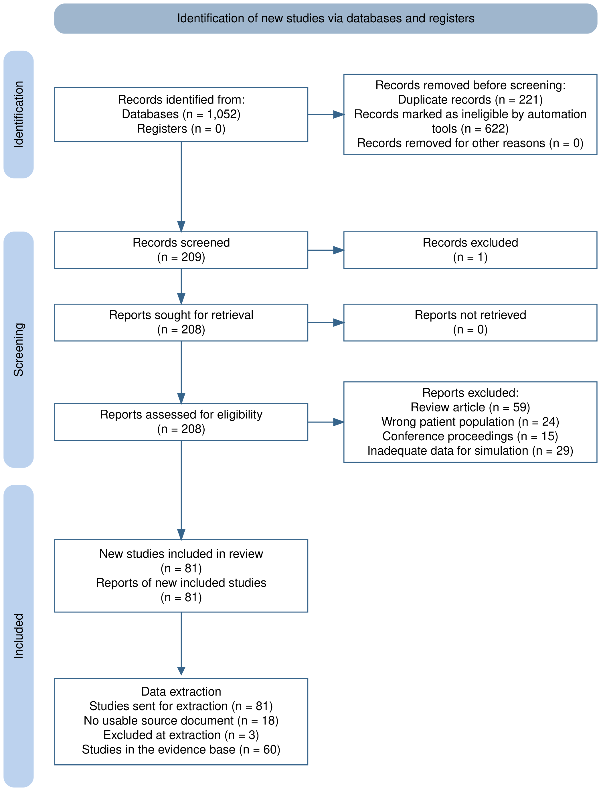
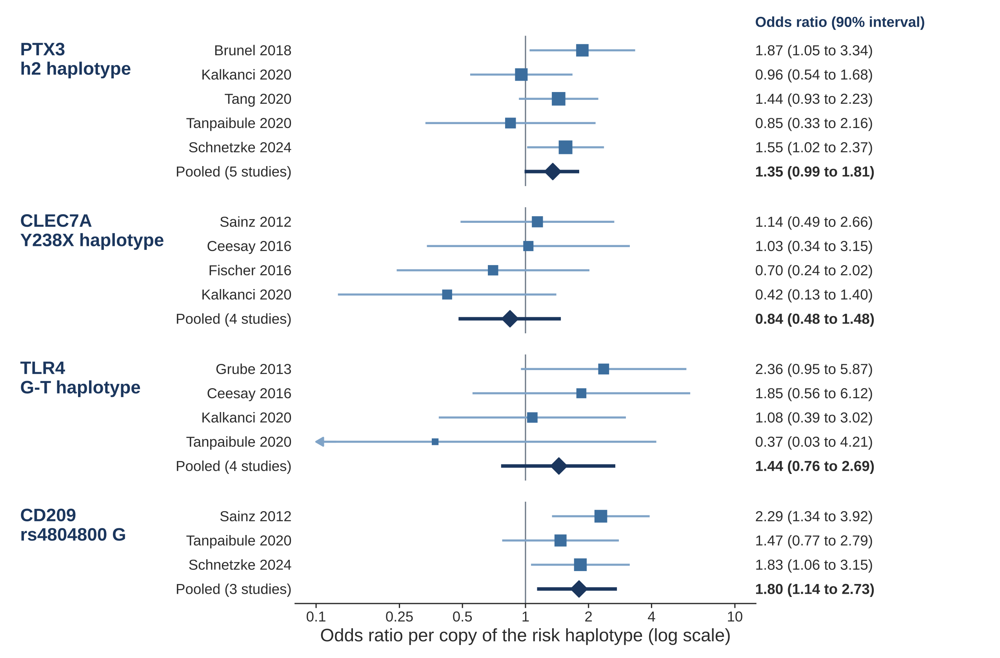
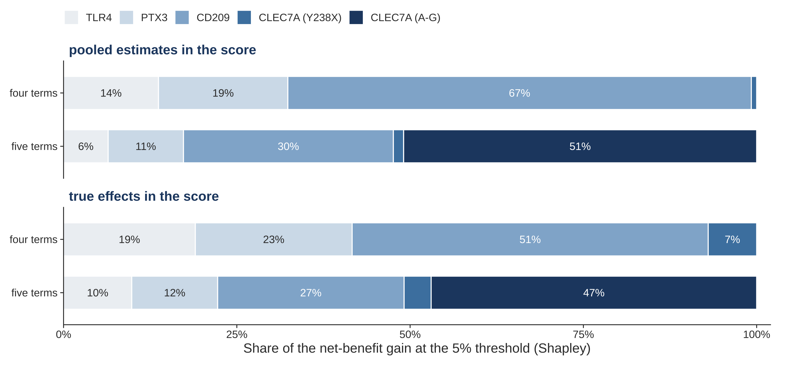
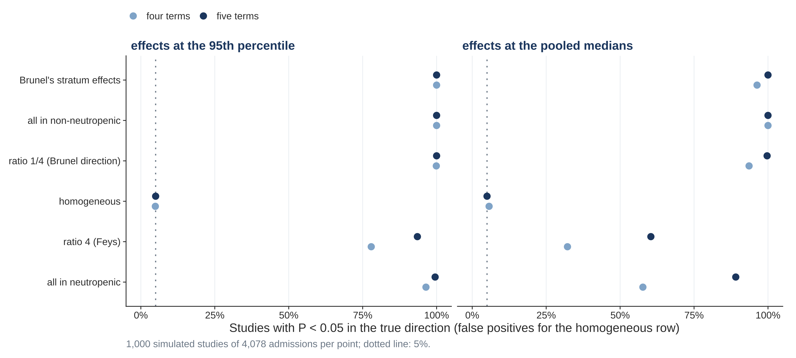
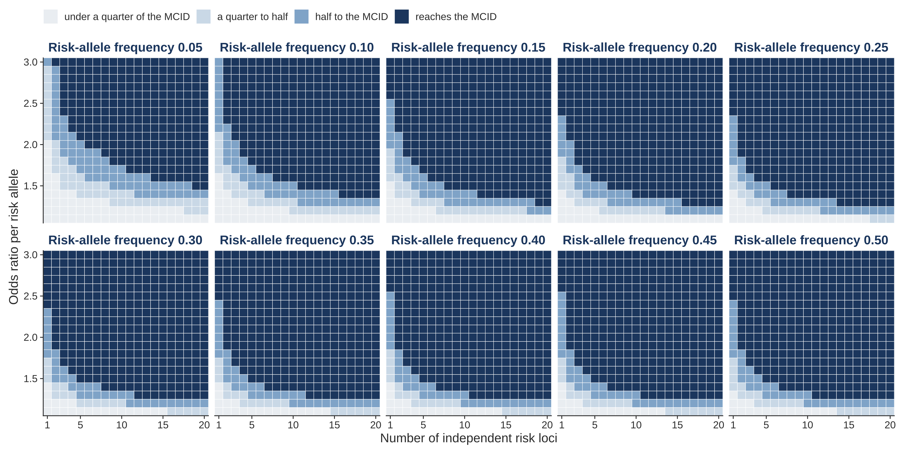
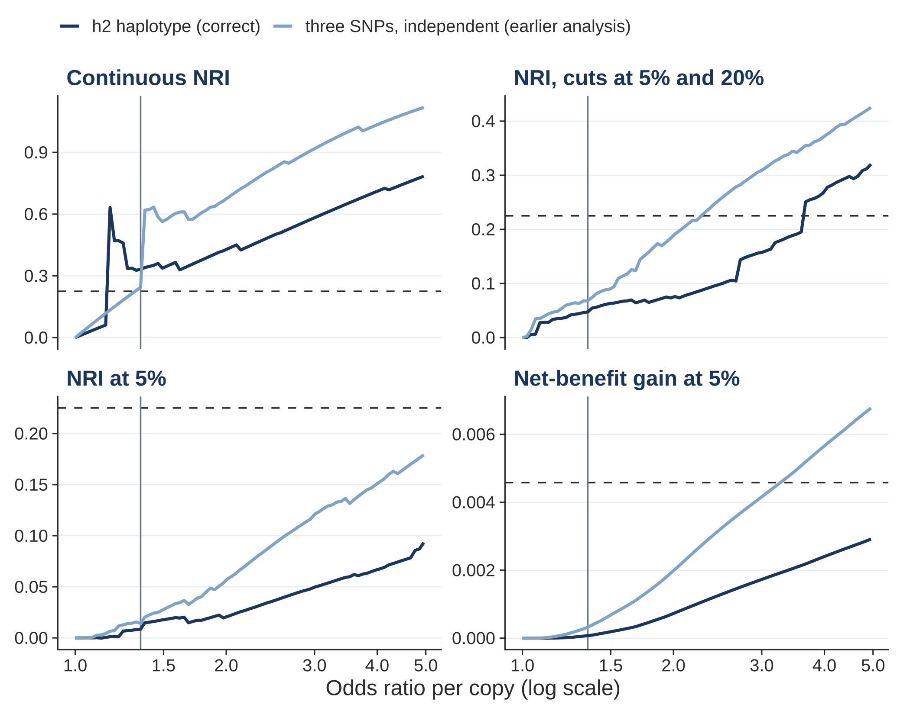

```{r}
#| label: setup
suppressPackageStartupMessages({library(dplyr); library(tidyr); library(gt)})
rd <- function(f) read.csv(file.path("output", f))
```

\[Authors to be added.\]

**Contents**

- Supplementary Methods: design and prespecification (Table S1); clinical cohort and baseline; evidence synthesis (Figure S1); the genetic layer and the global-intercept truth; secondary and sensitivity analyses; software
- Supplementary Results: cohort and baseline; evidence base (Figure S2); construction of the truth (Table S2); second CLEC7A parameter; sampling variability and robustness; attribution (Figure S3); effect modification by neutropenia (Table S3, Figure S4); donor genotype; genetic architectures (Figure S5); net reclassification improvement (Tables S4 and S5, Figure S6)
- Supplementary Discussion: further limitations
- References

Figures 1 to 5 and Tables 1 and 2 are those of the main text. MCID, minimum clinically important difference; NRI, net reclassification improvement; aROC, area under the receiver operating characteristic curve; IMD, invasive mould disease.



## Supplementary Methods

### Design and Prespecification

This is a simulation study that combines individual admission-level clinical data with a meta-analysis of the published genetic evidence. The design is summarised in Table S1 in the ADEMP structure for simulation studies [@morris2019]. Design decisions were recorded before any genetic result existed and locked at a git tag (`prespec-lock`, commit `90e3656`, 17 October 2026). Every later change is a dated addendum to the decision record (`phase3_decisions.md` in the repository). Each addendum states what had been seen when the change was made. Two changes after the lock affected the primary analysis, and in both no genetic result had yet been computed. The baseline cohort moved from a copula reconstruction to the admission-level data (decisions D8 and D9), and the baseline model became a refit on those data (D10). The refit raised the MCID by 13% at the 5% threshold, which made the primary test harder.

A third change was made after the genetic results were known. The lock specified a single global intercept to hold prevalence (D5). A review of the genetic layer showed that this leaves the clinical score miscalibrated within clinical profiles under the simulated truth, so that part of a genetic score's gain could be the correction of that miscalibration. Addendum 24 (D27) made a profile-preserving truth primary and kept the global-intercept truth as a sensitivity analysis. The change lowered the primary net-benefit gains slightly (by 5% to 6% at the 5% threshold) and did not change any conclusion, but it was not blind to the earlier results. The sampling, ensemble, attribution, effect-modification, donor and robustness analyses were then rerun under it (addendum 25), with the same seeds and the same posterior draws.

**Table S1.** Design of the Simulation Study in the ADEMP Structure

| ADEMP element | This study |
|------------------------------------|------------------------------------|
| Aims | Decision value of host genotype added to a clinical IMD score; the architectures that would be needed |
| Data-generating mechanisms | Clinical profiles from the observed cohort; genotypes in Hardy–Weinberg equilibrium at gnomAD non-Finnish European frequencies; true genetic effects drawn from the pooled posteriors under two readings and added with an intercept per clinical profile (profile-preserving; a single global intercept as sensitivity analysis); architecture sweep on a grid |
| Estimand | Gain in decision-curve net benefit over the clinical score, at thresholds of 5% (primary) and 20% (secondary) |
| Methods compared | Clinical score alone, which is calibrated under the primary truth; clinical score plus a genetic score with the true effects (ceiling) or the pooled estimates (realised) |
| Performance measures | Median gain and 90% range over draws; share of draws reaching the MCID; extra true cases per 1,000 admissions; aROC |

### Clinical Cohort and Baseline Model

The clinical data are the admission-level derivation data of the Stanzani score [@stanzani2019], from the BOSCORE registry of the haematology unit in Bologna (admissions 2007–2016). The outcome was proven or probable IMD by EORTC criteria within 60 days of admission. The seven predictors were prior mould disease, high-dose corticosteroids, uncontrolled malignancy, high-risk chemotherapy, prolonged neutropenia, severe lymphopenia and cytomegalovirus infection.

The published analysis file contains 4,127 admissions, which are the rows of the parent registry extract with complete data on all seven predictors. We removed 49 duplicated admission rows (a recording artefact), leaving a base cohort of 4,078 admissions in 1,945 patients, with 133 events (3.26%). Direct identifiers were not read, and no patient-level data are held in the repository.

The baseline model was a maximum-likelihood logistic regression of the outcome on the seven predictors in the base cohort, with standard errors clustered by patient. We quantified uncertainty with a patient-level bootstrap, resampling patients and refitting the model in each of 2,000 resamples. Optimism was estimated by Harrell's bootstrap method [@harrell1996] and is reported but not subtracted. The refitted model was then held fixed. The joint distribution of clinical risk was taken to be the observed distribution of the 128 possible predictor profiles, of which 75 occurred.

We repeated key analyses under three alternative specifications of the clinical baseline. These were the published equation in place of the refit, the 4,127-row cohort without the duplicate rows removed, and a Gaussian-copula reconstruction of the predictor correlations. The copula was fitted to the published marginal counts and carried as an ensemble of 150 near-optimal correlation matrices. It was the primary specification when the analysis was locked, because only published counts were then available. It was demoted to a sensitivity analysis once the patient-level data became available, because it fitted the observed joint distribution poorly.

### Evidence Synthesis

**Search and screening.** We searched PubMed (267 records; 7 July 2026) and Embase (785 records; 8 October 2026) for studies of host genetic variants and invasive fungal disease. Citation chasing from eight seed papers (6 October 2026) gave 440 further records; these were not screened and are not in the flow diagram. After 221 duplicates were removed, 831 unique records remained. An automated, AI-assisted screen of titles and abstracts against the eligibility criteria, run by one investigator, excluded 622. The remaining 209 records were imported into Covidence; one was excluded on title and abstract, and 208 full texts were assessed independently by two reviewers, with disagreements resolved by the senior reviewer. The two-reviewer process therefore began at the full-text stage. Of the 208 full texts, 127 were excluded (59 review articles, 24 wrong patient population, 15 conference proceedings with insufficient information and 29 with inadequate data for the simulation) and 81 studies were included. Of the 81, 18 could not be matched to a usable source document (twelve had no full text available, and for six the link pointed to the wrong document), leaving 63 studies for extraction. Three of these were excluded when read in full for extraction: a functional genomics study with no clinical outcome, a paediatric acute myeloid leukaemia study that did not analyse genotype against the fungal endpoint, and a study that compared patients with leukaemia against healthy controls without analysing infection by genotype. Sixty studies form the evidence base (Figure S1).

{width=6in}

**Figure S1.** PRISMA 2020 flow diagram of the literature search and study selection (databases only), with the extraction stage added below. The 622 records excluded by the automated screen were not reviewed by a human and were not recorded with reasons. Records from citation chasing (n = 440) did not enter screening.

**Extraction and verification.** Data were extracted from each source document by a purpose-built script that sent the full text to a large language model (Claude Opus 4.8, Anthropic; 15 July 2026). For each variant it recorded the alleles, genetic model, comparison as printed, subgroup, genotype counts, effect estimate, confidence limits, P value and the page or table. The extraction yielded 2,008 variant rows. Of these, 970 were usable: 823 effect estimates with both confidence limits and an orientable effect allele, 115 complete 2×3 genotype tables and 32 complete 2×2 tables. A second investigator then checked the extracted rows against the source documents, working through a prioritised list of rows (round 2). Conference abstracts were eligible when they reported genotype-level results not published elsewhere. Four abstracts were included; a fifth was excluded at extraction (it compared patients with leukaemia against healthy controls), and an abstract that repeated the results of a full report was treated as a duplicate. Every row whose comparison text had no reference marker was checked against the source tables. That covered seven studies. The two reversals found [@herrerosanchez2018; @fischer2016] and one duplicated row read in the opposite direction [@sainz2012] were corrected and logged with their evidence (43 corrected rows in all).

The rows from the 24 studies that inform the genetic panel were then checked by a blinded second extraction (Claude Opus 5.5, Anthropic; 25 November 2026). The second extraction re-read each source document with only the list of variants to look for, never the first-round values. For each field on which the two extractions differed, a further call to the same model, blinded to which extraction was which, read the source document, quoted the printed value and said which extraction matched it. Of 416 first-round rows, 239 were matched by the second extraction and 110 agreed on every field. Of 661 field-level differences, the source supported the first-round value in 296, the second-round value in 236, both in 52 and neither in 6; 71 could not be located in the source. No first-round genotype count, effect estimate or confidence limit was contradicted by its source. One investigator reviewed every proposed correction against the quoted source text: 96 field corrections in 48 rows from 11 studies were accepted and logged with their source location, and 20 were held for further review. Most accepted corrections filled fields the first round had left blank or corrected the adjustment flag, the genetic model label or P-value rounding. The accepted corrections left the primary pooled terms unchanged. Every request, the model that served it and its output are archived with the code. The same procedure was then applied to every variant in the remaining studies of the evidence base (27 November 2026). Of 60 studies, 57 were checked; for two the model returned an unreadable response and for one the source document was not available. Of 1,929 first-round rows, 881 were matched by the second extraction and 486 agreed on every field, so this check covers a sample of the rows rather than all of them. Of 2,357 field-level differences, the source supported the first-round value in 1,023, the second-round value in 713, both in 139 and neither in 12; 470 could not be located. Again no first-round genotype count, effect estimate or confidence limit was contradicted by its source: the 12 count differences that favoured the second extraction were rows that record a dominant or recessive comparison as a two-by-two table, with the combined genotypes in one cell, where the paper prints three genotype counts. Of 365 proposed corrections, 139 that filled a blank field with the value printed in the source (alleles, genotype counts, estimates and P values) were accepted and logged; the remainder were rejected or held, mostly because the proposed value was a description rather than a codebook value or would have overwritten a correctly recorded table. None of the accepted corrections changed a pooled estimate. In a sensitivity analysis excluding the four conference abstracts, every pooled estimate was unchanged: none of the abstracts reported whose genotype (recipient or donor) was analysed, so none entered a pooled estimate.

**Panel.** Candidate variants needed at least three meta-analysable studies. Within each gene, pairwise linkage was measured in phased 1000 Genomes phase 3 European haplotypes (503 samples) [@genomes2015]. Haplotype frequencies were rescaled to gnomAD v4 non-Finnish European allele frequencies [@gnomad] by iterative proportional fitting. Linked SNPs were collapsed into one haplotype term per gene. Each term is an additive per-copy effect of a risk haplotype class (Table S6).

**Table S6.** Haplotype Terms of the Genetic Panel

| Term | Risk haplotype class | Frequency | Note |
|--------|------------------------------------|--------|------------------------------------|
| PTX3 | h2: the class carrying A at rs2305619 (tagged equally by rs1840680) | 48.2% | |
| CLEC7A | Y238X: the C allele of rs16910526, which lies only on one rs7309123 background | 7.7% | |
| TLR4 | G-T haplotype of rs4986790 and rs4986791 | 6.1% | Pooled under a carrier model with a continuity correction, because no cohort had minor homozygotes |
| CD209 | Chromosomes carrying G at rs4804800 | 12.5% | |

TLR9 rs352140 was dropped because only one study was usable. IL10 rs1800896 and IFNG rs2069705 were dropped because they had one and two studies respectively, and the two IFNG studies disagreed in direction. One study [@herrerosanchez2018] was excluded from the primary analysis because its main endpoint included colonisation.

**Mapping and pooling.** Each study's contrast (allelic, dominant, recessive or genotype counts) was converted to a log odds ratio per copy of the risk class. The conversion solves a haplotype model: additive on the log-odds scale, haplotype pairs in Hardy–Weinberg equilibrium, case–control sampling. Standard errors come from the delta method. One effect was taken per study. The primary analysis used recipient genotype, the odds-ratio scale and whole-cohort analyses. Hazard-ratio studies were added only as a sensitivity analysis, or as a labelled fallback where fewer than three odds-ratio studies existed. Effects were pooled with a Bayesian random-effects model, μ ~ N(0, 1) and τ ~ half-normal(0.5), evaluated on a grid.

**Second CLEC7A parameter.** The three CLEC7A haplotypes carry a second effect: the A-G haplotype (G at rs7309123 on the non-Y238X background) against A-C. rs7309123 is a C/G palindrome. Its strand was therefore resolved study by study, from control allele frequencies, primer sequences and full texts. The primary estimate uses the three strand-resolved studies of European or Turkish cohorts [@schnetzke2024; @kalkanci2020; @sainz2012]. Two East Asian studies [@chen2019; @tanpaibule2020] were mapped through 1000 Genomes East Asian haplotype frequencies and entered a sensitivity analysis. This parameter was not part of the prespecified four-term panel. The four-term analysis is therefore primary, and the five-term analysis is secondary.

### The Genetic Layer

Each patient receives one genotype, which is shared by all of their admissions. The dosage of each risk class (0, 1 or 2) follows Hardy–Weinberg equilibrium at the gnomAD frequencies. Genotype is independent across terms and of the clinical profile. The true risk of an admission is

$$\operatorname{logit} p = \eta_X + \sum_j \beta_j g_j + a_X,$$

where $$\eta_X$$ is the baseline linear predictor of clinical profile $$X$$ (one of 128) and $$g_j$$ the dosage of term $$j$$. The intercept $$a_X$$ is chosen separately for each profile so that the risk averaged over genotypes equals the clinical score's risk,

$$\sum_g \pi_g \operatorname{expit}\!\left(\eta_X + \beta^\top g + a_X\right) = \operatorname{expit}(\eta_X),$$

where $$\pi_g$$ is the Hardy–Weinberg probability of genotype $$g$$. The conditional effect of genotype is the same in every profile; what is held fixed is that the clinical score is exactly calibrated within every clinical profile. A change in net benefit therefore cannot come from correcting miscalibration of the clinical score, and reflects the information in genotype. We call this the profile-preserving truth. Each genetic score is built in the same way, with an intercept per profile that holds its mean risk at $$\operatorname{expit}(\eta_X)$$ (for a score with estimated weights simulated on a sample of genotypes, the mean over that sample).

**The global-intercept truth.** The first version of the layer (D5) used one intercept $$a$$ for all profiles, which holds the overall prevalence at 3.26% but not the risk within each profile. Because $$\operatorname{E}_g\{\operatorname{expit}(\eta_X + \beta^\top g + a)\} \neq \operatorname{expit}(\eta_X)$$ (Jensen's inequality), the clinical score is then miscalibrated within profiles under the simulated truth, and some of a genetic score's gain could be the correction of that miscalibration. We keep this global-intercept truth as a sensitivity analysis and compare three things (addendum 24). The *current* comparison uses the global-intercept truth, with the clinical score $$\operatorname{expit}(\eta_X)$$ as the comparator (the construction of the first version). The *marginal* comparison uses the same truth, with the best clinical-only rule under it as the comparator, the marginal risk $$m(X) = \sum_g \pi_g \operatorname{expit}(\eta_X + \beta^\top g + a)$$. The *profile* comparison uses the profile-preserving truth, with $$\operatorname{expit}(\eta_X)$$ as the comparator, which is then exactly calibrated.

The question is whether adding genotype to a clinical score that is already calibrated would change decisions for patients stratified by that score. The profile comparison estimates this. The current comparison handicaps the clinical score by construction. The marginal comparison removes that handicap while keeping the truth, so the difference between current and marginal measures the part of the gain that is a correction of induced miscalibration, and the difference between marginal and profile measures the effect of the truth itself being a different simulated population.

**Readings and scores.** True effects $$\beta_j$$ were drawn 2,000 times from each term's pooled posterior under two readings: the pooled mean μ (mean reading), and a new-study effect drawn from N(μ, τ), which carries between-study heterogeneity (predictive reading). Three scores were compared under the same truth: the clinical score alone; the ceiling score, which uses the true effects (the best any genetic score could do); and the realised score, which uses the pooled posterior medians, recentred.

**Net benefit.** Net benefit at threshold $$p_t$$ is

$$\text{NB}(p_t) = \frac{\text{TP}}{n} - \frac{\text{FP}}{n}\cdot\frac{p_t}{1-p_t}.$$

The gain is the net benefit of a genetic score minus that of the clinical score. It was computed exactly over the 128 clinical profiles and all genotype combinations (81 for four terms), with no patient-level sampling. Under the global-intercept truth, a patient-level simulation on a 100-fold replicated cohort reproduced the exact gain (0.00041 against 0.00040 at 5%). Under the profile-preserving truth the clinical score's true positives are exactly those of the refit baseline, so the MCID is unchanged (+0.00458 at 5%, +0.00160 at 20%).

### Secondary and Sensitivity Analyses

All of these were run under the profile-preserving truth. The global-intercept versions are kept as sensitivity analyses (addendum 25).

**Sampling variability.** We simulated 2,000 studies of the cohort's size per scenario. Each study resampled patients with their admissions, assigned genotypes, drew outcomes from the true risk, and recorded the observed gain of fixed scores.

**Robustness.** The layer was repeated in four further settings, each with its own MCID: the 150 correlation-ensemble members, the published equation on the 4,078 admissions, the published equation on the 4,127 rows, and a refit on the 4,127 rows.

**Attribution.** The gain was divided among the terms by Shapley decomposition. The value of a subset is the gain of a score carrying only those terms, under the full truth. Shapley values sum to the total gain, but net benefit is not additive in the terms, so the split is a fair division of the gain and not a set of separable effects.

**Effect modification by neutropenia.** This tests the hypothesis that per-copy effects are larger in neutropenic admissions (H_F, from the inflammatory-levelling argument of Feys and colleagues [@feys2026]). The direction we expected was recorded before the run. Admissions were split by the prolonged-neutropenia predictor. Stratum-specific effects were constrained to average, weighted by events, to the pooled effect, and the ratio of the neutropenic to the non-neutropenic effect was set to ∞, 4, 1, 1/4 and 0. A further scenario applied the stratum effects of the only stratified study [@brunel2018] directly. We compared an oracle score, a common score with the pooled estimates, and two scores that assume a direction. To test for an interaction, we simulated 1,000 studies per scenario and fitted a logistic model with the baseline logit as an offset, which estimated the interaction between the genetic score and neutropenia.

**Donor genotype.** In the allogeneic transplant stratum (272 admissions, 43 events, from an admission-level flag), donor effects from the donor-genotype studies were tested against the stratum's own MCID. The baseline score has no allogeneic item and under-predicts in the stratum, so the truth holds, within each profile, the risk that includes the stratum's recalibration offset, and the scores hold the baseline's risk.

**Architecture sweep.** The sweep covered k independent loci with the same risk-allele frequency and the same per-allele odds ratio. The number of loci k ran from 1 to 20, the odds ratio from 1.1 to 3.0 by 0.1, and the frequency from 0.05 to 0.50 by 0.05. This gives 4,000 architectures, computed exactly by convolution with the ceiling score. In a realised version, each locus weight carried independent error with standard deviation σ from 0.05 to 0.40, with 12 replicate discovery studies per architecture.

**Pathogen specificity.** The sweep treats every case as genotype-sensitive. In a further scenario only a fraction f of cases (the target pathogen, for example *Aspergillus* among all invasive mould disease) arises through the pathway the loci act on and the rest are independent of genotype. The true risk is (1 − f) times the clinical risk plus f times the risk with the genetic effect, with an intercept per clinical profile on the genetic part, so that the clinical score stays calibrated in every profile. We assumed f = 1, 0.8, 0.6 and 0.4, because the cohort has no pathogen-level outcome. Two ceiling scores were compared: weights equal to the target-pathogen effect (what a pathogen-specific discovery study would estimate) and weights fitted to the all-mould outcome (what a study of any mould disease would estimate). For f = 0.8 and 0.6 the weights also carried independent error with σ = 0.10, 0.20 and 0.40, with 12 replicate discovery studies per architecture. The grid had odds ratios from 1.2 to 3.0 (10 values), frequencies of 0.1, 0.3 and 0.5, and 1 to 20 loci.

**Stress tests of the realised score.** At f = 1 and 0.8, with σ = 0.10 and 0.20 and odds ratios of 2.0, 2.5 and 3.0, we added three departures from the idealised score, each alone and all together: loci with different frequencies and so different precision; the winner's curse, with the k loci picked by their z-scores from five times as many candidates, the rest null; and incomplete tagging, with the scored variant correlated 0.7 with the causal one (a separate sweep used 0.5, 0.7, 0.9 and 1.0). The causal loci themselves were also linked in a further sweep: blocks of four adjacent loci with allele correlations of 0.3 and 0.6, with the weights estimated for each locus on its own, as in a single-SNP discovery study, or jointly for the block. All these departures were then applied to the main grid at f = 1 (600 architectures, σ = 0.10 and 0.40).

**Net reclassification improvement (tertiary).** This analysis places the earlier 22.5% figure in context. NRI was computed exactly in three forms: categorical at 5%; three categories, with cuts at 5% and 20%; and continuous, in which any change in predicted risk counts as a reclassification. Five scores were compared with the clinical score. These were the four-term panel with true effects and with pooled estimates; the PTX3 h2 term alone; a score that adds the PTX3 effect once for each of the three SNPs, applied to real, linked chromosomes; and the earlier analysis's structure, in which the three SNPs are simulated independently and the effect enters both the truth and the score. The earlier per-SNP effects are not on record, so every PTX3 structure used the pooled per-copy effect, over the same 2,000 posterior draws as the main analysis. We also traced NRI against the per-copy effect from a log odds ratio of 0 to 1.6.

### Software

Analyses used R 4.6.1, with package versions pinned by renv. The code, the test suite and every summary output are public at https://github.com/lewis-id-lab/PROSE, and every result can be regenerated from the numbered scripts.



## Supplementary Results

### Cohort and Clinical Baseline

The base cohort has 4,078 admissions in 1,945 patients (2.10 admissions per patient) and 133 events (3.26%). The refit baseline's odds ratios ranged from 2.15 for uncontrolled malignancy to 7.28 for prior mould disease. Every published coefficient lies inside the refit's 90% bootstrap interval. The aROC was 0.858 apparent and 0.853 after optimism correction, and the calibration slope was 0.97. On the same admissions, the published equation under-predicted slightly (3.06% against 3.26%).

At the 5% threshold the refit baseline flags 15.7% of admissions, with 22.9 true and 133.8 false positives per 1,000. Its net benefit is 0.0158. The MCID is therefore +0.00458 (patient bootstrap 90% interval 0.00387 to 0.00566), or 4.6 extra true cases per 1,000 admissions at no extra false positives. At 20% the MCID is +0.00160. Under the published equation the MCIDs would be +0.00404 and +0.00113.

### Evidence Base

Table 1 of the main text shows the pooled effects, and Figure S2 the study effects behind them. Each term rests on three to five studies. CD209 is the only term in the four-term panel whose interval excludes an odds ratio of 1. PTX3 is borderline, with a 5.5% posterior probability that its effect is below zero. CLEC7A Y238X is centred below 1. The second CLEC7A parameter, A-G against A-C, is estimated at an odds ratio of 1.86 per copy. Its interval excludes 1 under every strand assumption (1.5 to 1.9).

{width=6.5in}

**Figure S2.** Study effects and pooled effects for the four terms of the panel, per copy of each term's risk haplotype class (primary analysis: recipient genotype, odds-ratio scale, whole cohort). Squares, study estimates, sized by precision; lines, 90% intervals (estimate ± 1.645 standard errors on the log scale). Diamonds, pooled effects from the Bayesian random-effects model, with 90% credible intervals. The arrow marks an interval that extends beyond the axis.

The two East Asian studies point the other way (difference from the European estimate −1.19 on the log scale, SE 0.31, P = .0001). Adding them gives 1.28 (0.79 to 1.95). The linkage of rs7309123 with rs3901533 in phased 1000 Genomes data explains this pattern: it is the reversal expected when a tag SNP sits on different haplotype backgrounds in the two ancestries.

### Does the Construction of the Truth Favour the Genetic Score?

The clinical score is exactly calibrated within every profile under the profile-preserving truth, by construction. Under the global-intercept truth it was not: for the four-term panel (pooled-mean reading) the median calibration slope of the clinical score was 0.98, and its largest error within a profile was 0.023 in risk (0.029 under the predictive reading). The best clinical-only rule under that truth, the marginal risk, did better than the clinical score in 0.05% to 34% of draws, depending on panel, reading and threshold. The margin was at most +0.00027 in net benefit in any draw, and the 95th percentile of its share of the ceiling gain was at most 0.1%. The median gain was therefore the same with the marginal risk as the comparator as with the clinical score (Table S2). Correcting induced miscalibration did not produce the reported gains.

Moving from the global-intercept to the profile-preserving truth did change the results, because it is a different simulated population. For the panels the gain at 5% was 4.6% lower for four terms (+0.00056 against +0.00059) and 5.9% lower for five terms, and at 20% it was within 2% of the original. The architecture sweep was more sensitive (Table S2): at 5%, 39.7% of 4,000 architectures reached the MCID, against 45.7%. 241 verdicts changed, all of them losses. At 20% the share was 77.2% against 77.0%, with six verdicts changed, all gains. The panels' conclusions did not change.

**Table S2.** The Same Analyses Under Three Comparisons

```{r}
#| label: table-calibration
rd("calibration_check_headline.csv") |>
  filter(analysis != "PRS benchmark, ceiling") |>
  mutate(analysis = factor(analysis, unique(analysis))) |>
  gt(groupname_col = "analysis", rowname_col = "metric") |>
  fmt_number(c(current, marginal, profile), decimals = 3, drop_trailing_zeros = TRUE) |>
  sub_missing(missing_text = "none") |>
  cols_label(current = "Current", marginal = "Marginal", profile = "Profile (primary)")
```

Current, global-intercept truth with the clinical score as the comparator. Marginal, the same truth with the best clinical-only rule (the marginal risk) as the comparator. Profile, profile-preserving truth with the (calibrated) clinical score as the comparator; primary. Gains are net-benefit gains over the comparator multiplied by 1,000; panels use the ceiling score and the pooled-mean reading (medians over 2,000 draws); the frontier is for risk-allele frequency 0.3 at the 5% threshold.

### The Second CLEC7A Parameter

Adding the A-G haplotype made CLEC7A an active term and roughly doubled the gain: +0.00115 (0.00046 to 0.00220) at 5% with the ceiling score, and +0.00094 with the realised score. The 5% MCID stayed out of reach, reached in no draw under the pooled-mean reading and 1.5% under the predictive reading. At 20% the ceiling score reached the MCID in 64% of draws (73% under the predictive reading) and the realised score in 47%. With the all-ancestry estimate of the second parameter the gain at 5% was +0.00073, and 30% of draws reached the 20% MCID. At the secondary 20% threshold the four-term realised score reached the MCID in 4% of draws (12% under the predictive reading).

### Sampling Variability and Robustness

The next four sections (sampling and robustness, attribution, effect modification, donor genotype) use the profile-preserving truth. Rerunning them under the global-intercept truth gave the same conclusions. Most gains and shares differed by a few per cent. The largest difference was in the scenario that puts the whole effect in non-neutropenic admissions, where the oracle score's gain and its chance of reaching the MCID were lower under the profile-preserving truth (addendum 25).

A study of the cohort's size would observe the gain with a standard deviation as large as the expected gain or larger: 0.00064 to 0.00116 at 5%. With the effects fixed at the pooled medians, the observed gain at 5% averaged +0.00038 (SD 0.00064). It was above zero in 71% of studies and never reached the MCID. With the effects drawn from the posteriors, the observed gain was positive in 67% to 82% of studies and reached the MCID in at most 1.1%. Even with every effect at the 95th percentile of its posterior, the ceiling score's observed gain reached the 5% MCID in 0.5% of studies (78% at 20%).

The clinical correlation structure moved the median gain by at most 0.00016 (between-member SD 0.00007 to 0.00028). The published-equation and 4,127-row cohorts gave gains at 5% of +0.00060 to +0.00062 (ceiling, pooled mean). In those settings at most 1.3% of draws reached that setting's MCID. The settings differed mainly at 20%, where the published equation sets a lower bar (+0.00113).

### Which Terms Carry the Gain

In the four-term panel, CD209 supplied 51.4% of the Shapley gain at 5% (ceiling, pooled mean). PTX3 supplied 22.6%, TLR4 19.0% and CLEC7A 7.0% (Figure S3). CD209 has the largest pooled effect but rests on three studies. With the second CLEC7A parameter the ranking changed. CLEC7A supplied 50.9%, almost all of it through the common A-G haplotype (47.0%), and CD209 fell to 26.9%, PTX3 to 12.4% and TLR4 to 9.8%. CLEC7A's share stayed between 44.8% and 53.3% in every combination of cohort, correlation structure, reading, score and threshold. It was the largest single contributor in 54% to 70% of draws.

{width=6.5in}

**Figure S3.** Shapley shares of the net-benefit gain at the 5% threshold under the profile-preserving truth, for the four- and five-term panels, with pooled estimates or true effects in the score (pooled-mean reading).

### Effect Modification by Neutropenia

Neutropenic admissions were 28% of the cohort (1,157), with an event rate of 9.2% and 106 of the 133 events (80%). With homogeneous effects, the gain per admission was 11 times larger in neutropenic admissions (+0.00160 against +0.00015 at 5%). That stratum supplied 80% of the whole-cohort gain at 5% and 95% at 20%. With five terms it supplied 82% and 95%, and 77% to 83% at 5% across every sensitivity setting.

The only stratified evidence [@brunel2018] points against H_F. Mapped to the per-copy PTX3 h2 scale, its effect was +1.17 in non-neutropenic and −0.13 in neutropenic courses for rs2305619 (difference −1.30, SE 0.72, P = .07). For rs3816527 the difference was −1.99 (SE 1.01, P = .049). These estimates come from 212 courses and 26 events, with neutropenia defined at presentation.

Across scenarios (Figure 3 of the main text), the 5% MCID came nearest only when the whole effect was placed in non-neutropenic admissions. There the oracle score gained +0.00314, reaching the MCID in 2% of draws. With five terms it gained +0.00383 and reached the MCID in 6% of draws. The common score with pooled estimates lost little under an H_F truth (+0.00041 against an oracle +0.00075 at 5%). It was harmful if Brunel's stratum effects held (−0.00016 with four terms, −0.00086 with five). A score built on H_F was the most harmful when the truth ran the other way.

In simulated studies of the cohort's size, the interaction test detected the effect modification more often than we had predicted. With five terms and pooled-median effects, it reached P < .05 in the true direction as shown in Table S3. The false-positive rate was 5.0%. The corresponding four-term figures were 58%, 32% and 94% to 96%. Of the five predictions recorded before the run, two held, one mostly held, one was not borne out, and one was wrong: we had predicted that the test would be underpowered.

**Table S3.** Power of the Interaction Test in Studies of the Cohort's Size (Five Terms, Pooled-Median Effects)

| Scenario                                    | Power   |
|---------------------------------------------|---------|
| All of the effect in neutropenic admissions | 89%     |
| Ratio of 4                                  | 60%     |
| Brunel-sized modifications                  | ≥ 99.7% |

{width=6.5in}

**Figure S4.** Power of the interaction test between the genetic score and neutropenia, by scenario, in 1,000 simulated studies of 4,078 admissions per point, for the four- and five-term panels with effects at the pooled medians or at the 95th percentile of their posteriors. The horizontal axis gives the share of studies with P < .05 in the true direction (false positives for the homogeneous row); dotted line, 5%.

### Donor Genotype in Allogeneic Transplant Recipients

The allogeneic stratum held 272 admissions and 43 events (32% of events). The baseline already flagged 77% of these admissions at 5%. The net-benefit gain from donor genotype was equivalent to 0.1 to 0.9 extra true cases per 1,000 transplant admissions at 5%, against about 30 needed for the stratum's MCID, and 3.0 to 10.1 at 20%, against about 12 needed. In raw counts, donor genotype changed the number of true cases by 0.0 to +0.5 per 1,000 at 5% (a net loss in one reading) and added 15 to 25 at 20%, with extra false positives. Whole-cohort, the gain at 5% was at most +0.0001. The donor evidence is two studies for PTX3 (one of them a Leiden letter added after the first extraction), one for CLEC7A, two for TLR4 and none for CD209. The pooled donor PTX3 effect is 0.89 per h2 copy (90% interval 0.59 to 1.69). A smoothed version of the stratum's profile distribution gave the same conclusions.

### Genetic Architectures That Would Reach the MCID

Under the profile-preserving truth, of the 4,000 architectures 40% reached the 5% MCID (Figure 4 of the main text) and 77% reached the 20% MCID (Figure S5). The pattern was:

- **One locus:** never enough. At an odds ratio of 3.0 and frequency 0.5 it reached 37% of the MCID.
- **Odds ratio 1.5 or less:** no number of independent loci up to 20 reached it at 5% (linked causal loci can; see below).
- **Odds ratio 2.0:** 9 to 12 loci were needed at frequencies of 0.2 to 0.5, and 19 at 0.1.
- **Odds ratio 3.0:** 4 to 5 loci were enough at frequencies of 0.15 to 0.5.

The gain peaks at a frequency of about 0.45 and is slightly lower at 0.5, so the frontier is not strictly monotone in frequency near 0.5 (under the global-intercept truth, for example, an odds ratio of 2.9 needs 3 loci at frequencies of 0.4 and 0.45 and 4 at 0.5).

The global-intercept truth needed 7 to 9 loci at odds ratio 2.0 and 3 to 4 at odds ratio 3.0, so the 5% frontier moved out by two to three loci at an odds ratio of 2.0, and by two at 1.8 (frequency 0.3; Table S2). Under that truth one architecture with an odds ratio of 1.5 (20 loci at frequency 0.45) reached the 5% MCID, by +0.000007. The profile-preserving truth removes it.

The four-term panel corresponds to about 7 loci of odds ratio 1.3 at frequency 0.3, and would need to be roughly eight times stronger to reach the 5% MCID. Architectures near the frontier depended on the unpublished correlation structure (gain over MCID varied by about 15% across ensemble members, computed under the global-intercept truth). Those well inside or outside it did not.

With estimated weights, a score kept a median of 96% of the ceiling gain at a per-locus precision of σ = 0.10. It kept 89% at σ = 0.20 and 58% at σ = 0.40, which is the range of precision of the present pooled estimates (0.18 to 0.38). At those precisions, between 12% and 36% of the architectures that reached the MCID with exact weights no longer did. The loci needed for a given odds ratio rose by one to several. At σ = 0.40 and an odds ratio of 1.8 (frequency 0.3), no number of loci up to 20 reached the 5% MCID under the profile-preserving truth, against 20 under the global-intercept truth.

{width=6.5in}

**Figure S5.** Gain of the ceiling score relative to the MCID at the 20% threshold under the profile-preserving truth, by number of independent risk loci, per-allele odds ratio and risk-allele frequency, in four bands; the darkest band reaches the MCID (+0.00160).

**Pathogen specificity.** Treating every case as genotype-sensitive is optimistic if only some of the moulds respond to the genes tested. Under the profile-preserving truth and with exact weights, the share of the 600 architectures of the grid that reached the 5% MCID fell from 24% when every case responds (f = 1) to 9% to 10% at f = 0.8, and none reached it at f = 0.6 or 0.4. At 20% the shares were 69%, 57% to 58%, 35% to 41% and 4% to 15%. At frequency 0.3, the loci needed for an odds ratio of 2.0 rose from 10 at f = 1 to 19 or 20 at f = 0.8 (Figure 5 of the main text), and for an odds ratio of 3.0 from 4 to 7 or 8. For 10 loci of odds ratio 2.0, the gain went from 1.07 times the MCID at f = 1 to 0.65 (0.68 with all-mould weights) at f = 0.8 and 0.22 (0.37) at f = 0.6. With the target-pathogen weights the gain became negative at f = 0.4 (2.0 fewer true cases per 1,000 admissions), against +0.9 with all-mould weights. Weights fitted to the all-mould outcome gave the higher gain in 95% of the architectures with f < 1. With error in the weights at f = 0.8, a precision of σ = 0.10 to 0.20 kept 0.87 to 0.97 of the exact gain. At σ = 0.40 the all-mould weights kept 0.53 and the target-pathogen weights 0.72, because the all-mould weights are smaller for the same error. At frequency 0.3, an odds ratio of 2.5 needed 10 to 11 loci at σ = 0.10 to 0.20 (11 with exact weights), and at σ = 0.40 no number up to 20 with all-mould weights (18 with target-pathogen weights). An odds ratio of 2.0 did not reach the MCID within 20 loci at any σ, and at f = 0.6 nothing did, even with exact weights. The global-intercept truth was more favourable (29% of architectures at f = 1, 16% to 17% at f = 0.8 and 2% to 5% at f = 0.6; addendum 38).

**Stress tests.** The stress tests changed little except for tagging. On the grid of odds ratios of 2.0 to 3.0, exact weights reached the 5% MCID in 63% of architectures at f = 1 and in 31% to 34% at f = 0.8. Unequal frequencies and locus-specific precision changed this by no more than 3 points. The winner's curse changed it by 1 to 2 points at σ = 0.10, because loci with odds ratios of 2 or more stand out from null ones (99% to 100% of the selected loci were true), and by up to 10 points for the all-mould weights at σ = 0.20 and f = 0.8 (15% against 25%; 79% to 92% of the selected loci true). A tag correlated 0.7 with the causal variant kept 42% to 49% of the gain and cut the share reaching the MCID to 3% to 12% at f = 1 and to none at f = 0.8. At frequency 0.3 and σ = 0.10, an odds ratio of 2.5 needed 20 loci with tags against 6 with the causal variants. With all three departures, 0% to 9% of architectures reached the MCID. Over correlations of 0.5, 0.7, 0.9 and 1.0, the share of the gain that the tag kept followed the square of the correlation (0.23, 0.49 and 0.82 at f = 1), so a tag at 0.9 already lost about a fifth of the gain and needed one to five more loci, and at 0.5 no architecture reached the 5% MCID.

**Linkage among causal loci.** Linkage among the causal loci did not make the requirements harder. With the effect of each locus unchanged, correlated risk alleles raise the variance of the true genetic score, so with the causal weights known the share of architectures reaching the 5% MCID rose from 63% (independent loci) to 83% and 87% (allele correlations of 0.3 and 0.6) at f = 1, and from 31% to 64% and 76% at f = 0.8; the loci needed for an odds ratio of 2.0 at frequency 0.3 fell from 10 to 5 and 4 at f = 1. A joint estimate of the weights kept 0.93 to 0.99 of that gain. Estimating each locus on its own, as a single-SNP discovery study would, double counted the linked neighbours, kept 0.76 to 0.86 of the gain with the target-pathogen weights, and needed three to five more loci for an odds ratio of 2.0 (at f = 0.8, 15 and 13 loci against 11 and 8). This result holds for distinct causal variants that happen to be correlated; one causal signal seen through several correlated variants is the incomplete tagging above.

**The main frontier with these departures.** The same departures were applied to the main grid (every case genotype-sensitive; 600 architectures of odds ratios 1.2 to 3.0, three frequencies and 1 to 20 loci; σ = 0.10 and 0.40). With the idealised assumptions the realised score reached the 5% MCID in 23% and 16% of architectures, as in the main realised sweep (23% and 15%). Unequal frequencies changed nothing. The winner's curse mattered only at σ = 0.40 (9% against 16%; the realised gain kept 0.16 of the exact gain against 0.70). A tag correlated 0.9 with the causal variant cut the share to 17% and 10% and kept 0.79 and 0.48 of the gain (Figure 5 of the main text), and a tag correlated 0.7 cut it to 2% and 0; with the three departures together the gain at σ = 0.40 was negative. At frequency 0.3 and σ = 0.10, an odds ratio of 2.5 needed 6 loci with the causal variants and with a tag at 0.9 and 19 with a tag at 0.7; an odds ratio of 2.0 needed 11 loci, then 14, then none within 20. At 20% the ordering was the same with smaller losses (67% and 47% for the idealised score, 61% and 39% with a tag at 0.9, 45% and 18% with a tag at 0.7). Linkage among the causal loci raised the share (blocks of four with allele correlations of 0.3 and 0.6: 41% and 52% with joint estimates and 35% and 38% with marginal estimates at σ = 0.10) and let odds ratios of 1.4 and 1.5 reach the MCID in some architectures (joint estimates at a correlation of 0.6: 11 and 24 of 60 architectures at σ = 0.10), so the statement that no panel of loci with odds ratios of 1.5 or less reaches the MCID holds for independent loci only. That result holds every locus's conditional effect fixed within a correlated block, which is a generous assumption.

### Net Reclassification Improvement (Tertiary)

All NRI results use the profile-preserving truth, with the clinical score as the comparator. Continuous NRI was large even where net benefit barely moved (Table S4). For the four-term panel with true effects, the continuous NRI was 34% (90% range 19% to 53%), yet the net-benefit gain at 5% was +0.0006, about an eighth of the MCID. The categorical NRI at the 5% decision threshold was 2.4%.

**Table S4.** Net Reclassification Improvement, Net-Benefit Gain and aROC Change Against the Clinical Score

```{r}
#| label: table-nri
labs_nri <- c(
  "four-term panel, ceiling"     = "Four-term haplotype panel, true effects",
  "four-term panel, realised"    = "Four-term haplotype panel, pooled estimates",
  "PTX3 h2 haplotype"            = "PTX3 h2 haplotype (correct structure)",
  "PTX3 three SNPs, real LD"     = "PTX3 three-SNP score on real (linked) chromosomes",
  "PTX3 three SNPs, independent" = "PTX3 three SNPs simulated independently (earlier analysis)"
)
pct <- function(m, lo, hi) sprintf("%.1f (%.1f to %.1f)", 100 * m, 100 * lo, 100 * hi)
rd("calibration_check_nri.csv") |>
  filter(comparison == "profile", metric %in% c("nri_cat5", "nri_cat3", "nri_cont", "dnb_05", "dauc")) |>
  mutate(value = case_when(
    metric == "dnb_05" ~ sprintf("%.5f (%.5f to %.5f)", median, lo, hi),
    metric == "dauc" ~ sprintf("%.3f (%.3f to %.3f)", median, lo, hi),
    TRUE ~ pct(median, lo, hi)),
    scenario = unname(labs_nri[scenario])) |>
  select(scenario, metric, value) |>
  pivot_wider(names_from = metric, values_from = value) |>
  gt() |>
  cols_label(scenario = "Score", nri_cat5 = "NRI at 5% (%)", nri_cat3 = "NRI, cuts at 5% and 20% (%)",
             nri_cont = "Continuous NRI (%)", dnb_05 = "Net-benefit gain at 5%", dauc = "aROC change")
```

Median and 90% range over 2,000 draws of the true effects (pooled-mean reading), under the profile-preserving truth. Every PTX3 structure carries the pooled per-copy h2 effect.

**The earlier analysis's structure.** Simulating the three PTX3 SNPs independently, at the pooled per-copy effect, gave a continuous NRI of 25% (4% to 63%). That is consistent with the 22.5% the earlier analysis reported, but does not reproduce it (see Supplementary Discussion).

**Linkage at the same per-copy effect.** The correct h2 structure gave less than a quarter of the independent model's net-benefit gain (+0.00008 against +0.00033). That is because the independent model triples the true genetic variance. Continuous NRI did not follow this: it was higher for the h2 haplotype (34%) than for the independent structure (25%), for the reason given below; under the global-intercept truth the h2 value was 13%. Figure S6 traces both structures across per-copy effects, and Table S5 gives the crossing points.

**Table S5.** Per-Copy PTX3 Effect at Which Each Target Is Reached

| Target | Three SNPs, independent | PTX3 h2 haplotype |
|----|----|----|
| Continuous NRI of 22.5% | OR 1.32 per copy | OR 1.17 per copy |
| Three-category NRI of 22.5% | OR 2.32 | OR 3.67 |
| The 5% MCID | OR 3.32 | Not reached by OR 4.95, the end of the grid |

OR, odds ratio.

{width=6in}

**Figure S6.** NRI and net-benefit gain at 5% against the per-copy PTX3 effect, for the correct h2 haplotype structure and the earlier analysis's structure (three SNPs simulated independently), under the profile-preserving truth. Dashed lines, an NRI of 22.5% (the earlier analysis's figure) and the 5% MCID. Grey line, the pooled per-copy odds ratio (1.35).

**Applying the three-SNP score to real chromosomes.** Here the haplotype is counted up to three times. The score lowered net benefit (−0.0004 at 5%) and the aROC (−0.005), and its categorical NRI at 5% was negative (−1.4%). Its continuous NRI was positive (29%), so the continuous measure did not register the miscalibration.

**Instability of continuous NRI.** Even for the correctly specified h2 term, its components were unstable. The event component was −18% and the non-event component +53%. Heterozygotes' predicted risk shifts by a very small amount after recentring, and the continuous NRI counts any shift as a reclassification. Across draws the event component ranged from −36% to +51%. The value depends on the construction of the truth in a way that net benefit does not: for the h2 term the continuous NRI was 13% under the global-intercept truth and 34% under the profile-preserving one, while its net-benefit gain was +0.00008 under both. Mean h2 dosage is 0.96, so a heterozygote sits almost exactly at its profile's mean risk, and which way its predicted risk moves is decided by a small curvature effect. Between the global-intercept comparison and the marginal one, only 0.9% of the cohort changed direction (23.2% moved up, against 24.1%), yet the continuous NRI went from 0.13 to 0.33, so those cells must carry a large share of the events. We did not examine which profiles they belong to.



## Supplementary Discussion

### Comparison With the Earlier Reclassification Result

The earlier analysis simulated rs2305619, rs3816527 and rs1840680 as independent multiplicative risks, although in European haplotypes they tag one haplotype class (r² 0.79 to 0.996, D′ = 1). Its homozygote odds ratio of 15.2 for rs1840680 came from that triple counting. It also used the global dbSNP frequency of rs2305619 (0.36) rather than the non-Finnish European one (0.48), which shrinks the homozygote class from 21% to 13% of the cohort. At the same per-copy effect, the independent structure quadrupled the net-benefit gain (+0.00033 against +0.00008; Figure S6). Treated correctly as one haplotype, PTX3 adds +0.00008 in net benefit at 5%, about 2% of the MCID. It does not reach the MCID at any per-copy odds ratio up to 5. The NRI comparison rests on the pooled PTX3 effect, because the earlier analysis's per-SNP inputs are not on record, and we do not know which form of NRI it reported.

### Further Limitations

**The evidence.** The record of the human round-2 verification of the extraction is not yet in the repository. The direction of one donor study's recessive PTX3 rows [@fisher2017] is inferred from an allele-order footnote (addenda 39 and 40). The cohort overlap between the Spanish registry series and the Jena AML cohorts is only partly adjudicated. The priors on μ and τ, and the continuity correction for TLR4, are analytic choices with little data to check them against. The 29 full-text exclusions for inadequate data for the simulation are as reported by the senior reviewer and have not been checked against the Covidence export; this reason is judged against what the simulation needs rather than against the protocol's eligibility criteria.

**Simulation assumptions.** The realised score uses posterior medians, which are already shrunk. In stress tests on odds ratios of 2 or more, the winner's curse and unequal precision changed the loci needed little, but a tag correlated 0.7 with the causal variant kept under half of the gain (addendum 42). Genotype is assumed independent across genes and independent of the clinical profile. The analysis considers one threshold decision per admission. The stress tests of locus-specific precision, the winner's curse, incomplete tagging and linkage among the causal loci were run within the pathogen-specificity grid and on the main grid at f = 1, one setting each (blocks of four loci for linkage). The pathogen-specificity scenario rests on an assumed share f of cases due to the target pathogen, because the cohort has no pathogen-level outcome.

**The construction of the genetic truth.** The profile-preserving truth adds the same logit-scale effect in every clinical profile and compensates with an intercept per profile. Other forms of interaction between genotype and clinical risk were not examined. The primary truth was adopted after the global-intercept results were known (addendum 24), though it was not tuned to them. Every analysis in this paper was run under it, and the first version's global intercept was kept as a sensitivity analysis (addenda 24 to 34). Compared with that sensitivity analysis, the global intercept overstated gains at 5% by 5% to 6% in the panels, let 241 of 4,000 architectures reach the MCID that did not under the profile-preserving truth, and made the scenario with all of the effect in non-neutropenic admissions look more favourable (the oracle score reached the 5% MCID in 18% of draws against 2%). It changed little at 20% and did not change the neutropenia pattern, the attribution or the donor result. The non-neutropenic scenario is the one most sensitive to the construction because it puts a per-copy effect about five times the pooled one into a low-risk stratum. There the single intercept flattens the clinical gradient: the lowest-risk profiles, which hold most of the stratum, get a true risk 14% to 29% above the clinical score's, and the highest-risk ones a much lower one. This is a different simulated population, not a correction of the comparator: against the best clinical-only rule the gain under the global intercept was almost the same (3.01 against 3.05, per 1,000 admissions at 5% and the pooled estimates). The gain was 11% lower under the profile-preserving truth, which is enough to move the MCID from the 82nd to above the 95th percentile of the draws (addendum 26). The other scenarios would be distorted too at effects that large, by 11% to 28% in the median gain and more where the large effect is in the neutropenic stratum, but none of them has one: their stratum effects are at most 2.5 times the pooled one, and they differ by 3% to 8% (addendum 27). The five-term panel and the realised score behave in the same way, apart from the realised score in the scenario with all of the effect in non-neutropenic admissions, where its gain is negligible under both constructions (addendum 28). The reason is that the global intercept raises the true risk of the lowest-risk profiles and lowers it in the higher-risk ones: that helps a score strong enough to flag the former, as the ceiling score is, and hurts one that reaches only the latter, as the pooled weights of the realised score do (addenda 30 to 32). The distortion exceeds 10% only when the panel's effects are 2.4 to 2.7 times the pooled ones (1.6 to 1.8 times for five terms), or when a single dominant term has a per-copy odds ratio of 3 to 5.5; with every term at the 95th percentile of its posterior it is 9% (four terms) and 12% (five terms) at 5% and 0.5% to 2% at 20% (addendum 29).

**The second CLEC7A parameter** is the least mature part of the evidence. It comes from three studies. The opposite direction in East Asian studies fits a tag SNP whose linkage to a causal variant differs between ancestries, but the causal variant has not been identified.

**The cohort and decision framework.** The baseline is evaluated on the data it was fitted to, although the optimism was small (0.005 in aROC), and the score's calibration under current prophylaxis practice is unknown. The MCID of 20% more true cases is a judgement, though the strictest of the three readings we considered.

## References

::: {#refs}
:::
